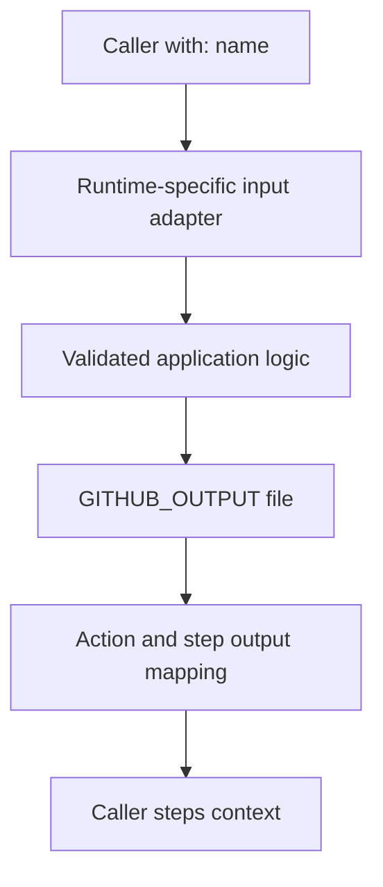

# GitHub Actions cheatsheet

## Local commands

| Command | Use it for |
| --- | --- |
| `task setup` | Install locked Python/Node dependencies and pinned actionlint |
| `task test` | Type-check, check the committed bundle, and test four adapters |
| `task actions:build` | Rebuild the TypeScript action after changing source |
| `task lint:workflows` | Check workflow syntax, expressions, and metadata |
| `task check` | Run all host checks, diagram validation, and the site build |
| `task docs:verify` | Check all documentation links and diagrams, then build once |
| `task docs:diagrams -- --force` | Re-render all diagrams instead of reusing successful checks |
| `task docs:build:clean` | Rebuild the site from scratch for publishing or troubleshooting |
| `task test:container` | Build/run the Docker action with its output-file mount |
| `task act:list` | List jobs in the dedicated smoke workflow |
| `task act:smoke` | Execute only the smoke job locally |
| `task agentic:check` | Validate agentic frontmatter without an agent run |
| `task docs:serve` | Open a local Zensical development server |

See the [local testing guide](local-testing.md) for prerequisites, fixtures, Podman, Apple Silicon, and coverage limits.

## Metadata and data flow

| Need | Syntax or protocol |
| --- | --- |
| Docker action | `runs.using: docker`, `image: Dockerfile`, and explicit `args` |
| JavaScript/compiled TypeScript | `runs.using: node24` and a distributed JS entrypoint |
| Composite | `runs.using: composite`, explicit `shell`, and mapped step outputs |
| Step output | Append `key=value` to `$GITHUB_OUTPUT` |
| Later steps' environment | Append `KEY=value` to `$GITHUB_ENV` |
| Composite's own files | `${{ github.action_path }}` or `$GITHUB_ACTION_PATH` |
| Caller workspace | `$GITHUB_WORKSPACE` |
| Job output | Declare `jobs.<id>.outputs` from step outputs |
| Dependent job's value | `${{ needs.<job>.outputs.<key> }}` |

Composite inputs need explicit mapping; they do not automatically become `INPUT_*` variables. Validate required input in action code as well as declaring it in metadata. These rules are defined in the [metadata reference](https://docs.github.com/en/actions/reference/workflows-and-actions/metadata-syntax).



## Quote untrusted values

```yaml
- shell: bash
  env:
    TITLE: ${{ github.event.pull_request.title }}
  run: printf '%s\n' "$TITLE"
```

Pass data through the environment and quote it. Avoid inserting event text directly into generated shell code. Review the [secure-use reference](https://docs.github.com/en/actions/reference/security/secure-use).

## Workflow controls

```yaml
permissions:
  contents: read
concurrency:
  group: checks-${{ github.ref }}
  cancel-in-progress: true
jobs:
  checks:
    runs-on: ubuntu-latest
    timeout-minutes: 10
    steps:
      - run: task test
```

This fragment assumes earlier steps installed Task, Node 24, uv, and project dependencies. The repository's `.github/workflows/checks.yml` is a complete example.

| Previous | Catalog | Next |
| --- | --- | --- |
| [Curriculum](../lessons/index.md) | [Cheatsheet](index.md) | [Local testing](local-testing.md) |
