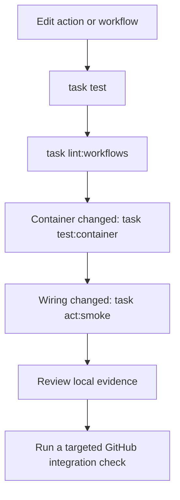

# Test GitHub Actions locally

Use **Task for repeatable commands, direct tests for action behavior, actionlint for workflows, Docker for container boundaries, and `act` for selected workflow wiring**. Each layer answers a different question.

## Install the host tools

You need uv, Node.js 24 with npm, Task v3, and Go to install the pinned actionlint binary. A Docker-compatible daemon and `act` are needed only for container/workflow smoke tests. The GitHub CLI and its `gh aw` extension are needed only for the agentic lab.

For macOS with Homebrew, one setup route is:

```bash
brew install uv node@24 go go-task act
export PATH="$(brew --prefix node@24)/bin:$PATH"
node --version
task --version
task setup
task check
```

Use the official installation guides for [uv](https://docs.astral.sh/uv/getting-started/installation/), [Node](https://nodejs.org/en/download), [Go](https://go.dev/doc/install), [Task](https://taskfile.dev/docs/installation), and [act](https://nektosact.com/installation/index.html) on other systems. The shell examples assume Bash or a compatible Unix shell; on Windows, WSL2 provides that environment.

`task setup` installs into `.venv/`, `node_modules/`, and `.tools/bin/`. The npm dependency for Mermaid validation also installs a headless browser. It never installs a GitHub runner or dispatches a workflow. Once dependencies are cached, direct action tests need no GitHub service. Zensical owns `.cache/` and clears it during clean builds, so keep tool binaries outside it.

## Choose the right boundary

| Layer | What it proves | What it leaves for another layer |
| --- | --- | --- |
| Function tests | Validation and transformation logic | Input transport and output files |
| Process adapter tests | Real entrypoint, exit status, stderr, output protocol | Action metadata execution |
| actionlint | Workflow structure and expression checks | Runtime behavior and service permissions |
| Docker smoke test | Image builds, entrypoint runs, output mount works | GitHub orchestration |
| `act` smoke job | Selected local action wiring and output mapping | GitHub policy and hosted-image parity |
| GitHub integration | Real token/OIDC/environment/platform behavior | Every possible event or external failure |



## The everyday loop

```bash
# Fast path while editing behavior.
task test

# Authored Modules 2–4 and 9 have additional host contracts; lab workflow lint covers Modules 1–4 and 9.
task test:labs
task lint:labs

# Rebuild the distribution artifact only after changing TypeScript source.
task actions:build
task test

# Catch workflow mistakes without running a job.
task lint:workflows

# Full host verification before handoff.
task check

# Documentation-only edits: check links and diagrams, then build once.
task docs:verify

# Explicitly re-render every diagram, or rebuild without the site cache.
task docs:diagrams -- --force
task docs:build:clean
```

Mermaid validation scans the selected Markdown files, deduplicates diagrams, and renders only diagrams without a matching successful check. Cache keys include diagram content, validator code, installed renderer versions, and the dependency lockfile. A repeat run or prose-only edit does not start Node or a browser. New or changed diagrams share one browser; failed renders are always retried. The cache lives under `.tools/validation/`, which survives Zensical clean builds. To focus on one lesson, run `uv run python .agents/skills/teach/scripts/validate_mermaid.py docs/lessons/0001-execution-model.md`. Whole-site link checks remain enabled to catch incoming links to renamed or deleted headings.

`task test` first type-checks TypeScript, compares its generated bundle with the committed distribution file, then tests the pure JavaScript function and all four real entrypoints. Cases include default input, empty input, whitespace, Unicode, multiline rejection, and shell-like text treated as data. Docker's program is tested with host Python at this layer; the image is tested separately.

`task test:labs` additionally exercises the authored labs in Modules 2–4 and 9, including Task cache invalidation, real process contracts, packaging drift, fixture-only APIs, lifecycle cleanup, and host interruption handling. `task lint:labs` selects 23 syntax-valid recipes across Modules 1–4 and 9. Deliberate negative workflow fixtures remain separate; a clean static check also does not repair or execute an intentionally broken output mapping. These lab commands perform no documentation checks and need no container daemon. Use `task test:module2`, `task test:module3`, `task test:module4`, or `task test:module9`, with the matching `lint:moduleN` task, for a focused module edit.

The TypeScript bundle check builds into a temporary file and compares bytes. It fails on stale output without silently repairing it. Commit both source and `examples/typescript-action/dist/index.cjs` when changing that action.

## Test the GitHub output protocol directly

```bash
output_file="$(mktemp)"
INPUT_NAME=Ada GITHUB_OUTPUT="$output_file" node examples/javascript-action/index.cjs
cat "$output_file"
rm "$output_file"
```

Expected file contents: `greeting=Hello, Ada!`. The file is the interface to the runner; stdout is a log. `scripts/test_actions.py` automates this pattern using temporary directories and checks failed runs do not publish a success output.

The examples intentionally accept only single-line names, so this simple output format is sufficient. For arbitrary multiline values, use the delimiter protocol in [workflow commands](https://docs.github.com/en/actions/reference/workflows-and-actions/workflow-commands).

## Run the Docker boundary

```bash
docker info
task test:container
```

The task builds `examples/docker-action/Dockerfile`, then mounts a temporary directory into the action container, sets `GITHUB_OUTPUT`, and verifies both successful and invalid-input runs. It uses local temporary files and no credentials.

If `docker info` fails, fix the engine connection first. On macOS the `docker` command can be a Podman compatibility wrapper. Direct `docker build` commands may work through that wrapper while `act` still needs a Docker-compatible API socket.

With an existing Podman machine, a typical route is:

```bash
podman machine list
podman machine start
podman machine inspect --format '{{.ConnectionInfo.PodmanSocket.Path}}'
# Set DOCKER_HOST to unix:// followed by the socket path printed above.
docker info
```

Use [act's custom container-engine guidance](https://nektosact.com/usage/custom_engine.html) for your engine. Creating a new VM or changing socket configuration is an environment setup step; do it deliberately. The host tests remain usable while the daemon is stopped.

## Run exactly one workflow job with act

```bash
task act:list
task act:smoke
```

The command selects `workflow_dispatch`, `.github/workflows/actions-smoke.yml`, the `smoke` job, and a synthetic event fixture. It does not select the Pages workflow. The smoke job calls the four local actions and checks their outputs; it does not publish a release or call an AI model.

Equivalent command:

```bash
act workflow_dispatch \
  -W .github/workflows/actions-smoke.yml \
  -j smoke \
  -e tests/fixtures/workflow_dispatch.json \
  -P ubuntu-latest=catthehacker/ubuntu:act-latest \
  --container-architecture linux/amd64
```

The Taskfile defaults to `linux/amd64` for runner compatibility, including on Apple Silicon; emulation can be slower. Where your selected images support ARM64, try `task act:smoke ACT_ARCH=linux/arm64`. The architecture for the Docker action's image must also be compatible with the daemon. `ACT_IMAGE` is configurable if you need a different image. Follow the [act runner guide](https://nektosact.com/usage/runners.html); local images are approximations of GitHub's VM images.

The first run downloads a runner image and referenced actions. Later runs can reuse caches. If your act version supports it, `task act:smoke -- --action-offline-mode` reuses previously cached action sources. Confirm flags with `act --help`.

## Events, credentials, and external effects

Keep event fixtures under `tests/fixtures/`. Add only fields needed by the code path being tested. Use separate fixtures for push, PR, and dispatch behavior; a dispatch fixture cannot prove fork-PR permissions or event filters.

The smoke workflow needs no secrets. For a separate API integration exercise, use short-lived, narrowly scoped test credentials and a disposable repository. `act` can accept a secret interactively with `-s NAME`; follow its [usage guide](https://nektosact.com/usage/index.html). Never commit secret files or pass production credentials merely to make a local job succeed.

Running with `act` does not automatically disable network writes in arbitrary workflows. Select the dedicated smoke job, and use mocks or an explicit dry-run mode for code that changes external systems.

## What still needs a GitHub run

GitHub token scopes, actual OIDC claims and federation, environment protection rules, concurrency/cancellation behavior, hosted cache/artifact services, and the intended OS matrix need real platform evidence. `act` documents ignored or incomplete features in its [support limitations](https://nektosact.com/not_supported.html). Self-hosted runners also execute real GitHub jobs; they have their own operational and trust requirements.

Review `.github/workflows/actions-smoke.yml` and run it through GitHub's manual dispatch when ready. It is intentionally manual to avoid paying for a full runner smoke test on every edit. `.github/workflows/checks.yml` runs the shared host checks for relevant pull requests and main-branch changes.

## Agentic workflows: compile first

```bash
gh extension install github/gh-aw
gh aw version
task agentic:check
```

This task validates the example with `--no-emit --strict`; it does not execute an agent. Compilation may need network access to resolve action references or imports. Check the installed CLI's help because this project evolves quickly.

`gh aw trial` and `gh aw run` are hosted execution paths. A trial is not an offline local test, and model calls can incur separate AI usage. Keep compilation, mocked tool/fixture evaluation, and bounded hosted trials as distinct evidence. Continue in the [Agentic Workflows lab](../lessons/agentic-workflows.md).

## Is another task runner better?

Task suits this workspace because named commands, preconditions, and shared CI invocation fit in a small YAML file. If your team already standardizes on `just`, Make, or npm scripts, keep that contract instead. Dagger can make complex dependency-heavy pipelines more portable through containers, at the cost of another runtime. None of these tools reproduces GitHub's control plane; the useful architecture is to make the underlying work directly executable.

| Previous | Catalog | Next |
| --- | --- | --- |
| [Command cheatsheet](index.md) | [Cheatsheet](index.md) | [Action labs](../lessons/action-labs.md) |
