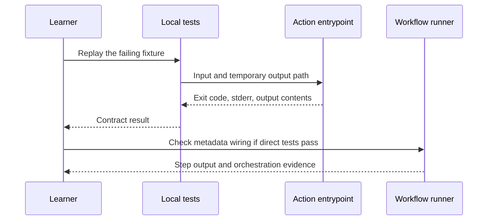

# Debug GitHub Actions by boundary

Start with the first failing contract. Preserve its input fixture, exact command, exit status, and relevant stderr; reproduce it at the smallest layer that reaches the failure.

## Diagnostic catalog

| Symptom | First checks | Likely boundary |
| --- | --- | --- |
| Workflow never starts | Event name, branch/path filters, default-branch requirements, Actions settings | GitHub event selection |
| `uses: ./...` cannot be found | Checkout order, relative path, filename case | Workspace and metadata |
| Empty greeting output | `GITHUB_OUTPUT`, step ID, output mapping, stdout versus output file | Runner protocol |
| JavaScript module missing | Distributed entrypoint exists, bundle includes runtime dependencies | Packaging |
| TypeScript source works but consumers see old behavior | `task actions:build`, then `task test`; commit `dist` | Distribution drift |
| Composite cannot find a script | `$GITHUB_ACTION_PATH`, quoting, shell availability | Composite step execution |
| Docker action fails immediately | Linux runner, Dockerfile context, entrypoint, line endings | Container startup |
| Generated files are inaccessible | Workspace mount, UID/GID, writable output path | Container filesystem |
| `docker info` fails | Daemon/VM running, socket, Docker versus Podman wrapper | Local environment |
| `act` fails with architecture/Node errors | Runner image, `ACT_ARCH`, action runtime, cached action version | Local emulation |
| `act` passes but OIDC or permissions fail on GitHub | Actual job permissions, provider trust, environment and fork context | GitHub platform policy |
| `gh aw compile` rejects configuration | Installed version, frontmatter schema, network/tool configuration | Agentic compiler |
| Agentic report has no published issue | Staged output, output cap, tool result, handler logs | Output policy or execution |

## Missing step output

1. Run `task test` to inspect the actual adapter contract.
2. Confirm the action writes to `GITHUB_OUTPUT`, not only stdout.
3. For a composite, check its internal step ID and `outputs.<name>.value` mapping.
4. Run `task act:smoke` with a working container engine.
5. Reproduce on GitHub only if the remaining failure depends on the real runner/platform.

## Container or act unavailable

`docker` can resolve to Podman on macOS. If the compatibility wrapper cannot reach its VM, the action's code is not yet the failing component. Keep working with `task test`; use the [local engine guide](../cheatsheet/local-testing.md#run-the-docker-boundary) to restore the socket before container checks. `act` has [documented feature gaps](https://nektosact.com/not_supported.html); ignored permissions or environment rules cannot be diagnosed as if they were enforced locally.

## Mermaid validation fails

Run `task docs:diagrams`. The validator identifies a file and block number. Quote labels containing punctuation, prefer `flowchart TD`, and use real node IDs. If the error is a missing browser rather than Mermaid syntax, run `npm ci` and review its install output; the CLI's browser dependency must be installed before rendering. The [Zensical diagram guide](https://zensical.org/docs/authoring/diagrams/) covers authoring support.

Unchanged diagrams reuse successful renders. Run `task docs:diagrams -- --force` to investigate a rendering problem without reusing those passes. A corrupted cache triggers fresh checks automatically; dependency and validator changes invalidate it. `task test:validation` checks cache invalidation and failure handling after editing the validation tooling.

## GitHub Pages does not deploy

Run `task docs:check` and `task docs:build` first. On GitHub, select **Settings → Pages → Source: GitHub Actions**. Check the build artifact and the separate deploy job's `pages: write`, `id-token: write`, and `github-pages` environment. PR builds validate content; deployment is limited to the configured main branches. See [GitHub's Pages workflow guide](https://docs.github.com/en/pages/getting-started-with-github-pages/using-custom-workflows-with-github-pages).

## Agentic workflow fails after compiling

Compilation does not execute tools or prove model behavior. Inspect engine authentication, generated permissions, tool availability, sandbox/network restrictions, and the safe-output handler separately. Capture the fixture and run evidence; do not solve a missing tool by granting broad credentials without understanding the needed operation. Continue with the [agentic lab](../lessons/agentic-workflows.md).

| Previous | Catalog | Next |
| --- | --- | --- |
| [Local testing](../cheatsheet/local-testing.md) | [Debugging](index.md) | [Interview exercises](../interview/index.md) |
