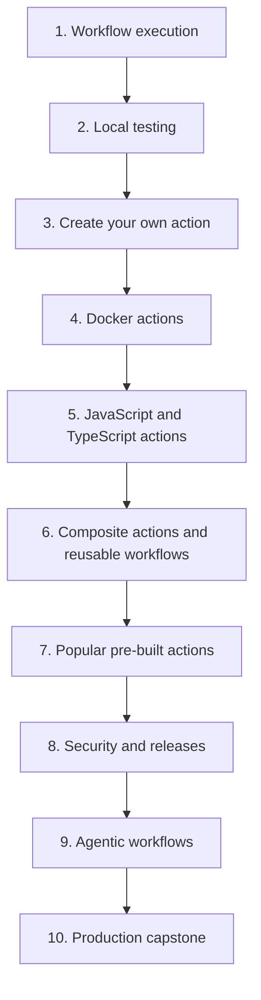

# GitHub Actions, from workflows to production orchestration

Start with **workflows, events, jobs, steps, and runners**, establish a **local testing loop**, then build **Docker container actions, JavaScript and TypeScript actions, and composite actions**. Study **maintained pre-built actions** before security, releases, and **GitHub Agentic Workflows**. Progress toward an orchestrator with tested workers, parallel jobs, evidence gates, bounded credentials, and an operating playbook. Keep the feedback loop local, then use GitHub to verify behavior that depends on its platform.

[Start with GitHub Actions](lessons/0001-execution-model.md){ .md-button .md-button--primary }
[Use pre-built actions](lessons/prebuilt-actions.md){ .md-button }
[Create your own action](lessons/create-your-own-action.md){ .md-button }

## Your learning workspace

<div class="grid cards" markdown>

- :lucide-compass: **Mission**

    Define what you will build and how you will know it works.

    [Read the mission](mission.md)

- :lucide-graduation-cap: **60 GitHub Actions lessons**

    Follow 10 modules from workflow execution and local testing to custom actions, security, agentic workflows, and a production capstone. Each planned page has a teaching brief and a prompt for its own thread.

    [Open the curriculum](lessons/index.md)

- :lucide-terminal: **Local testing lab**

    Use Task, direct tests, actionlint, container smoke tests, and selected `act` runs.

    [Build your feedback loop](cheatsheet/local-testing.md)

- :lucide-box: **Runnable action examples**

    Compare the same input/output contract across Docker, JavaScript, TypeScript, and composite actions.

    [Explore the action labs](lessons/action-labs.md)

- :lucide-bot: **GitHub Agentic Workflows**

    Follow Markdown through compilation, agent execution, constrained outputs, and evaluation.

    [Open the agentic lab](lessons/agentic-workflows.md)

- :lucide-bug: **Debugging and reference**

    Diagnose failures, revisit syntax, and prepare for architecture discussions.

    [Debugging](debugging/index.md) · [Cheatsheet](cheatsheet/index.md) · [Interview questions](interview/index.md) · [References](references/index.md)

</div>

## The route



## Learn one lesson in each thread

Open the [curriculum](lessons/index.md), select a lesson, and copy its thread prompt. The [teaching guide](lessons/teaching-guide.md) keeps explanations focused on Actions behavior, relevant YAML and code, and learner predictions and exercises. Start with `/teach 0001` for the execution model.

Modules 1–5 now have 30 authored reference lessons and local labs. The remaining 30 pages in Modules 6–10 are detailed teaching briefs for future sessions; there are no starter pages. Written pages and checkmarks are separate from demonstrated understanding.

## Local workspace commands

With **uv, Node.js 24, Go, and Task v3** installed, these commands run from the repository root. See the [local testing guide](cheatsheet/local-testing.md) for setup:

```bash
task setup
task check
task docs:serve
```

`task check` runs workflow linting, host tests for all four action adapters, link checks, Mermaid validation, and an incremental site build. Use `task test:labs` for the Module 2–5 host exercises and `task lint:labs` for the 23 syntax-valid lab workflow recipes. For documentation-only edits, use `task docs:verify` once after the complete authoring batch. Successful diagram renders are reused until their content or validation tools change. These checks do not dispatch GitHub Actions or call an AI model. The first setup downloads dependencies and a browser used to render diagrams.

When a Docker-compatible daemon is running:

```bash
task test:container
task act:smoke
```

!!! tip "Keep the loop small"
    Edit action code, run `task test`, and use `act` when you need to exercise workflow wiring. The [local testing guide](cheatsheet/local-testing.md) explains what each layer can prove.

Begin a guided session with `/teach 0001`, or copy the prompt from the Actions lesson you want to develop.
