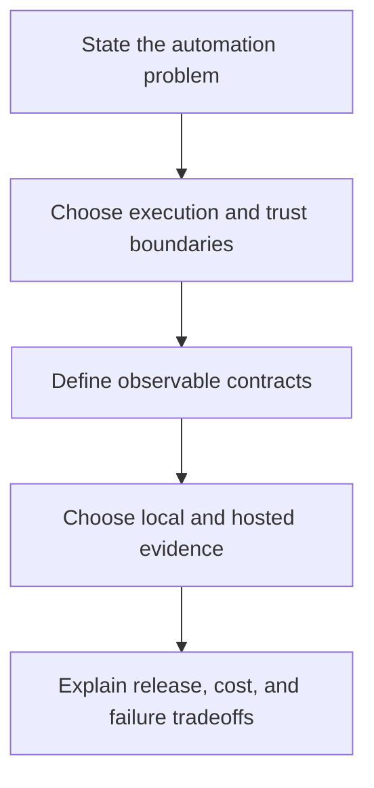

# GitHub Actions engineering questions

Practice explaining boundaries and proposing observable tests. Use the answer checkpoints to evaluate an explanation, then build a small experiment for anything uncertain.

## Execution model

1. **A step exports an environment variable but the next step cannot see it. Why?** Explain process inheritance, `GITHUB_ENV`, and when values become available.
2. **When do you choose Docker, JavaScript, or composite actions?** Discuss dependencies, startup/build costs, operating systems, portability, and the caller's environment.
3. **How does a step output become an output of a dependent job?** Trace the file protocol, step ID, job output declaration, and `needs` context.
4. **When is a reusable workflow a better boundary than a composite action?** Compare step reuse with job orchestration, runner selection, permissions, and secret interfaces.

## Local testing and release quality

5. **Design a development loop that avoids repeated GitHub reruns.** Include pure tests, process-adapter tests, actionlint, container checks, a selected `act` job, and a short hosted integration checklist.
6. **A composite's script test passes but its action output is empty. What is missing?** Inspect metadata mapping and workflow wiring; propose a smoke test that reads the caller-visible output.
7. **What can `act` prove about OIDC?** Distinguish local wiring from real identity issuance, provider trust, and GitHub's policy enforcement.
8. **How do you prevent a stale TypeScript distribution?** Compare a deterministic temporary bundle to the committed artifact before releasing; do not silently rebuild it during the check.
9. **Your local tests run on ARM64 but the runner uses AMD64. What changes?** Examine image manifests, native modules, emulation, and the real target matrix.
10. **Would you use Task, Make, just, or Dagger?** Start from the team's command contract and dependency/portability needs, then explain the additional runtime cost.

## Security and reliability

11. **An external PR changes a script consumed by a privileged workflow. What could happen?** Trace event trust, checkout ref, token scope, and execution of untrusted code.
12. **Why pin an action to a commit SHA?** Discuss immutable references, reviewable updates, and how the team receives security fixes.
13. **How can an artifact or cache cross a trust boundary?** Explain producer identity, contents validation, executable data, and cache key scope.
14. **How do you reduce CI usage without hiding failures?** Reuse direct tests, choose path filters carefully, cancel superseded checks, and preserve a deliberate hosted integration gate.

## GitHub Agentic Workflows

15. **What does a successful `gh aw compile` establish?** Separate schema/compiler validation from agent quality and tool/runtime behavior.
16. **How does a safe-output proposal differ from direct write access?** Trace the agent's tools, generated handler, operation limit, staged output, and publish policy.
17. **How would you evaluate a repository-health agent?** Use fixed repository fixtures, grounded citations, a rubric for correctness, adversarial content, versioned run evidence, and a usage budget.
18. **An agent reports that tests passed without running them. How do you improve the system?** Require observable evidence, test the rubric on that failure, and separate inferred claims from tool results.

## System-design exercise

Design a repository-health service that runs deterministic checks in TypeScript, shares setup through a composite action, optionally runs a Docker scanner, and uses an agent to propose one evidence-backed report. Keep the fast path executable through Task. State which checks run locally, which require GitHub, and how the report is staged before publication.

Your design should explain credentials, execution isolation, retries, idempotency, output caps, release pinning, artifact provenance, and the expected user-visible failure messages. Use [the reference library](../references/index.md) to verify assumptions.

| Previous | Catalog | Next |
| --- | --- | --- |
| [Debugging](../debugging/index.md) | [Interview questions](index.md) | [References](../references/index.md) |
