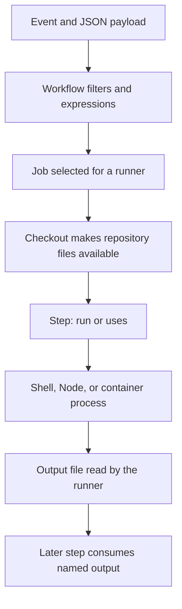

# 0001 · The GitHub Actions execution model

!!! note "Starter lesson for a future teaching thread"
    Introductory content is available below. Develop it into the full guided session using the [teaching guide](teaching-guide.md), the workflow examples, and the learner's actual answers.

## Prerequisites and thread prompt

This is the course entry point; no earlier lesson is required. Use this repository's workflow and action examples. Begin by asking the learner to trace what should happen when an event starts a workflow, then introduce the Actions terms needed to explain that behavior.

```text
/teach 0001

Expand docs/lessons/0001-execution-model.md in place using
docs/lessons/teaching-guide.md. Read the mission, NOTES, and prerequisite pages.
Start with events, workflows, jobs, steps, and runners. Explain each workflow line.
Pause for predictions and exercises before revealing their solutions.
```

## What you will be able to explain

Trace an event to a process, distinguish an action from a workflow, and identify which values cross process or job boundaries.

## Follow the execution boundary

A **workflow** defines an event-driven graph of **jobs**. A job runs on a runner and contains ordered **steps**. A step executes a shell command with `run` or invokes an action with `uses`. Jobs can run concurrently unless dependencies constrain them. Each ordinary job gets its own runner environment; files and environment changes do not automatically cross job boundaries. See [GitHub's workflow syntax reference](https://docs.github.com/en/actions/reference/workflows-and-actions/workflow-syntax).



## Three action runtimes, four examples

JavaScript and TypeScript actions share the Node action runtime: TypeScript must become executable JavaScript before distribution.

| Kind | Execution boundary | Test closest to the code |
| --- | --- | --- |
| Docker container action | A Linux container described by its Dockerfile/image | Test its program, then its image and mounts |
| JavaScript action | A Node process on the runner | Unit tests and process-adapter tests |
| TypeScript-authored action | Compiled JavaScript running in Node | Type-check, test, bundle, verify committed output |
| Composite action | Steps expanded into the caller's job | Test scripts, then metadata/input/output wiring |

The [official metadata reference](https://docs.github.com/en/actions/reference/workflows-and-actions/metadata-syntax) defines `runs.using`, action inputs, and action outputs.

## Read a real workflow

Open `.github/workflows/actions-smoke.yml` in the repository. It checks out this repository, invokes each example using a local path, and asserts that their outputs match.

```yaml
- id: greeting
  uses: ./examples/composite-action
  with:
    name: Ada
- name: Verify the public contract
  shell: bash
  env:
    ACTUAL: ${{ steps.greeting.outputs.greeting }}
  run: test "$ACTUAL" = 'Hello, Ada!'
```

`uses: ./...` resolves relative to the checked-out workspace. For this example, the composite maps its internal step output to an action output. The next step reads that named value through the `steps` context.

!!! note "Output is a protocol"
    Printing a value to stdout makes a log line. A named step output is written to the file whose path the runner exposes as `GITHUB_OUTPUT`. Use a temporary file to test that protocol locally.

## Experiment

```bash
task test
task act:list
```

The first command executes action code and verifies output files locally. The second lists the selected smoke workflow; running `task act:smoke` additionally needs a container engine.

## Break it on purpose

Temporarily change the composite output mapping from `steps.greet.outputs.greeting` to `steps.greet.outputs.missing`. Predict which layer can detect it. A direct shell-script test can still pass because the script writes the correct value; a workflow smoke test should expose the broken mapping. Restore the mapping after the experiment.

## Retrieval exercise

1. Why is checkout needed before a local `uses` step?
2. Which action types introduce a container boundary?
3. Why does writing `export NAME=Ada` in one `run` step not export it to all later processes?
4. What evidence is still missing after a direct entrypoint test passes?

??? tip "Check your explanation"
    Checkout supplies the local action files. Docker actions introduce the action container; JavaScript and composite actions use the runner environment. An export affects the current process tree; persistent step-to-step environment values use the runner's environment-file protocol. A direct test does not execute workflow expression evaluation, action output mapping, GitHub permissions, or platform services.

| Previous | All lessons | Next |
| --- | --- | --- |
| [Mission and starting point](../mission.md) | [Curriculum](index.md) | [0002 · Local feedback](0002-local-feedback-loop.md) |
