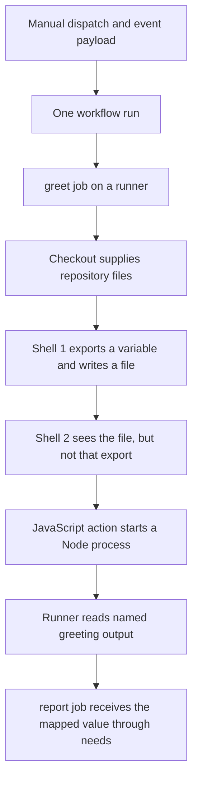

# 0001 · The GitHub Actions execution model

!!! note "Authored reference lesson"
    This page and its lab are ready for a guided session. Written content does not establish learner mastery. Predict each result before opening the worked explanation.

## Prerequisites

This is the course entry point; no earlier lesson is required. You need a local checkout and the host tools in the [local testing guide](../cheatsheet/local-testing.md#install-the-host-tools) to run the lab. Supporting syntax is explained as it appears.

## What you will be able to explain

Trace an event into a workflow run, identify which process executes a step, and explain why a file, an exported variable, and a named output have different lifetimes. Success means you can annotate the lab workflow and predict both its assertions without running it.

## Follow the execution boundary

An **event** is repository activity or a manual request that can start automation. A **workflow** is the YAML definition stored in `.github/workflows/`; a **workflow run** is one execution of that definition for an event and revision. A **job** groups steps and selects a **runner**, the machine and runner software that execute them. A **step** runs a command with `run` or invokes a reusable **action** with `uses`. See GitHub's [workflow overview](https://docs.github.com/en/actions/concepts/workflows-and-actions/workflows).

The ordinary foreground steps used here run in order. Each `run` step starts a fresh shell process. Steps in one job can share workspace files, but an `export` in one shell does not change the next shell's environment. GitHub-hosted jobs receive separate runner instances. A self-hosted runner may retain disk state, so never use leftover files as an intentional cross-job interface.



!!! tip "Predict before reading on"
    A first step writes `name.txt` and runs `export LESSON_NAME=Ada`. Can the next step read the file? Can it read that exported value? Would a different job automatically receive either one?

## Read a real workflow

The complete inactive recipe is `labs/0001/module1-execution.yml`. Files under `labs/` do not register as GitHub workflows. Run commands from the repository root.

This is the first part of the recipe:

```yaml title="labs/0001/module1-execution.yml — opening"
name: Module 1 execution boundaries
on:
  workflow_dispatch: # (1)!
permissions:
  contents: read
jobs:
  greet:
    runs-on: ubuntu-latest # (2)!
    timeout-minutes: 5
    outputs:
      greeting: ${{ steps.greet.outputs.greeting }}
    steps:
      - uses: actions/checkout@3d3c42e5aac5ba805825da76410c181273ba90b1 # v7.0.1
        with:
          persist-credentials: false
```

1. Manual dispatch creates a run when requested. Merely saving this recipe under `labs/` creates no run.
2. This runner label selects a GitHub-hosted Ubuntu image when executed on GitHub. It does not install Ubuntu on your laptop.

YAML indentation groups configuration. `jobs.greet` is the job's identifier; a display `name` is optional. The `steps` list uses `-` for each step. `permissions` limits the workflow token to repository reads. Checkout is a maintained action that puts repository files into the workspace. The full commit reference reuses the project's reviewed pin; selecting and maintaining actions is taught in [Module 7](prebuilt-actions.md).

Later steps demonstrate the process boundary and call the existing local action:

```yaml title="labs/0001/module1-execution.yml — steps excerpt"
- name: First shell
  shell: bash
  run: |
    export LESSON_NAME=Ada
    printf '%s\n' "$LESSON_NAME" > lesson-name.txt
- name: Next shell, same job workspace
  shell: bash
  run: |
    test -z "${LESSON_NAME:-}"
    test "$(cat lesson-name.txt)" = Ada
- id: greet
  uses: ./examples/javascript-action
  with:
    name: Ada
```

`run: |` is a multiline command. `test` exits unsuccessfully if its assertion is false. `${LESSON_NAME:-}` supplies an empty fallback for an unset shell variable. `$(cat ...)` reads the file into the comparison. These are shell operations. `${{ steps.greet.outputs.greeting }}` in the opening excerpt is an Actions expression, handled by the workflow machinery.

A local `uses: ./...` path is relative to the checked-out workspace. Its `action.yml` selects the implementation. Without checkout, this repository's local action files are unavailable. The action returns `greeting`; the job's `outputs` mapping exposes it to the later `report` job. [Lesson 0005](0005-environment-files-and-output-contracts.md) develops that mapping.

## Three action runtimes, four examples

| Kind | What executes | Closest useful check |
| --- | --- | --- |
| Docker container action | Program in a Linux container | Program test, then image and mount tests |
| JavaScript action | JavaScript in the Node runtime chosen by metadata | Function and real entrypoint tests |
| TypeScript-authored action | Bundled JavaScript in that Node runtime | Type-check, test, and compare distribution bundle |
| Composite action | A group of steps within the caller's job | Script tests, then input/output wiring |

TypeScript is an authoring language here, rather than a fourth action runtime. The [metadata reference](https://docs.github.com/en/actions/reference/workflows-and-actions/metadata-syntax) defines each runtime. A composite does not create an independent job; actions it invokes can introduce their own processes or containers.

## Experiment

Before executing anything, write your prediction for the two shell steps. Then run this host-only exercise:

```bash
uv run python labs/0001/processes.py
```

It starts two actual Bash processes in a temporary directory and removes the directory afterward. Expected output:

```text
environment=unset
Ada
PASS: the file survived; the exported variable did not cross processes
```

This observes a real process/file boundary without pretending to run GitHub's scheduler. Inspect `labs/0001/module1-execution.yml` and identify the matching two steps, the checkout, the action, and the cross-job output. Batch workflow linting is available through `task lint:module1`.

??? tip "Worked prediction"
    The second shell inherits the environment supplied by its parent, not modifications made inside the first shell. Both shells use the same directory, so the file is readable. A separate hosted job gets neither that file nor the shell's export automatically; its greeting arrives through an explicit output mapping.

## Break it on purpose

In a temporary copy of the workflow, replace the second shell's empty-value assertion with `test "$LESSON_NAME" = Ada`. Predict the failure before running the shell pair. The value is absent in that new process; adding checkout or a token permission cannot make a prior shell export persistent.

??? tip "Diagnose and repair"
    Inspect the failing step, then trace where `LESSON_NAME` was set. For a constant needed throughout a job, declare job-level `env`. For a value computed in an earlier step, append it to `GITHUB_ENV`. For a named result, use `GITHUB_OUTPUT`. Restore the lab's original assertion after the experiment; it intentionally verifies isolation.

A second useful failure is moving the local action before checkout in your copy. The runner cannot find its metadata. Repair the order rather than replacing the action with shell glue.

## Transfer exercise and retrieval

Design a two-job workflow where a first job computes a version and a second uses it. Mark the job dependency, the value that must be mapped, and any file that needs an artifact transfer. Do not assume a shared hosted filesystem.

Explain without reopening the examples:

1. How does a workflow definition differ from one workflow run?
2. Why does a local action require repository files, while a remote `uses` reference can be downloaded separately?
3. Which boundary separates two `run` steps? Which separates two hosted jobs?
4. Does a successful program test prove an action's workflow output mapping?

??? tip "Check your explanation"
    The definition is reusable configuration; a run is one event-driven execution. A local action must already exist in the workspace. Two `run` steps use fresh shell processes but share job files. Hosted jobs use separate runner instances. A direct program test does not evaluate action metadata, workflow expressions, or job output mappings.

## Verification limits

The host lab checks process behavior. Static linting checks workflow structure and known interfaces. Neither proves GitHub event delivery, runner provisioning, or token policy. The optional `act` path and the existing four-runtime smoke workflow are covered in [0002](0002-local-feedback-loop.md) and the [local testing guide](../cheatsheet/local-testing.md).

Primary sources were checked on **2026-10-30**; the [source library](../references/resources.md) records the trusted references.

| Previous Lesson | All Lessons | Next Lesson |
| --- | --- | --- |
| [Mission and starting point](../mission.md) | [Curriculum](index.md) | [0002 · Build a local feedback loop](0002-local-feedback-loop.md) |
