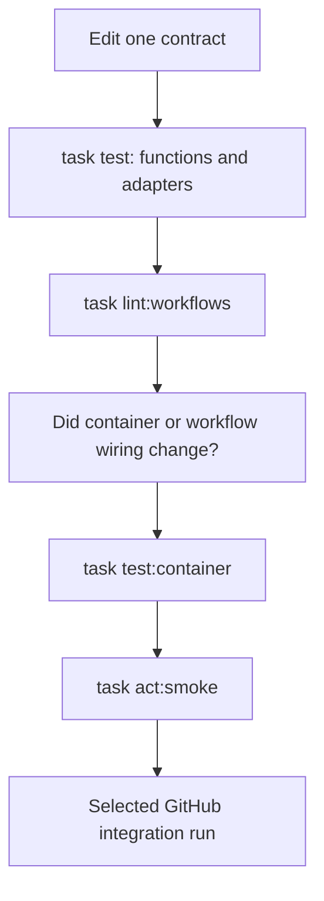

# 0002 · Build a local feedback loop

!!! note "Starter lesson for a future teaching thread"
    Introductory content is available below. Expand it using the [teaching guide](teaching-guide.md), including command-by-command explanations, learner predictions, and a diagnosed failure.

## Prerequisites and thread prompt

Start with [0001 · The execution model](0001-execution-model.md). Use the existing action examples and [local testing guide](../cheatsheet/local-testing.md) to connect each check to the action or workflow boundary it observes.

```text
/teach 0002

Expand docs/lessons/0002-local-feedback-loop.md in place using
docs/lessons/teaching-guide.md. Read the mission, NOTES, and prerequisite pages.
Explain each local command and what its result proves, starting with one small
test. Let me predict a failure and diagnose it before showing the repair.
```

## Goal

Detect an action defect before committing or pushing, and choose a test that reaches the boundary you changed.

## Make CI call an existing command

Put behavior in scripts or application modules. Let `Taskfile.yml` name the commands that people and CI run. Keep workflow YAML focused on events, runners, permissions, and orchestration. A task runner reduces duplicated command definitions; it does not emulate GitHub.



## Run the smallest useful check

```bash
task setup
task test
task lint:workflows
```

The TypeScript check verifies the committed bundle without rewriting it. After editing TypeScript source, explicitly regenerate it and repeat the tests:

```bash
task actions:build
task test
```

Use `task check` before handing off a change. It additionally validates documentation links, Mermaid syntax, and the Zensical build.

## Write a failure prediction

Open `examples/javascript-action/greet.cjs`. Change its output punctuation to `Hello Ada`. Before rerunning `task test`, identify the assertion that should fail. Restore the function, then confirm the test passes.

Open `scripts/test_actions.py` next. It runs real entrypoints with temporary output files and invalid inputs. Compare these integration checks with the pure-function tests; each observes a different boundary.

!!! tip "Fixtures make failures repeatable"
    `tests/fixtures/workflow_dispatch.json` is a small synthetic event for the smoke job. Keep fixtures small and free of credentials. Add event fields when a workflow actually depends on them.

## Know what remains unproven

`act` exercises selected workflow execution paths in a local environment. It cannot establish GitHub's authorization decisions, real OIDC federation, environment protection behavior, or hosted runner parity. Its [documented unsupported functionality](https://nektosact.com/not_supported.html) includes ignored permissions and concurrency settings. Reserve a hosted run for those contracts.

Agentic workflows add another boundary: local compilation checks the workflow specification; evaluating an agent's behavior requires fixtures and eventually a bounded execution with the chosen engine. `gh aw trial` uses a GitHub repository and can consume remote usage. See the [agentic lab](agentic-workflows.md).

## Retrieval exercise

1. A pure-function test passes but the action returns no output. What should you test next?
2. A composite script passes but a caller cannot read its output. Which file and layer should you inspect?
3. An OIDC login works in a local mock. What must still be validated on GitHub?
4. Why keep the TypeScript bundle comparison separate from rebuilding the bundle?

??? tip "Check your explanation"
    Test the process adapter with a temporary `GITHUB_OUTPUT` file. Inspect the composite's output mapping and execute its workflow smoke job. Verify the actual identity claims, provider trust policy, and permission behavior on GitHub. Comparing without rewriting catches a stale distribution artifact before consumers receive it.

Continue with the complete [local testing guide](../cheatsheet/local-testing.md) and [runnable action labs](action-labs.md).

| Previous | All lessons | Next |
| --- | --- | --- |
| [0001 · Execution model](0001-execution-model.md) | [Curriculum](index.md) | [0003 · Event payloads and filters](0003-events-payloads-and-filters.md) |
