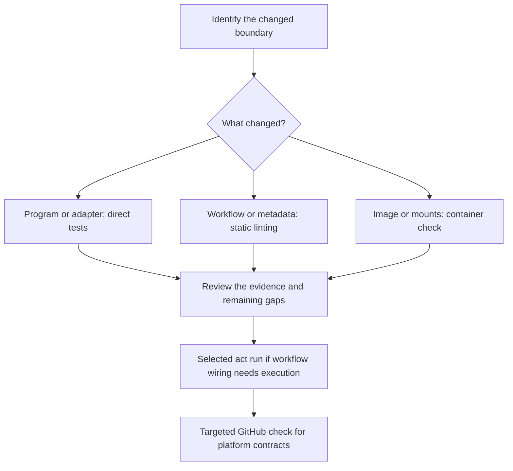

# 0002 · Build a local feedback loop

!!! note "Authored reference lesson"
    Work through predictions and experiments before opening solutions. Available lesson content and passing author checks do not establish learner mastery.

## Prerequisites

Start with [0001 · The execution model](0001-execution-model.md). Explain why a program, action metadata, and a workflow are separate test boundaries. Reuse the installed tools from the [local testing guide](../cheatsheet/local-testing.md); run all commands from the repository root.

## Goal

Catch a real action defect before pushing and choose a check that observes the boundary you changed. Success means you can produce a failing local assertion, explain it, repair it, and name what still needs GitHub evidence.

## Make CI call an existing command

The workflow chooses events, permissions, runners, and job order. Scripts and application modules own the behavior. `Taskfile.yml` gives humans and CI the same named commands. A task is a command contract; it does not reproduce GitHub's control plane.

Start with the real JavaScript action at `examples/javascript-action/index.cjs`. It reads `INPUT_NAME`, calls a greeting function, appends a named value to the path in `GITHUB_OUTPUT`, and exits unsuccessfully for invalid input. Calling that process directly tests more than calling the function alone, while avoiding a container or remote runner.



The branches are choices, not a requirement to run every layer on every edit. A prose correction needs documentation checks; it does not justify building a container.

## Run the smallest useful check

First predict the action's exit status, stdout, and output-file contents. Then execute:

```bash
uv run python labs/0002/probe.py
```

The probe creates a temporary output file, invokes the actual Node entrypoint with `INPUT_NAME=Ada`, and compares the file with `greeting=Hello, Ada!` followed by a newline. It cleans up afterward. Expected result:

```text
exit=0; output='greeting=Hello, Ada!\n'
PASS: real adapter wrote the expected named output
```

The printed `\n` is a display of the newline byte, not two literal bytes in the file. The probe's `--name` and `--expect` arguments let you vary the contract without editing shared action code:

```bash
uv run python labs/0002/probe.py --name Grace --expect 'Hello, Grace!'
```

!!! tip "Predict a negative case"
    If the adapter exits zero but the file contains the wrong greeting, should this probe pass? Which assertion would a function-only test miss if the adapter wrote to the wrong destination?

## Break the expectation, then repair the mismatch

Use an intentionally incorrect contract expectation:

```bash
uv run python labs/0002/probe.py --expect 'Hello Ada'
```

Expected: exit status **1**, the actual output value, and a `FAIL` message containing the expected value. This command is supposed to fail. A successful negative experiment means the check detects the mismatch; it does not mean the action is defective.

??? tip "Worked diagnosis"
    Compare expected and actual bytes. The existing action's contract includes the comma and exclamation mark. Restore the expectation to `Hello, Ada!` and rerun the first command. If the required product behavior actually changed, update implementation and meaningful tests together rather than weakening the assertion.

Now try `--name ''`. The adapter should reject the empty name, emit a diagnostic on stderr, exit nonzero, and leave the output file empty. The probe expects success, so it also exits nonzero. The existing suite explicitly asserts that this invalid-input failure is correct.

## Expand to the shared checks

```bash
# Function tests plus real process adapters, type checks, and bundle consistency.
task test

# Active workflow syntax and known metadata/expression checks.
task lint:workflows

# All inactive Module 1 workflow recipes, including the reusable call interface.
task lint:module1
```

`task test` includes three JavaScript function tests and the process contracts in `scripts/test_actions.py`. The adapter cases cover defaults, whitespace, Unicode, invalid multiline input, output append behavior, and a missing output path. They run the Docker action's Python program on the host; they do not build its container image.

[Actionlint](https://github.com/rhysd/actionlint/blob/main/docs/checks.md) finds structural and expression mistakes without running jobs. It can inspect known local action and reusable-workflow interfaces. It cannot prove arbitrary string output names from every program or hosted behavior. A clean lint result is useful evidence with a specific scope.

!!! note "Rebuild only after changing TypeScript source"
    `task test` compares the generated TypeScript bundle against the committed distribution file without repairing it. After an intentional source change, run `task actions:build`, review the bundle, and repeat `task test`. Consumers execute the distribution file, so rebuilding silently inside the comparison would hide drift.

For a complete host handoff, use `task check`. It includes documentation validation and the site build.

## Add the execution boundary when needed

| Change or question | Smallest useful next check | What remains outside it |
| --- | --- | --- |
| Greeting formatting | Function test | Input transport and workflow wiring |
| Wrong `GITHUB_OUTPUT` path | Real entrypoint with a temporary file | Runner consumption of that file |
| Composite output mapping | Static check, then selected workflow smoke run | GitHub policy and services |
| Dockerfile or output mount | `task test:container` | Hosted runner/engine parity |
| Token scope or environment approval | Targeted GitHub integration | Other event and policy combinations |

With a working Docker-compatible daemon, `task test:container` builds and exercises the existing Docker action. `task act:smoke` runs the dedicated four-runtime smoke job using a dispatch fixture. `task act:list` only lists jobs and does not execute them. The [local testing guide](../cheatsheet/local-testing.md#run-exactly-one-workflow-job-with-act) explains the selected workflow, job, runner image, and architecture.

A smaller optional smoke run for this module's execution recipe is:

```bash
act workflow_dispatch \
  -W labs/0001/module1-execution.yml -j greet \
  -P ubuntu-latest=catthehacker/ubuntu:act-latest \
  --container-architecture linux/amd64
```

This exercises the `greet` job only, including the two shell steps and local JavaScript action. It does not execute the downstream `report` job. It may download an image and action sources; it needs a running engine. Listing or linting the recipe is not evidence that this command ran successfully.

## Know what remains unproven

The [act support limitations](https://nektosact.com/not_supported.html) include platform features that are incomplete or ignored. Local execution cannot establish actual GitHub token enforcement, OIDC federation, environment approvals, hosted cache/artifact services, real event admission, or cancellation behavior. Reserve a deliberate hosted run for the contract you need to prove.

Agentic workflows add a further distinction. Local `gh aw compile --no-emit --strict` validates a specification. `gh aw trial` and `gh aw run` execute on GitHub infrastructure and can consume model usage. Continue in the [agentic lab](agentic-workflows.md) when that module is reached; none is needed for this lesson.

## Transfer exercise and retrieval

A greeting function test passes, but an action consumer receives an empty output. Choose the next two checks and explain what each can distinguish. Then design a fixture for one invalid input without requiring credentials or a GitHub run.

1. Why can an action's program pass while its output mapping fails?
2. What does a fixture control, and what does it not prove about event delivery?
3. Why compare a TypeScript bundle before rebuilding it?
4. Which local check can prove GitHub rejected a token write? Explain the missing boundary.

??? tip "Check your explanation"
    A process adapter can drop a value or use the wrong channel; metadata can then map a different name. A fixture controls input to a selected path, not GitHub's decision to deliver the event. Bundle comparison exposes stale shipped code. Actual authorization enforcement needs GitHub evidence; a local mock only tests your response to a simulated denial.

## Next lesson

Next is [0003](0003-events-payloads-and-filters.md), where events become structured inputs and admission rules. Primary references were checked on **2026-10-30** and are indexed in the [source library](../references/resources.md).

| Previous Lesson | All Lessons | Next Lesson |
| --- | --- | --- |
| [0001 · The GitHub Actions execution model](0001-execution-model.md) | [Curriculum](index.md) | [0003 · Event payloads, branch filters, path filters, and manual dispatch](0003-events-payloads-and-filters.md) |
