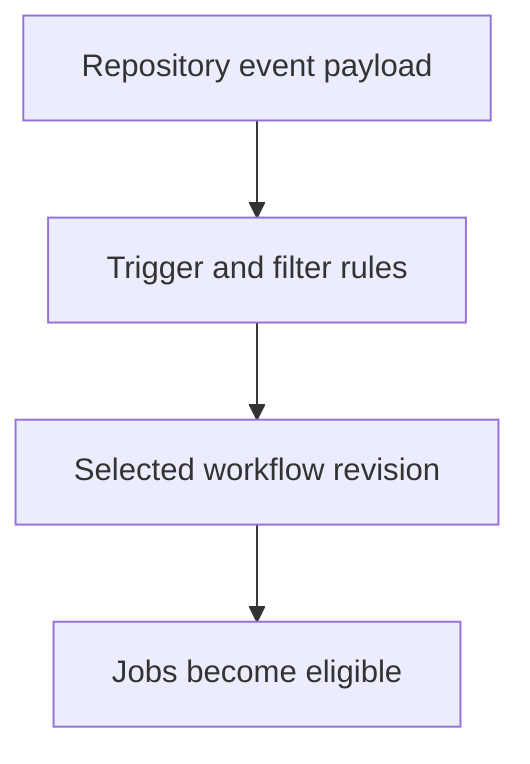

# 0003 · Event payloads, branch filters, path filters, and manual dispatch

!!! note "Placeholder for a future teaching thread"
    This page is a teaching brief. Expand it into a full interactive lesson in its own thread. The planned exercises and outcomes have not been completed or demonstrated.

**Level:** Beginner.

## Prerequisites

- [0002 · Build a local feedback loop before the first push](0002-local-feedback-loop.md)

## What you will learn to do

- Navigate the fields consumed by an event-driven workflow.
- Design admitted and rejected cases for branch and path selection.

## Explain the Actions behavior

Start from the prerequisite workflow or action behavior and introduce these concepts with focused examples:

1. An event payload is structured input describing what happened in the repository.
2. Trigger configuration selects which events and revisions a workflow considers.
3. A filter expresses an intended admission rule; a fixture alone does not prove GitHub delivered an event.

Explain the relevant workflow YAML, expressions, and action code in context. Follow the [shared teaching guide](teaching-guide.md) for pacing, expected output, and progression toward independent design.

## Planned local lab

Create an isolated exercise under `labs/0003/` when the lesson is developed. Explain setup and expected output before each command; reuse installed tools rather than reinstalling them on every step.

1. Read dispatch and pull-request event fixtures without assuming their fields match.
2. Draw a truth table for branch and changed-file cases before writing trigger YAML.
3. Inspect workflow selection locally and list the remaining real-event checks.

## Break it and diagnose it

Read a pull-request-only field from a dispatch fixture and diagnose the missing value instead of adding an unrelated permission.

Ask for a prediction first. Capture the smallest reproducer, the actual result, and the corrected behavior. State which remaining claim requires a real GitHub or external-service check.

## Planning diagram



When expanding this lesson, refine the diagram to show the actual processes, branches, data exchange, and trust boundaries being taught.

## Retrieval questions

1. Which facts come from the event payload?
2. How would you test a filter that silently excludes useful changes?
3. Why does dispatching a workflow differ from receiving a pull request?

## Evidence to capture in the teaching thread

- A working learner-produced example and an explanation of why it works.
- A reproduced failure, a reasoned repair, and the smallest check that verifies it.
- A short account of remaining limits, unresolved questions, and readiness for the next lesson.

Use [primary references](../references/resources.md) to verify current syntax, runtime support, and tool behavior. Add learning records only for real statements or demonstrated understanding; a placeholder or generated page does not establish mastery.

## Start this lesson in a new thread

```text
/teach 0003

Expand docs/lessons/0003-events-payloads-and-filters.md in place using docs/lessons/teaching-guide.md.
Read docs/mission.md, NOTES.md, and the prerequisite lesson pages first.
Begin with a short check of the Actions prerequisites. Explain relevant YAML,
expressions, and action contracts, one concept at a time. Let me predict and
try each exercise before revealing its answer. Keep feedback local where possible.
Finish with retrieval questions and a truthful handoff for the next thread.
```

| Previous | All lessons | Next |
| --- | --- | --- |
| [0002 · Build a local feedback loop before the first push](0002-local-feedback-loop.md) | [Curriculum](index.md) | [0004 · Contexts, expressions, conditions, status, and input types](0004-contexts-expressions-and-conditions.md) |
