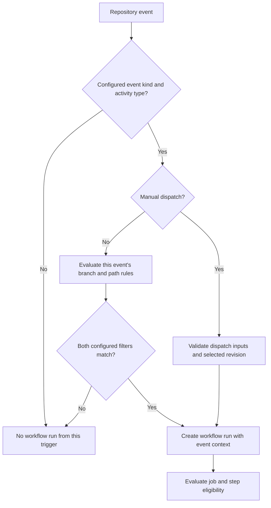

# 0003 · Event payloads, branch filters, path filters, and manual dispatch

!!! note "Authored reference lesson"
    The fixtures and recipe are available under `labs/0003/`. Predict the admitted events and missing fields before opening solutions. Authoring this page does not establish learner mastery.

## Prerequisites

Read [0002 · Local feedback](0002-local-feedback-loop.md). You should be able to distinguish executing a program with a fixture from proving that GitHub selected a workflow.

## What you will learn to do

Read only the event fields a workflow needs, design admitted and rejected trigger cases, and explain the difference between a push branch, a pull request's base branch, and a manual dispatch. Success means you can write an admission table before editing YAML.

## Explain the Actions behavior

An **event payload** is structured data describing the activity that started a run. The `github.event` context exposes it; `github.event_name` identifies the event kind. Shapes differ: a dispatch does not contain a `pull_request` object. The runner also exposes the payload file path through `GITHUB_EVENT_PATH`.

A workflow's `on` configuration determines which event kinds, activity types, branches, and paths can admit a run. Admission happens before a job's `if` condition. A fixture is controlled input to your local exercise; it does not ask GitHub to deliver a real event. See the [event reference](https://docs.github.com/en/actions/reference/workflows-and-actions/events-that-trigger-workflows).



## Design selection before writing YAML

The complete inactive recipe is `labs/0003/module1-events.yml`. Its trigger block is:

```yaml title="labs/0003/module1-events.yml — triggers"
on:
  push:
    branches: [main] # (1)!
    paths: ['examples/**', '.github/workflows/module1-events.yml']
  pull_request:
    types: [opened, synchronize, reopened]
    branches: [main] # (2)!
    paths: ['examples/**', '.github/workflows/module1-events.yml']
  workflow_dispatch:
    inputs:
      run_checks:
        description: Run the optional check
        type: boolean
        default: false
```

1. A branch push must be to `main` and include a matching changed path. This branch-only configuration does not admit tag pushes.
2. For a pull request, `branches` matches the **base**, the branch receiving the proposed merge. The contributor's source branch is the **head**.

Within one `paths` list, a matching path can admit the event; when branch and path filters are both configured, both constraints must hold. The different event kinds are alternatives. Push filters do not automatically restrict a manual dispatch. GitHub's [filter syntax reference](https://docs.github.com/en/actions/reference/workflows-and-actions/workflow-syntax#onpushpull_requestpull_request_targetpathspaths-ignore) documents these combinations.

!!! tip "Write your admission table first"
    Use a small branch change or PR with a complete changed-file comparison. For each row below, predict whether this recipe starts a run. Then check the worked table.

??? tip "Worked admission table"

    | Event | Branch information | Changed path or input | Run admitted? |
    | --- | --- | --- | --- |
    | Push | `refs/heads/main` | `examples/javascript-action/index.cjs` | Yes |
    | Push | `refs/heads/feature/greeting` | Same action file | No: branch excluded |
    | Push | `refs/heads/main` | `docs/mission.md` only | No: path excluded |
    | PR synchronized | Base `main`, head `feature/greeting` | Action file | Yes |
    | PR opened | Base `release`, head `main` | Action file | No: base excluded |
    | PR closed | Base `main` | Action file | No: activity type excluded |
    | Manual dispatch | Selected `main` revision | `run_checks=false` | Yes; optional step skips |

    The last row still creates a workflow run. `run_checks` controls one step inside the admitted run.

## Read fixtures without inventing fields

Run from the repository root:

```bash
uv run python labs/0003/read_event.py push labs/0003/push.json
uv run python labs/0003/read_event.py pull_request labs/0003/pull_request.json
uv run python labs/0003/read_event.py workflow_dispatch labs/0003/dispatch.json
```

These are intentionally minimal synthetic payloads, not complete webhook examples. The script reads the fields each exercise needs and prints selected JSON. Expected distinctions:

- Push: `ref` is `refs/heads/main`, with a synthetic `after` commit.
- Pull request: `base` is `main`; `head` is `feature/greeting`.
- Dispatch: `run_checks` is the **string** `"false"` in this event-payload fixture.

Do not use `Boolean`-style truthiness on that string. [Lesson 0004](0004-contexts-expressions-and-conditions.md) shows why the typed `inputs.run_checks` context is the better workflow condition.

The fixture reader deliberately does not emulate glob filters, changed-file comparison, or expression coercion. Use the truth table to review your intended policy, static linting to check syntax, and real small events to validate GitHub admission.

## Inspect only necessary context

The recipe passes selected fields through environment variables before printing them:

```yaml title="Workflow step excerpt"
- name: Inspect only the fields this lesson needs
  shell: bash
  env:
    EVENT_NAME: ${{ github.event_name }}
    EVENT_REF: ${{ github.ref }}
    BASE_REF: ${{ github.base_ref }}
    PR_HEAD: ${{ github.event.pull_request.head.ref }}
  run: |
    printf 'event=%s\nref=%s\nbase=%s\nhead=%s\n' \
      "$EVENT_NAME" "$EVENT_REF" "$BASE_REF" "$PR_HEAD"
```

For an open `pull_request` run, `github.ref` ordinarily identifies the PR merge ref, such as `refs/pull/7/merge`, rather than the source branch. `github.base_ref` and `github.head_ref` identify PR branch names. For this recipe's manual dispatch, the PR-only values are empty. A missing context property evaluates to an empty string; the strict fixture reader instead raises a diagnostic when you claim the fixture is the wrong event type. See the [contexts reference](https://docs.github.com/en/actions/reference/workflows-and-actions/contexts).

Treat branch names and other event text as data. Mapping them through `env` and quoting shell variables avoids turning those values into shell source. Printing selected fields also keeps unnecessary context out of logs.

## Break it and diagnose it

Predict what happens when you claim the dispatch payload is a PR:

```bash
uv run python labs/0003/read_event.py pull_request labs/0003/dispatch.json
```

Expected: exit **1** with `Missing required field: pull_request`. No credential or API call is involved.

??? tip "Worked repair"
    Use the event name that actually matches the payload, or select the PR fixture if that is the intended case. In a multi-event workflow, guard PR-only logic with `github.event_name == 'pull_request'`. Adding token permission cannot create a missing payload object. Avoid silently fabricating PR fields in a dispatch fixture to make the error disappear.

Change one trigger rule in your copy: replace the PR base filter with `release`. Rewrite the affected admission-table rows before running `task lint:module1`. Linting can accept this valid but unintended policy; that is why rejected-case review matters.

## Platform behavior to account for

Manual dispatch requires the workflow file to exist on the repository's default branch. A dispatch can target a selected branch or tag; `github.ref` identifies the selected ref. Keeping the recipe only under `labs/` does not enable a Run workflow button. The [manual dispatch reference](https://docs.github.com/en/actions/reference/workflows-and-actions/events-that-trigger-workflows#workflow_dispatch) describes the availability rule.

Path filtering also has documented limits. GitHub compares two-dot diffs for existing branch pushes and three-dot diffs for pull requests. Changed-file evaluation is limited to the first 300 files; a relevant later file may be missed. More than 1,000 pushed commits or a diff-generation timeout can cause the workflow to run without the usual path decision. When an entire workflow is skipped by branch/path filtering, an expected required check can remain pending and block merging. See the [Git diff comparison rules](https://docs.github.com/en/actions/reference/workflows-and-actions/workflow-syntax#git-diff-comparisons).

For a required CI gate, consider admitting the workflow broadly and making job selection explicit inside it. [Paths-filter and selective jobs](0050-paths-filter-and-selective-jobs.md) develops that design using a maintained action.

## Transfer exercise and retrieval

Design a policy that tests PRs targeting `main` when either `examples/**` or `tests/**` changes, plus a manual input that enables an extra check. Write one accepted case and one rejected case for each event kind. Explain whether a documentation-only PR should leave a required check pending.

1. Which PR branch does `branches: [main]` match?
2. Why can `github.ref` differ from the PR head branch?
3. Does `run_checks=false` prevent a manual workflow run from being created?
4. What evidence distinguishes a fixture-consumption test from a real trigger test?

??? tip "Check your explanation"
    The PR base is matched. An open PR run normally uses a merge ref for its test revision. A false optional input skips guarded work inside the run. A real trigger test records an actual event, changed paths, selected ref, and whether GitHub created the expected run; feeding JSON to a script establishes only local input handling.

## Evidence and next session

Capture the learner's admission table, event-field explanation, corrected mismatch, and actually executed checks. A targeted hosted experiment should use small changes with known paths, comparing one admitted and one rejected event. Local fixtures and linting cannot establish that result. Primary references were checked on **2026-10-30** and are indexed in the [source library](../references/resources.md).

## Start this lesson in a new thread

```text
/teach 0003

Use docs/lessons/0003-events-payloads-and-filters.md and labs/0003/.
Read docs/mission.md, NOTES.md, docs/lessons/teaching-guide.md, and lesson 0002.
Ask me to predict branch/path admission and inspect each event fixture.
Pause before solutions; let me diagnose the dispatch-as-PR failure.
Record actual evidence and hand off to lesson 0004.
```

| Previous Lesson | All Lessons | Next Lesson |
| --- | --- | --- |
| [0002 · Local feedback](0002-local-feedback-loop.md) | [Curriculum](index.md) | [0004 · Contexts and conditions](0004-contexts-expressions-and-conditions.md) |
