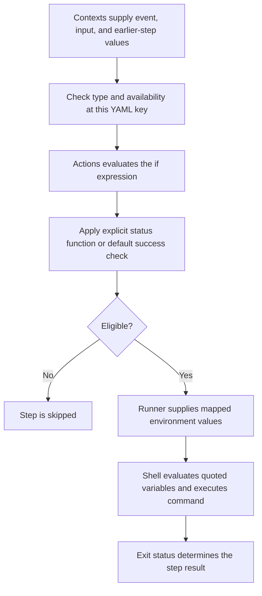

# 0004 · Contexts, expressions, conditions, status, and input types

The recipe includes a text condition that looks false but still runs. Predict which steps execute before opening the explanation.

## Explain the Actions behavior

A **context** is a named collection of workflow values. An **expression** such as `${{ github.event_name }}` reads or computes a value using Actions' expression language. The shell later evaluates `$EVENT_NAME`. YAML supplies the surrounding structure; it does not make these two evaluators interchangeable.

Actions evaluates some expressions before assigning a runner. Step expressions can use values produced during the job.

Which contexts you can read depends on the configuration key. A job-level `if` cannot inspect that job's future `steps` values. Actions also evaluates job `if` before expanding its matrix. Consult the [context availability table](https://docs.github.com/en/actions/reference/workflows-and-actions/contexts#context-availability) when choosing where a rule belongs.

| Context | Example | Intended use |
| --- | --- | --- |
| `github` | `github.event_name` | Event, repository, and revision information |
| `inputs` | `inputs.run_extra` | Typed dispatch or reusable-workflow inputs |
| `env` | `env.TEXT_FLAG` | Workflow-defined environment values; these are text here |
| `steps` | `steps.exercise.outcome` | Earlier identified steps in the current job |
| `needs` | `needs.build.result` | Direct dependency jobs and mapped outputs |
| `matrix` | `matrix.case` | This expanded job's matrix values |



## Separate expressions from shell evaluation

```yaml title="Small step example"
- name: Identify the event
  env:
    EVENT_NAME: ${{ github.event_name }} # (1)!
  shell: bash
  run: printf 'event=%s\n' "$EVENT_NAME" # (2)!
```

1. Actions resolves the context value and supplies it as an environment value.
2. Bash expands a quoted variable during process execution.

This keeps event text in the data channel. Avoid interpolating untrusted event strings directly into `run` source. Inside Actions expressions use single-quoted string literals, such as `github.event_name == 'workflow_dispatch'`. In `if`, the `${{ }}` wrapper is usually optional; use the wrapper for a leading `!` so YAML does not interpret a tag.

## A flag is not always a boolean

The complete inactive recipe is `labs/0004/module1-conditions.yml`. It declares boolean inputs `run_extra` and `simulate_failure`, each defaulting to `false`, plus job environment text `TEXT_FLAG: 'false'`.

!!! tip "Predict all four conditions"
    Assume prior steps succeeded and the default dispatch inputs are unchanged. Which conditions below admit their steps? Then repeat with `run_extra=true`.

```yaml title="labs/0004/module1-conditions.yml, condition excerpts"
- name: Deliberately wrong text condition
  if: env.TEXT_FLAG
  run: printf '%s\n' 'nonempty text ran this step'
- name: Explicit text comparison
  if: env.TEXT_FLAG == 'true'
  run: printf '%s\n' 'text enabled'
- name: Convert known JSON text
  if: fromJSON(env.TEXT_FLAG)
  run: printf '%s\n' 'JSON boolean enabled'
- name: Typed dispatch input
  if: inputs.run_extra
  run: printf '%s\n' 'typed input enabled'
```

??? tip "Worked condition table"

    | Supplied value | Expression | Result with earlier success |
    | --- | --- | --- |
    | Text `'false'` | `env.TEXT_FLAG` | Runs: nonempty text is truthy |
    | Text `'false'` | `env.TEXT_FLAG == 'true'` | Skips |
    | Known JSON text `'false'` | `fromJSON(env.TEXT_FLAG)` | Skips: parsed boolean false |
    | Typed boolean `false` | `inputs.run_extra` | Skips |
    | Typed boolean `true` | `inputs.run_extra` | Runs |
    | Missing property | A direct truthiness check | Skips: missing property yields empty text |

    Use typed `inputs` where available. For string outputs or environment flags, an explicit comparison states the contract clearly. `fromJSON` is appropriate for validated JSON text; an empty string or `yes` is not valid JSON and can cause an evaluation error.

`inputs.run_extra` retains the declared boolean type for manual dispatch. The corresponding `github.event.inputs.run_extra` is text. Choice inputs are strings too; choosing the word `false` from a choice list would not create a boolean. GitHub's [dispatch-input reference](https://docs.github.com/en/actions/reference/workflows-and-actions/workflow-syntax#onworkflow_dispatchinputs) and [expression reference](https://docs.github.com/en/actions/reference/workflows-and-actions/expressions) explain the typing and conversions.

Avoid relying on loose equality between mixed types. Numeric output strings need explicit conversion for numeric comparisons. The shortcut `flag && a || b` also chooses `b` when `a` is falsy, even if `flag` is true; use explicit conditions when empty or false values are meaningful.

## Account for earlier status

A condition without a status-check function implicitly includes `success()`. That is why an ordinary next step skips after an unhandled failure, even if its unrelated flag is true.

The lab's identified `exercise` step exits 1 when `simulate_failure` is true. Later steps include:

```yaml title="Status-sensitive excerpts"
- name: Default success condition
  run: printf '%s\n' 'earlier steps succeeded'
- name: Failure diagnostic
  if: failure() && steps.exercise.outcome == 'failure'
  run: printf '%s\n' 'exercise failed; inspect its log'
- name: Report unless cancelled
  if: ${{ !cancelled() }}
  run: printf '%s\n' 'bounded report after success or failure'
```

With `simulate_failure=false`, the default success step and bounded report run. With `true`, the default step skips, the failure diagnostic runs, and the bounded report runs. The report can succeed while the job still fails because of the earlier error.

`failure()` explicitly allows failure-path evaluation. `!cancelled()` allows a short report after success or failure while excluding cancellation. `always()` evaluates true even during cancellation, so choose it only for work that should continue in that state and keep it bounded. See the [status-function reference](https://docs.github.com/en/actions/reference/workflows-and-actions/expressions#status-check-functions).

!!! note "Outcome and conclusion can differ"
    For an identified step with `continue-on-error: true`, `steps.id.outcome` retains its original failure while `steps.id.conclusion` can be `success`. Tolerating a failure changes propagation; it does not prove the attempted operation succeeded. This lab leaves its exercise failure unhandled so the status transition is visible.

## Local lab

1. Open `labs/0004/module1-conditions.yml` and write the default execution order, including skipped steps.
2. Repeat for `run_extra=true`, then for `simulate_failure=true`.
3. Lint the entire module with `task lint:module1`. Valid syntax does not detect a logically unintended truthiness rule.
4. If a Docker-compatible engine is running, execute the selected default case:

```bash
act workflow_dispatch \
  -W labs/0004/module1-conditions.yml -j conditions \
  --input run_extra=false --input simulate_failure=false \
  -P ubuntu-latest=catthehacker/ubuntu:act-latest \
  --container-architecture linux/amd64
```

The deliberately wrong text step should run. The explicit comparison, JSON conversion, and typed optional step should skip. The exercise should pass, followed by the success step and report.

Repeat with `--input simulate_failure=true`. This time, expect the job to fail. Local execution provides evidence for the installed `act` implementation, not proof of GitHub cancellation or input handling parity. The [act usage guide](https://nektosact.com/usage/index.html) documents input selection.

## Break it and diagnose it

The text condition is already the deliberate defect. Explain why changing `TEXT_FLAG` from `'true'` to `'false'` does not disable its step. Repair your copy with `env.TEXT_FLAG == 'true'`, then compare the two runs if a local engine is available.

??? tip "Worked repair"
    The producer supplies nonempty text in both cases. The evaluator asks whether that text is truthy. Comparing with the agreed literal `'true'` expresses the intended flag contract. If the value is actually a declared boolean input, read `inputs.run_extra` directly instead of routing it through text first.

For a second diagnosis, remove `failure()` from the diagnostic condition and leave only `steps.exercise.outcome == 'failure'`. After the exercise fails, the implicit success check suppresses the diagnostic. Restore the explicit status function.

## Transfer exercise and retrieval

A prior action returns the string output `changed=false`. Design a downstream step that runs only for `changed=true`, plus a diagnostic step after an actual failure. Handle a missing `changed` output explicitly rather than parsing unknown empty text as JSON.

1. Who evaluates `${{ ... }}` and who evaluates `$VALUE` in Bash?
2. What does a nonexistent context property produce?
3. Why can a true business flag still leave a step skipped after failure?
4. When would `always()` differ from `!cancelled()`?

??? tip "Check your explanation"
    Actions resolves context expressions; Bash expands shell variables. A missing property yields an empty string. Without an explicit status function, the implicit `success()` check can suppress a step. `always()` remains true during cancellation, while `!cancelled()` excludes it. Neither guarantees completion if the runner or process is terminated.

## Evidence and next session

Record static checks separately from any executed `act` cases; leave hosted cancellation behavior unproven until observed. Continue to [0005](0005-environment-files-and-output-contracts.md). Primary sources were checked on **2026-10-30** and are indexed in the [source library](../references/resources.md).

| Previous lesson | All lessons | Next lesson |
| --- | --- | --- |
| [0003 · Event payloads, branch filters, path filters, and manual dispatch](0003-events-payloads-and-filters.md) | [Curriculum](index.md) | [0005 · Environment files and step, job, and workflow output contracts](0005-environment-files-and-output-contracts.md) |
