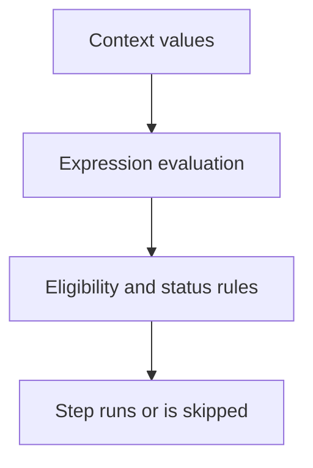

# 0004 · Contexts, expressions, conditions, status, and input types

!!! note "Placeholder for a future teaching thread"
    This page is a teaching brief. Expand it into a full interactive lesson in its own thread. The planned exercises and outcomes have not been completed or demonstrated.

**Level:** Beginner.

## Prerequisites

- [0003 · Event payloads, branch filters, path filters, and manual dispatch](0003-events-payloads-and-filters.md)

## What you will learn to do

- Evaluate small workflow conditions from a supplied context.
- Predict execution after success, failure, cancellation, or missing input.

## Explain the Actions behavior

Start from the prerequisite workflow or action behavior and introduce these concepts with focused examples:

1. Contexts provide named values to the workflow expression evaluator.
2. A job or step condition controls eligibility, including after earlier failures.
3. Text values, missing fields, and boolean values require deliberate interpretation.

Explain the relevant workflow YAML, expressions, and action code in context. Follow the [shared teaching guide](teaching-guide.md) for pacing, expected output, and progression toward independent design.

## Planned local lab

Create an isolated exercise under `labs/0004/` when the lesson is developed. Explain setup and expected output before each command; reuse installed tools rather than reinstalling them on every step.

1. Annotate expressions that read inputs, event data, and prior step results.
2. Build a condition table for a flag represented as text, a boolean, and an absent field.
3. Validate representative workflow conditions with actionlint and a selected smoke fixture.

## Break it and diagnose it

Use a text flag as though it were a boolean and predict which steps run unexpectedly. Repair the conversion explicitly.

Ask for a prediction first. Capture the smallest reproducer, the actual result, and the corrected behavior. State which remaining claim requires a real GitHub or external-service check.

## Planning diagram



When expanding this lesson, refine the diagram to show the actual processes, branches, data exchange, and trust boundaries being taught.

## Retrieval questions

1. Who evaluates an Actions expression versus a shell expression?
2. What should happen when the referenced context field is absent?
3. Why must cleanup conditions consider prior failure state?

## Evidence to capture in the teaching thread

- A working learner-produced example and an explanation of why it works.
- A reproduced failure, a reasoned repair, and the smallest check that verifies it.
- A short account of remaining limits, unresolved questions, and readiness for the next lesson.

Use [primary references](../references/resources.md) to verify current syntax, runtime support, and tool behavior. Add learning records only for real statements or demonstrated understanding; a placeholder or generated page does not establish mastery.

## Start this lesson in a new thread

```text
/teach 0004

Expand docs/lessons/0004-contexts-expressions-and-conditions.md in place using docs/lessons/teaching-guide.md.
Read docs/mission.md, NOTES.md, and the prerequisite lesson pages first.
Begin with a short check of the Actions prerequisites. Explain relevant YAML,
expressions, and action contracts, one concept at a time. Let me predict and
try each exercise before revealing its answer. Keep feedback local where possible.
Finish with retrieval questions and a truthful handoff for the next thread.
```

| Previous | All lessons | Next |
| --- | --- | --- |
| [0003 · Event payloads, branch filters, path filters, and manual dispatch](0003-events-payloads-and-filters.md) | [Curriculum](index.md) | [0005 · Environment files and step, job, and workflow output contracts](0005-environment-files-and-output-contracts.md) |
