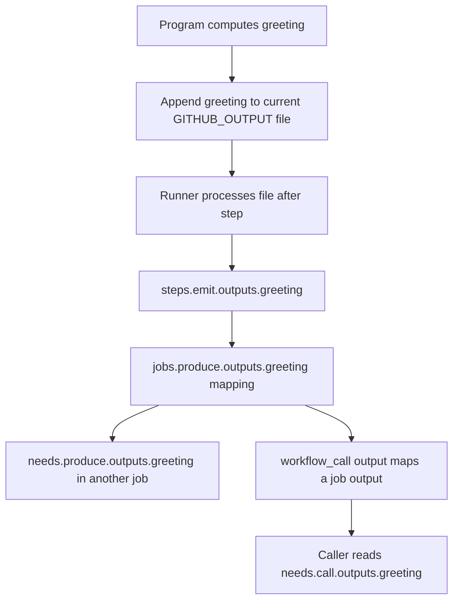

# 0005 · Environment files and step, job, and workflow output contracts

Follow one greeting from its producer to its consumers. The lab includes adapter checks and three inactive workflow recipes for tracing each output mapping.

## Explain the Actions behavior

A program's stdout is a log channel. A **named output** is a key/value result published through the runner's output-file protocol. The runner provides file paths in environment variables; the program appends the appropriate records, and the runner processes them at the step boundary. Merely assigning a shell variable does not publish anything.

| Destination | What to write | Consumer and scope |
| --- | --- | --- |
| stdout/stderr | Diagnostic text | Human-readable step log |
| `GITHUB_ENV` | Environment assignments | Subsequent steps in the same job |
| `GITHUB_OUTPUT` | Named output records | Later expressions using an identified step's outputs |
| `GITHUB_STEP_SUMMARY` | Markdown | The workflow run's human-readable job summary |
| Artifact action | Files | A later job or person downloading the named artifact |

The paths are runner-managed and specific to the current step; do not hardcode or reuse a previous step's path. A write to `GITHUB_ENV` does not update the writing process itself. Use a shell variable too when that same process needs the value. The [workflow-command reference](https://docs.github.com/en/actions/reference/workflows-and-actions/workflow-commands#environment-files) defines the protocols.



## Observe the actual adapter protocol locally

Run from the repository root. Before running, predict which channel contains a named value:

```bash
uv run python labs/0005/inspect_output.py
```

The script supplies `INPUT_NAME=Ada` and a real temporary `GITHUB_OUTPUT` path to the existing JavaScript action. It prints:

```text
exit=0; stdout='Hello, Ada!\n'; output_file='greeting=Hello, Ada!\n'
named greeting: Hello, Ada!
```

The temporary file is removed afterward. The helper only inspects this action's declared single-line format; it is not a complete runner parser. It never sources the output file as a shell script.

!!! tip "Predict the broken channel"
    If a program prints `greeting=Hello, Ada!` to stdout and exits zero but leaves `GITHUB_OUTPUT` empty, what can `steps.emit.outputs.greeting` contain?

Run the deliberately broken producer:

```bash
uv run python labs/0005/inspect_output.py --stdout-only
```

Expected: the log contains the assignment-looking text, the output file is empty, and the inspector exits **1** with `missing single-line greeting output`.

??? tip "Worked diagnosis and repair"
    A successful process exit only says the command completed successfully. The named-output protocol was never used. Append `greeting=Hello, Ada!` plus a newline to the runner-provided output file. The real adapter already does so; rerun without `--stdout-only` to verify that correct path.

## Map a result to a later step

The complete recipe `labs/0005/module1-outputs.yml` includes this producer:

```yaml title="Producer excerpt"
- name: Write three different runner channels
  id: emit # (1)!
  shell: bash
  run: |
    printf '%s\n' 'greeting=Hello, Ada!' >> "$GITHUB_OUTPUT"
    printf '%s\n' 'LESSON_COLOR=green' >> "$GITHUB_ENV"
    printf '%s\n' '### Greeting ready' >> "$GITHUB_STEP_SUMMARY"
- name: Consume in a later step of this job
  env:
    GREETING: ${{ steps.emit.outputs.greeting }} # (2)!
  shell: bash
  run: |
    test "$GREETING" = 'Hello, Ada!'
    test "$LESSON_COLOR" = green
```

1. `id` supplies the stable reference used by expressions. A display `name` is insufficient.
2. The named result is available after `emit` finishes. The environment-file assignment reaches this later process separately.

The excerpt omits the complete recipe's multiline and empty-output checks. `>>` appends; `>` would truncate a file and could erase earlier records in that step. The output value is text, so a later `if: steps.emit.outputs.enabled` would have the string-truthiness issue from 0004.

## Map a result across jobs

The producer job explicitly exports the step result, and the consumer explicitly depends on it:

```yaml title="Cross-job structure excerpt"
jobs:
  produce:
    runs-on: ubuntu-latest
    outputs:
      greeting: ${{ steps.emit.outputs.greeting }}
    steps:
      - id: emit
        run: printf '%s\n' 'greeting=Hello, Ada!' >> "$GITHUB_OUTPUT"
  consume:
    needs: produce
    runs-on: ubuntu-latest
    steps:
      - env:
          GREETING: ${{ needs.produce.outputs.greeting }}
        run: test "$GREETING" = 'Hello, Ada!'
```

`needs` both orders execution and makes the dependency's declared outputs available. The new job does not receive `LESSON_COLOR` through the first job's `GITHUB_ENV`. Use job outputs for small nonsecret values and maintained artifact actions for files. Do not encode an entire build artifact into an output string. The [job-output guide](https://docs.github.com/en/actions/how-tos/write-workflows/choose-what-workflows-do/pass-job-outputs) covers this mapping; [0006](0006-matrices-dependencies-and-cancellation.md) adds dependency failure behavior.

## Add the reusable-workflow boundary

A reusable workflow is called as a **job**, using `workflow_call`. It needs one more output mapping. The complete callee is `labs/0005/module1-reusable.yml`:

```yaml title="Reusable-workflow interface excerpt"
on:
  workflow_call:
    inputs:
      name:
        description: Single-line recipient
        type: string
        default: Ada
    outputs:
      greeting:
        description: Greeting returned by the worker
        value: ${{ jobs.greet.outputs.greeting }}
```

Its `greet` job calls the existing local JavaScript action and maps `steps.greet.outputs.greeting` to a job output. The interface above then exports that job result to the caller. The complete caller, `labs/0005/module1-caller.yml`, has this job structure:

```yaml title="Caller job excerpt"
jobs:
  call:
    uses: ./.github/workflows/module1-reusable.yml
    with:
      name: Ada
  verify:
    needs: call
    runs-on: ubuntu-latest
    steps:
      - env:
          GREETING: ${{ needs.call.outputs.greeting }}
        run: test "$GREETING" = 'Hello, Ada!'
```

The caller's `call` job invokes the reusable workflow with `uses`. It cannot also declare `runs-on` and ordinary `steps` in that job. The local workflow reference resolves at the caller's commit; it is not a path relative to the caller YAML file. Both recipes must be copied to `.github/workflows/` with their existing basenames for GitHub execution. Deeper input, secret, and permission contracts are taught in [0029](0029-reusable-workflows-and-permission-interfaces.md). See GitHub's [reusable-workflow output guide](https://docs.github.com/en/actions/how-tos/reuse-automations/reuse-workflows#using-outputs-from-a-reusable-workflow).

## Multiline, empty, missing, and invalid values

A single-line record has the form `name=value`. The existing action rejects names containing newlines so user data cannot introduce extra output records. Predict this failure:

```bash
uv run python labs/0005/inspect_output.py --name $'Ada\nother=injected'
```

Expected: the real adapter exits **1**, explains that input must be a nonempty single line, and publishes no greeting. Reject invalid input before writing a success output.

For a genuine multiline result, the complete output recipe writes:

```bash
printf '%s\n' 'report<<LESSON_REPORT' 'first line' 'second line' \
  'LESSON_REPORT' >> "$GITHUB_OUTPUT"
printf '%s\n' 'empty=' >> "$GITHUB_OUTPUT"
```

`LESSON_REPORT` is safe for this fixed two-line value because it cannot appear as a standalone content line. Arbitrary data needs a collision-free delimiter or file transfer; never assume a constant marker is safe for unknown text. The [multiline protocol](https://docs.github.com/en/actions/reference/workflows-and-actions/workflow-commands#multiline-strings) explains the delimiter requirement.

An explicitly empty output and an absent output can both appear as an empty string to a consumer. If that distinction matters, publish a separate status such as `present=true`, or a validated JSON envelope with an explicit field. Do not rely on truthiness to distinguish them.

GitHub can suppress job outputs it detects as containing secrets. Pass secrets through the supported secret interfaces and avoid printing them.

## Local lab and a missing-mapping failure

1. Trace `greeting` through the complete output recipe and both reusable recipes. Label all three output mappings: step to job, callee job to workflow, and caller consumption.
2. Run the successful and stdout-only adapter commands above. Keep their output channels and exit statuses separate in your notes.
3. Run `task lint:module1` to check all seven inactive recipes together. Its temporary staging directory lets actionlint resolve the local reusable-workflow reference without activating the recipes.
4. In your own copy, change the producer job mapping to `steps.emit.outputs.missing`. Predict the consuming `test` failure. Static analysis cannot guarantee arbitrary shell-generated output names; a workflow execution check is needed.

??? tip "Worked mapping diagnosis"
    Start at the consumer's empty value, inspect `needs.produce.outputs.greeting`, then the job's mapping, then the producer's `id` and actual output record. Repair `missing` to `greeting`. A correct output file alone does not prove the mappings. Increasing token permissions does not fix a misspelled result name.

If a container engine is available, an optional selected-job execution is:

```bash
act workflow_dispatch \
  -W labs/0005/module1-outputs.yml -j consume \
  -P ubuntu-latest=catthehacker/ubuntu:act-latest \
  --container-architecture linux/amd64
```

`act` includes the selected job's dependency, so this case exercises `produce` then `consume`. It does not test the reusable caller, hosted artifacts, or GitHub policy. See the [local testing guide](../cheatsheet/local-testing.md) for setup and limits.

## Transfer exercise and retrieval

A build job computes `package_version` and creates a package file. Specify which data should be a job output and which should be an artifact. Add a separate presence/status value if an empty version is allowed by the domain.

1. Who reads `GITHUB_OUTPUT`, and when?
2. Why can the writing step not immediately read a new value from `GITHUB_ENV`?
3. Which extra mapping does a reusable workflow require?
4. What happens if a multiline delimiter occurs as a full line inside the value?

??? tip "Check your explanation"
    The runner processes the step's output file at the boundary. The writing process has already inherited its environment; appending a record does not mutate that process. A reusable workflow exposes a job output through `on.workflow_call.outputs`. A colliding delimiter can end a value early and corrupt the intended records, so the delimiter or transport must change.

## Evidence and next session

Direct scripts check real process output; static checks inspect interfaces; a selected workflow run exercises runner-style consumption. Actual GitHub output processing, secret suppression, and hosted artifact exchange remain platform contracts. Continue to [0006](0006-matrices-dependencies-and-cancellation.md). Primary sources were checked on **2026-10-30** and are listed in the [source library](../references/resources.md).

| Previous lesson | All lessons | Next lesson |
| --- | --- | --- |
| [0004 · Contexts, expressions, conditions, status, and input types](0004-contexts-expressions-and-conditions.md) | [Curriculum](index.md) | [0006 · Matrices, job dependencies, cancellation, and failure propagation](0006-matrices-dependencies-and-cancellation.md) |
