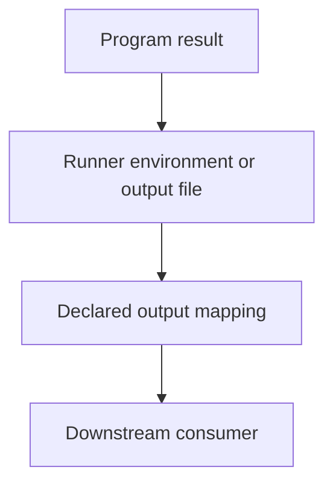

# 0005 · Environment files and step, job, and workflow output contracts

!!! note "Placeholder for a future teaching thread"
    This page is a teaching brief. Expand it into a full interactive lesson in its own thread. The planned exercises and outcomes have not been completed or demonstrated.

**Level:** Beginner.

## Prerequisites

- [0004 · Contexts, expressions, conditions, status, and input types](0004-contexts-expressions-and-conditions.md)

## What you will learn to do

- Trace a value from a process output file to a dependent job.
- Choose the appropriate mechanism for a log, environment value, or named result.

## Explain the Actions behavior

Start from the prerequisite workflow or action behavior and introduce these concepts with focused examples:

1. Writing to a runner-provided file is a protocol, distinct from printing a log.
2. Step-to-step environment changes and named outputs have different consumers and timing.
3. Job and reusable-workflow outputs add explicit mappings across larger boundaries.

Explain the relevant workflow YAML, expressions, and action code in context. Follow the [shared teaching guide](teaching-guide.md) for pacing, expected output, and progression toward independent design.

## Planned local lab

Create an isolated exercise under `labs/0005/` when the lesson is developed. Explain setup and expected output before each command; reuse installed tools rather than reinstalling them on every step.

1. Write and inspect temporary output files with direct adapter tests.
2. Map one step result to a job output and a downstream consumer in a small workflow.
3. Plan multiline, empty, and invalid-value cases, then verify the applicable output protocol in primary documentation.

## Break it and diagnose it

Write a result to stdout instead of the output file and observe why the caller sees an empty named value.

Ask for a prediction first. Capture the smallest reproducer, the actual result, and the corrected behavior. State which remaining claim requires a real GitHub or external-service check.

## Planning diagram



When expanding this lesson, refine the diagram to show the actual processes, branches, data exchange, and trust boundaries being taught.

## Retrieval questions

1. What consumes the output file?
2. Why must cross-job data be declared explicitly?
3. How could a newline change an output contract?

## Evidence to capture in the teaching thread

- A working learner-produced example and an explanation of why it works.
- A reproduced failure, a reasoned repair, and the smallest check that verifies it.
- A short account of remaining limits, unresolved questions, and readiness for the next lesson.

Use [primary references](../references/resources.md) to verify current syntax, runtime support, and tool behavior. Add learning records only for real statements or demonstrated understanding; a placeholder or generated page does not establish mastery.

## Start this lesson in a new thread

```text
/teach 0005

Expand docs/lessons/0005-environment-files-and-output-contracts.md in place using docs/lessons/teaching-guide.md.
Read docs/mission.md, NOTES.md, and the prerequisite lesson pages first.
Begin with a short check of the Actions prerequisites. Explain relevant YAML,
expressions, and action contracts, one concept at a time. Let me predict and
try each exercise before revealing its answer. Keep feedback local where possible.
Finish with retrieval questions and a truthful handoff for the next thread.
```

| Previous | All lessons | Next |
| --- | --- | --- |
| [0004 · Contexts, expressions, conditions, status, and input types](0004-contexts-expressions-and-conditions.md) | [Curriculum](index.md) | [0006 · Matrices, job dependencies, cancellation, and failure propagation](0006-matrices-dependencies-and-cancellation.md) |
