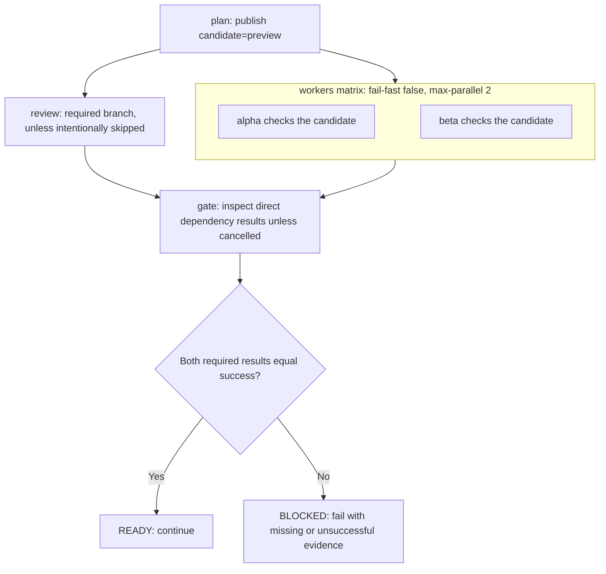

# 0006 · Matrices, job dependencies, cancellation, and failure propagation

!!! note "Authored reference lesson"
    Predict the job graph and its failure paths before opening solutions. The local gate checks a deliberate evidence policy; it does not emulate GitHub scheduling. Written content does not establish learner mastery.

## Prerequisites

Read [0005 · Output contracts](0005-environment-files-and-output-contracts.md) and [0004 · Conditions and status](0004-contexts-expressions-and-conditions.md). Be ready to explain a `needs` output and the implicit `success()` condition.

## What you will learn to do

Draw a workflow dependency graph, identify eligible parallel jobs, control matrix failure behavior, and join required results without accepting missing evidence. Success means you can explain what happens after success, failure, skipping, and cancellation.

## Explain the Actions behavior

A **directed acyclic graph**, or DAG, expresses ordering through dependencies without cycles. A job with `needs: plan` waits for `plan`; it does not wait for another independent job merely because that job appears earlier in the YAML. A **fan-out** starts independent workers; a **fan-in** waits for their results.

The complete inactive recipe `labs/0006/module1-graph.yml` has five job instances in its default case: one plan, two matrix workers, one review, and one gate. `workers` and `review` both need the plan, so they become eligible together. Runner availability and limits decide whether they actually start simultaneously. The gate depends on both branches.



The vertical stack inside the matrix is for readability; no dependency connects `alpha` to `beta`. Their ordering is unconstrained.

## Expand a matrix deliberately

A **matrix** expands one job definition for selected values. The recipe uses two lightweight cases on one OS:

```yaml title="labs/0006/module1-graph.yml — worker structure"
workers:
  needs: plan
  runs-on: ubuntu-latest
  timeout-minutes: 5
  strategy:
    fail-fast: false # (1)!
    max-parallel: 2 # (2)!
    matrix:
      case: [alpha, beta]
  steps:
    - name: Check one independent case
      shell: bash
      env:
        CASE_NAME: ${{ matrix.case }}
        FAIL_WORKER: ${{ inputs.fail_worker }}
        CANDIDATE: ${{ needs.plan.outputs.candidate }}
      run: |
        test "$CANDIDATE" = preview
        printf 'checking %s\n' "$CASE_NAME"
        test "$CASE_NAME" != "$FAIL_WORKER"
```

1. Keep the other matrix member running after a failure so this lesson can inspect the full attempt.
2. At most two instances of this matrix job run at once. Other jobs and other workflow runs are outside this setting.

Each worker gets the plan's mapped output, rather than a file left on another runner. `fail_worker=none` lets both cases pass; choosing `alpha` or `beta` makes that selected instance exit unsuccessfully. The matrix does not produce one unambiguous aggregate output per case merely by sharing an output name; use unique names or artifacts when collecting per-worker evidence.

A two-axis matrix such as `os: [ubuntu-latest, windows-latest]` and `case: [alpha, beta]` creates four combinations. `exclude` removes combinations; `include` can extend combinations or add selected ones. Count the intended jobs before executing them. See GitHub's [matrix guide](https://docs.github.com/en/actions/how-tos/write-workflows/choose-what-workflows-do/run-job-variations).

!!! tip "Prediction"
    With two workers and a review branch after the plan, which jobs are allowed to overlap? If `max-parallel` becomes 1, must the independent review wait too?

??? tip "Worked graph explanation"
    Both worker instances and the review become eligible after a successful plan. `max-parallel: 1` serializes the worker instances but does not add a dependency to review. The gate waits for both direct dependencies to finish; `needs` is the ordering contract.

## Choose failure propagation intentionally

| Setting | Scope | Meaning |
| --- | --- | --- |
| `strategy.fail-fast: true` | Siblings in this matrix | A non-tolerated failure cancels queued or in-progress siblings |
| `strategy.fail-fast: false` | Siblings in this matrix | Other instances continue despite a failed member |
| Step `continue-on-error: true` | One step | Its failure can be tolerated for propagation; original outcome remains visible |
| Job `continue-on-error: true` | One job or matrix instance | Allows that failure without failing the workflow through that job |
| `timeout-minutes` | Configured job or step | Bounds execution time |
| `concurrency` | Jobs or runs sharing a group | Controls overlap across that group |

`fail-fast` defaults to true. Turning it off gathers more diagnostics; it does not turn failed required work into success. Tolerating a required worker's failure can make a success-based gate misleading, so this lab does not set `continue-on-error` for either required branch.

By default, a failed or skipped dependency causes downstream jobs to skip. A gate intended to report those states needs a status-aware condition. The recipe uses:

```yaml title="Gate excerpt"
gate:
  needs: [workers, review]
  if: ${{ !cancelled() }}
  runs-on: ubuntu-latest
  timeout-minutes: 5
  steps:
    - uses: actions/checkout@3d3c42e5aac5ba805825da76410c181273ba90b1 # v7.0.1
      with:
        persist-credentials: false
    - name: Require both branches
      shell: bash
      env:
        WORKER_RESULT: ${{ needs.workers.result }}
        REVIEW_RESULT: ${{ needs.review.result }}
      run: python3 labs/0006/gate.py --worker "$WORKER_RESULT" --review "$REVIEW_RESULT"
```

The explicit `cancelled()` status function removes the default success-only eligibility check. The gate can therefore diagnose failed or skipped dependencies, while declining work after workflow cancellation. Its program still requires both results to equal `success`. Running the gate is permission to inspect evidence, rather than permission to declare readiness. GitHub's [dependency syntax](https://docs.github.com/en/actions/reference/workflows-and-actions/workflow-syntax#jobsjob_idneeds) and [needs context](https://docs.github.com/en/actions/reference/workflows-and-actions/contexts#needs-context) define the scheduling and result values.

`needs` contains direct dependencies, not every transitive ancestor. To read `plan` outputs directly in the gate, also list `plan` in the gate's `needs`; the worker's dependency alone does not expose it there.

## Local lab: enforce the join policy

Run from the repository root. Predict all three results first:

```bash
uv run python labs/0006/gate.py --worker success --review success
uv run python labs/0006/gate.py --worker failure --review success
uv run python labs/0006/gate.py --worker success --review skipped
```

The first exits **0** with `READY: required worker and review evidence succeeded`. The other two exit **1** with `BLOCKED` and the supplied states. These expected failures verify the actual policy function used by the workflow, without claiming to reproduce how GitHub selected or scheduled jobs.

The command also accepts `cancelled`; any non-success result blocks. Run `task lint:module1` to check all the recipes' workflow syntax and interfaces. With an available engine, a selected default graph can be exercised locally:

```bash
act workflow_dispatch \
  -W labs/0006/module1-graph.yml -j gate \
  --input fail_worker=none --input skip_review=false \
  -P ubuntu-latest=catthehacker/ubuntu:act-latest \
  --container-architecture linux/amd64
```

The selection includes the gate's dependencies. Changing `fail_worker=beta` should produce a failed required worker; changing `skip_review=true` should leave required review evidence absent. Treat these as checks of the installed local emulator. GitHub's actual scheduling, matrix cancellation, and concurrency decisions still need hosted evidence.

## Break it and diagnose it

In your own copy, remove the gate's `if: ${{ !cancelled() }}`. Predict the graph for `skip_review=true`: the review skips, and the default gate skips too. A missing gate log does not mean the checks passed.

??? tip "Worked repair"
    Inspect the job graph and dependency results before debugging the gate's Python. The gate never started because a required dependency skipped and its default eligibility required success. Restore the status-aware condition, then keep the program's explicit success requirement. The repaired graph produces a failed gate with an actionable message about the skipped review.

The skip input exists for the exercise; a real policy can decide that review is optional, but then the gate must deliberately encode that exception. Avoid accepting all skipped work merely to get a green check.

## Cancellation across workflow runs

The recipe groups runs by workflow name and ref:

```yaml
concurrency:
  group: ${{ github.workflow }}-${{ github.ref }}
  cancel-in-progress: true
```

A newer run in that group can cancel an in-progress predecessor. Including the workflow name avoids collisions with unrelated workflows sharing a ref. This differs from matrix `fail-fast`, which responds to a sibling failure within one matrix.

Under the default single-pending concurrency behavior, a new pending run replaces an older pending run in the group. Turning off `cancel-in-progress` preserves the running work, but does not by itself guarantee every pending run will execute. Do not use this configuration as a durable deployment queue. See the [concurrency guide](https://docs.github.com/en/actions/how-tos/write-workflows/choose-when-workflows-run/control-workflow-concurrency).

Cancelling superseded read-only checks is usually reasonable. Cancelling a job that has already published or deployed something does not undo that side effect. Such work needs an explicit completion/recovery policy. Neither `always()` nor a cancellation condition guarantees cleanup if a process or runner is terminated; GitHub's [cancellation reference](https://docs.github.com/en/actions/reference/workflows-and-actions/workflow-cancellation) describes condition re-evaluation and runner termination. Keep diagnostics bounded and design important cleanup to be repeatable.

## Transfer exercise and retrieval

Design a graph with a plan, two required checks, one optional experimental check, and a release gate. State which failures may be tolerated, which result names the gate reads, and whether a newer run may safely cancel each branch. Do not perform a release in this exercise.

1. Does YAML job order establish a dependency?
2. How many jobs result from two matrix axes with two values each?
3. Why can a gate require `!cancelled()` and still fail on a skipped dependency?
4. How do `fail-fast`, `max-parallel`, and concurrency differ?
5. What evidence would you collect from a hosted cancellation experiment?

??? tip "Check your explanation"
    `needs` establishes ordering; declaration order does not. The matrix has four combinations before exclusions. The status-aware condition admits inspection, while the gate's program rejects missing required success. Fail-fast cancels matrix siblings after failure; max-parallel limits matrix overlap; concurrency groups coordinate overlapping jobs or runs. A hosted experiment records refs, group keys, run IDs, job results, which processes stopped, and any partial side effects.

## Evidence and next session

Separate policy-function tests, static linting, emulator execution, and hosted observations. Continue in curriculum order to [0007 · Taskfile as the shared command contract](0007-taskfile-shared-command-contract.md) in Module 2. Primary references were checked on **2026-10-30** and are indexed in the [source library](../references/resources.md).

| Previous Lesson | All Lessons | Next Lesson |
| --- | --- | --- |
| [0005 · Environment files and step, job, and workflow output contracts](0005-environment-files-and-output-contracts.md) | [Curriculum](index.md) | [0007 · Taskfile as the command contract shared by humans and CI](0007-taskfile-shared-command-contract.md) |
