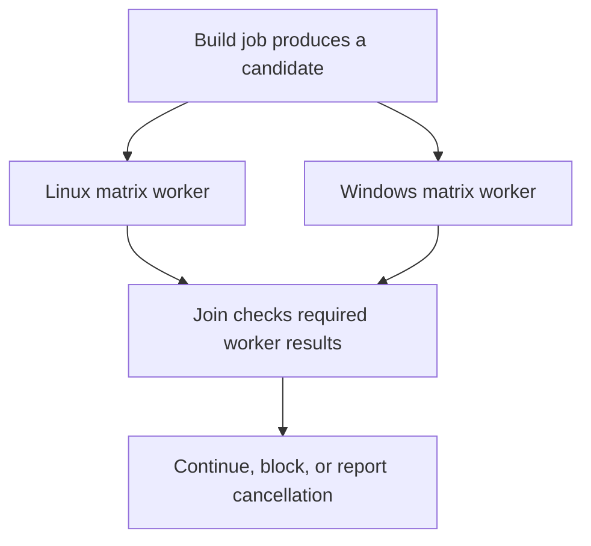

# 0006 · Matrices, job dependencies, cancellation, and failure propagation

!!! note "Placeholder for a future teaching thread"
    This page is a teaching brief. Expand it into a full interactive lesson in its own thread. The planned exercises and outcomes have not been completed or demonstrated.

**Level:** Beginner.

## Prerequisites

- [0005 · Environment files and step, job, and workflow output contracts](0005-environment-files-and-output-contracts.md)
- [0004 · Contexts, expressions, conditions, status, and input types](0004-contexts-expressions-and-conditions.md)

## What you will learn to do

- Draw and explain a workflow DAG with parallel branches and a join.
- Predict the effect of one failing or cancelled matrix member.

## Explain the Actions behavior

Start from the prerequisite workflow or action behavior and introduce these concepts with focused examples:

1. A dependency graph expresses ordering without making every job sequential.
2. A matrix expands a job over selected input combinations.
3. Failure, skipping, fail-fast behavior, and cancellation need intentional propagation rules.

Explain the relevant workflow YAML, expressions, and action code in context. Follow the [shared teaching guide](teaching-guide.md) for pacing, expected output, and progression toward independent design.

## Planned local lab

Create an isolated exercise under `labs/0006/` when the lesson is developed. Explain setup and expected output before each command; reuse installed tools rather than reinstalling them on every step.

1. Design a small test matrix and identify independent versus dependent jobs.
2. Enumerate success, failure, skipped, and cancelled paths before adding conditions.
3. Explain what local emulation can exercise and which scheduling or cancellation decisions need GitHub evidence.

## Break it and diagnose it

Introduce a dependency on a skipped job and diagnose why expected downstream work is absent.

Ask for a prediction first. Capture the smallest reproducer, the actual result, and the corrected behavior. State which remaining claim requires a real GitHub or external-service check.

## Planning diagram



When expanding this lesson, refine the diagram to show the actual processes, branches, data exchange, and trust boundaries being taught.

## Retrieval questions

1. Which jobs can begin concurrently?
2. What should a fan-in job require from each branch?
3. When is cancelling superseded work safe, and when could it interrupt a side effect?

## Evidence to capture in the teaching thread

- A working learner-produced example and an explanation of why it works.
- A reproduced failure, a reasoned repair, and the smallest check that verifies it.
- A short account of remaining limits, unresolved questions, and readiness for the next lesson.

Use [primary references](../references/resources.md) to verify current syntax, runtime support, and tool behavior. Add learning records only for real statements or demonstrated understanding; a placeholder or generated page does not establish mastery.

## Start this lesson in a new thread

```text
/teach 0006

Expand docs/lessons/0006-matrices-dependencies-and-cancellation.md in place using docs/lessons/teaching-guide.md.
Read docs/mission.md, NOTES.md, and the prerequisite lesson pages first.
Begin with a short check of the Actions prerequisites. Explain relevant YAML,
expressions, and action contracts, one concept at a time. Let me predict and
try each exercise before revealing its answer. Keep feedback local where possible.
Finish with retrieval questions and a truthful handoff for the next thread.
```

| Previous | All lessons | Next |
| --- | --- | --- |
| [0005 · Environment files and step, job, and workflow output contracts](0005-environment-files-and-output-contracts.md) | [Curriculum](index.md) | [0049 · Choose popular pre-built actions and verify their publishers](0049-selecting-popular-prebuilt-actions.md) |
