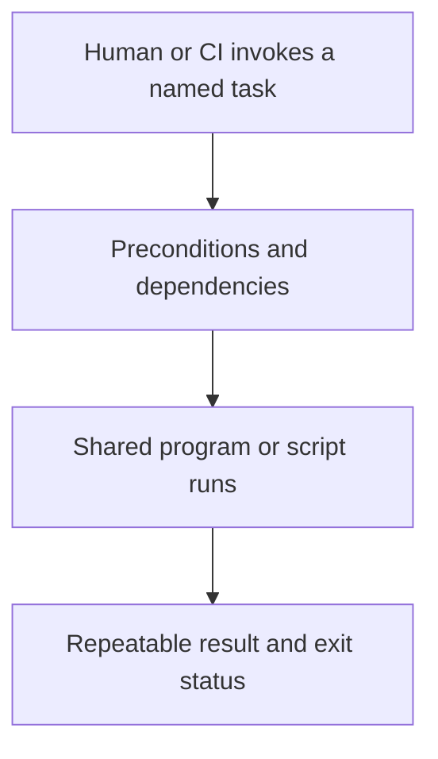

# 0007 · Taskfile as the command contract shared by humans and CI

!!! note "Placeholder for a future teaching thread"
    This page is a teaching brief. Expand it into a full interactive lesson in its own thread. The planned exercises and outcomes have not been completed or demonstrated.

**Level:** Beginner to intermediate.

## Prerequisites

- [0006 · Matrices, job dependencies, cancellation, and failure propagation](0006-matrices-dependencies-and-cancellation.md)

## What you will learn to do

- Create a small Taskfile that runs the same check locally and in CI.
- Explain when a source change should invalidate a cached task.

## Explain the Actions behavior

Start from the prerequisite workflow or action behavior and introduce these concepts with focused examples:

1. A named task exposes a repeatable operation while scripts hold its actual work.
2. Preconditions explain unavailable tools or services before a slow operation begins.
3. Caching and dependency ordering must avoid skipping checks when their real inputs change.

Explain the relevant workflow YAML, expressions, and action code in context. Follow the [shared teaching guide](teaching-guide.md) for pacing, expected output, and progression toward independent design.

## Planned local lab

Create an isolated exercise under `labs/0007/` when the lesson is developed. Explain setup and expected output before each command; reuse installed tools rather than reinstalling them on every step.

1. Read the existing Taskfile and run a targeted documentation or action check.
2. Add a disposable task with a precondition and an explicit underlying script.
3. Compare repeat runs and document why a project should use its existing task runner rather than add another one without a need.

## Break it and diagnose it

Cache a task without declaring an important input, then change that input and diagnose the stale successful result.

Ask for a prediction first. Capture the smallest reproducer, the actual result, and the corrected behavior. State which remaining claim requires a real GitHub or external-service check.

## Planning diagram



When expanding this lesson, refine the diagram to show the actual processes, branches, data exchange, and trust boundaries being taught.

## Retrieval questions

1. What behavior belongs in a task runner versus a program?
2. Which inputs affect whether a check is reusable?
3. Why does sharing a command reduce local/CI drift?

## Evidence to capture in the teaching thread

- A working learner-produced example and an explanation of why it works.
- A reproduced failure, a reasoned repair, and the smallest check that verifies it.
- A short account of remaining limits, unresolved questions, and readiness for the next lesson.

Use [primary references](../references/resources.md) to verify current syntax, runtime support, and tool behavior. Add learning records only for real statements or demonstrated understanding; a placeholder or generated page does not establish mastery.

## Start this lesson in a new thread

```text
/teach 0007

Expand docs/lessons/0007-taskfile-shared-command-contract.md in place using docs/lessons/teaching-guide.md.
Read docs/mission.md, NOTES.md, and the prerequisite lesson pages first.
Begin with a short check of the Actions prerequisites. Explain relevant YAML,
expressions, and action contracts, one concept at a time. Let me predict and
try each exercise before revealing its answer. Keep feedback local where possible.
Finish with retrieval questions and a truthful handoff for the next thread.
```

| Previous | All lessons | Next |
| --- | --- | --- |
| [0054 · Compose an action-based pipeline and maintain its dependencies](0054-compose-maintained-actions-and-manage-updates.md) | [Curriculum](index.md) | [0008 · Workflow linting, shell diagnostics, metadata checks, and security analysis](0008-workflow-shell-and-security-linting.md) |
