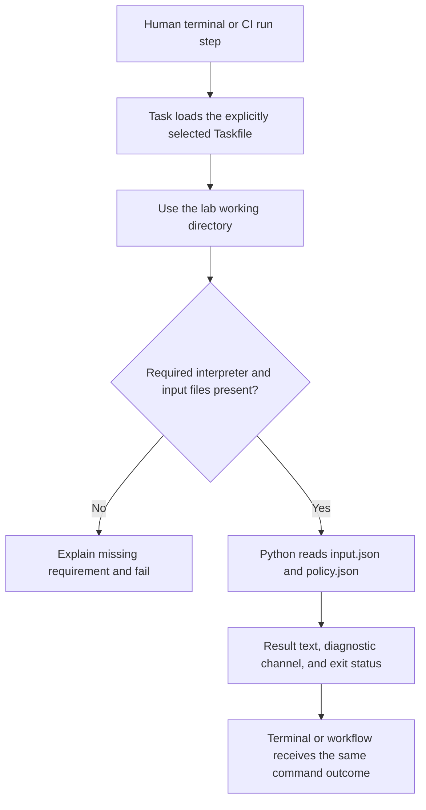

# 0007 · Taskfile as the command contract shared by humans and CI

Use `labs/0007/` to give local development and CI the same commands. Predict when Task will rerun a check and when it will reuse a result.

## Put one command behind the workflow step

Run commands from the repository root using the installed Task v3 and Python from the [local testing guide](../cheatsheet/local-testing.md).

A **command contract** states how to invoke work, what inputs it reads, what result it produces, and how failure is signaled. Task gives that operation a name. The program behind it owns validation and behavior; the workflow owns event admission, permissions, runners, and job dependencies.

The lab's `check.py` reads `input.json` and `policy.json` in its working directory. The input supplies `Ada`; the policy supplies punctuation. It validates both, prints `PASS: Hello, Ada!`, and returns zero. Missing or invalid files produce a `FAIL` diagnostic on stderr and return one. Treat this as a project test command. CI can call it directly without a custom action.



Here is the lab's uncached command:

```yaml title="labs/0007/Taskfile.yml, command excerpt"
version: '3'
dir: '{{.TASKFILE_DIR}}' # (1)!
tasks:
  check:
    preconditions:
      - sh: command -v python3 >/dev/null
        msg: This lab needs the already installed Python 3 interpreter
      - sh: test -f input.json && test -f policy.json
        msg: Run from this lab with both input.json and policy.json present
    cmds:
      - python3 check.py # (2)!
```

1. `TASKFILE_DIR` is a Task template variable. It anchors relative program and fixture paths to the selected Taskfile's directory. This is separate from Actions' `${{ ... }}` expression language.
2. Task starts the command and propagates its failure. The script contains the domain rule; the YAML does not duplicate that rule.

Run the explicit contract twice:

```bash
task --taskfile labs/0007/Taskfile.yml check
task --taskfile labs/0007/Taskfile.yml check
```

Both invocations should execute `python3 check.py`, print `PASS: Hello, Ada!`, and exit **0**. Task also echoes the invoked command, normally on stderr. This task has no up-to-date rule, so a previous successful test does not skip a later run.

!!! tip "Prediction"
    If you invoke the root Taskfile's `check` instead, are you selecting this lab? If a fixture is missing, should the precondition skip successfully or fail?

??? tip "Worked answer"
    Task names belong to the selected Taskfile. The root `check` is a different operation and includes documentation validation. Always include `--taskfile labs/0007/Taskfile.yml` here. A failed precondition is an error with an explanation; it is not successful evidence. Task's own exit code may differ from the underlying program's code, so callers should distinguish zero from nonzero rather than require Task to return exactly one.

[Task's precondition documentation](https://taskfile.dev/docs/guide/conditional-execution) explains that these checks guard the task's commands. Dependencies run before that task's preconditions, so a slow image build needs its engine precondition on the build task itself.

## Give CI the same invocation

`labs/0007/module2-command.yml` is an inactive manual workflow recipe. It checks out repository files, uses the existing project's reviewed `go-task/setup-task` pin to provision Task v3, and invokes exactly:

```yaml title="Workflow run step"
- run: task --taskfile labs/0007/Taskfile.yml check
```

The recipe sets `contents: read`, disables checkout credential persistence, and bounds the job to five minutes. Its Ubuntu runner supplies Python; the host supplies the already installed Python. The shared command reduces drift, but does not guarantee identical OS packages, runtime versions, locale, network, or permissions. Pin and test those environment contracts when they affect the result.

A recipe under `labs/` does not register a GitHub workflow. Inspect the complete file rather than copying only its final step into a job without checkout or Task. The local exercise leaves the recipe under `labs/` and does not dispatch it.

## Separate ordering from parallel prerequisites

A Task `deps` list describes prerequisites that can run concurrently. It does not promise list order. When one task consumes another's generated file, call them sequentially in `cmds`:

```yaml title="labs/0007/Taskfile.yml, ordering excerpt"
ordered:
  cmds:
    - task: build:fixed
    - task: verify-result
```

The first call must finish successfully before the second runs. Independent lint and function tests could instead be dependencies. This resembles [workflow DAG reasoning](0006-matrices-dependencies-and-cancellation.md), but Task dependencies execute local commands; they do not create GitHub jobs or isolated hosted machines. See [Task dependencies and task calls](https://taskfile.dev/docs/guide/dependencies).

## Break caching without breaking the program

An **up-to-date check** allows Task to reuse prior work when declared inputs have not changed. With the checksum method, `sources` contributes file content to the fingerprint; `generates` identifies expected output files. A missing output triggers work again. The source list must include every file affecting the result. Configuration and lockfiles are inputs too. See [Task's up-to-date guide](https://taskfile.dev/docs/guide/up-to-date).

The lab contrasts these definitions:

```yaml title="labs/0007/Taskfile.yml, deliberately incomplete and repaired inputs"
build:bad:
  sources: [check.py, input.json] # (1)!
  generates: [result.json]
  cmds: [python3 check.py --write]
build:fixed:
  sources: [check.py, input.json, policy.json] # (2)!
  generates: [result.json]
  cmds: [python3 check.py --write]
```

1. The program reads `policy.json`, but the fingerprint omits it. The definition can therefore reuse stale work.
2. Both data files and the program now affect freshness. External service state or undeclared environment values would still need their own strategy.

!!! tip "Predict the stale success"
    Build with punctuation `!`, repeat without changes, then change only the policy to `?`. What will `build:bad` do? What will an independent comparison against the current policy report?

Run the complete experiment without modifying shared files or leaving cache files in the checkout:

```bash
uv run --no-sync python labs/0007/cache_demo.py
```

The test script copies this lab into a temporary directory and selects the copy's absolute Taskfile path. It performs these steps:

| Step | Expected result |
| --- | --- |
| Uncached `check` | `PASS: Hello, Ada!` |
| First `build:bad` | `BUILT: Hello, Ada!` |
| Repeat `build:bad` | Task reports it is up to date |
| Change policy to `?`, repeat bad build | Still reported up to date; stale `!` remains |
| `verify-result` | Nonzero; actual `Hello, Ada!`, expected `Hello, Ada?` |
| `build:fixed`, then verification | Rebuild with `?`; comparison passes |
| Change policy back and call `ordered` | Rebuild with `!` before comparison; passes |
| Remove the input and call `check` | Nonzero with the explicit missing-file message |

Both failures are expected. The test script exits 0 after confirming them and ends with:

```text
PASS: stale cache detected, policy tracked, missing input explained
```

??? tip "Diagnosis and durable repair"
    First inspect whether the script ran at all. An up-to-date message means the program never examined the new policy. Compare the files the program reads with the task's `sources`, add `policy.json`, and rebuild with the fixed task. Clearing the cache only forces one rerun. Adding the missing input makes future policy changes trigger the task. Keep the independent verification because a generated file's existence does not prove its contents match the current contract.

Avoid caching test success casually. Tests may depend on interpreter versions, environment values, generated artifacts, or remote state beyond a short source list. This lab keeps `check` uncached and uses caching only for the explicit generated-result experiment. No task runner can infer all dependencies of arbitrary programs.

## Transfer and retrieval

A packaging command reads `src/`, `package.json`, a lockfile, and a configuration file, then writes a bundle that a test executes. Propose the source list, output declaration, and ordering. Decide whether to cache the test itself.

??? tip "Worked transfer"
    Track the source tree, configuration, manifest, lockfile, and build script; declare the bundle as generated output. Call the build before the test when the test consumes it. Include toolchain identity or avoid reuse when that identity cannot be represented reliably. Keep a verification gate that detects a stale shipped bundle rather than rebuilding silently inside a comparison.

Answer from memory:

1. Which responsibilities remain in the workflow after it calls Task?
2. How does a failed precondition differ from an up-to-date result?
3. Why is `deps: [build, verify]` insufficient when verification consumes the build?
4. Why did a successful cached task leave the lab's current contract unverified?

??? tip "Retrieval check"
    The workflow still selects events, identity, runners, and jobs. A precondition failure blocks execution; an up-to-date decision reuses declared prior work. Dependencies can run concurrently, while sequential task calls establish order. The cache omitted a real input, so its green result described an older contract.

## Verification limits and next lesson

The lab observes actual Task invocation, file fingerprints, ordering, and exit propagation. It does not prove runner provisioning or GitHub policy. Continue to [0008 · Linting layers](0008-workflow-shell-and-security-linting.md) to choose static checks for the shared command's workflow caller.

Primary Task pages above and the [curated source library](../references/resources.md) were checked on **2026-10-30**. The module handoff records executed commands and environment limits.

| Previous lesson | All lessons | Next lesson |
| --- | --- | --- |
| [0006 · Matrices, job dependencies, cancellation, and failure propagation](0006-matrices-dependencies-and-cancellation.md) | [Curriculum](index.md) | [0008 · Workflow linting, shell diagnostics, metadata checks, and security analysis](0008-workflow-shell-and-security-linting.md) |
