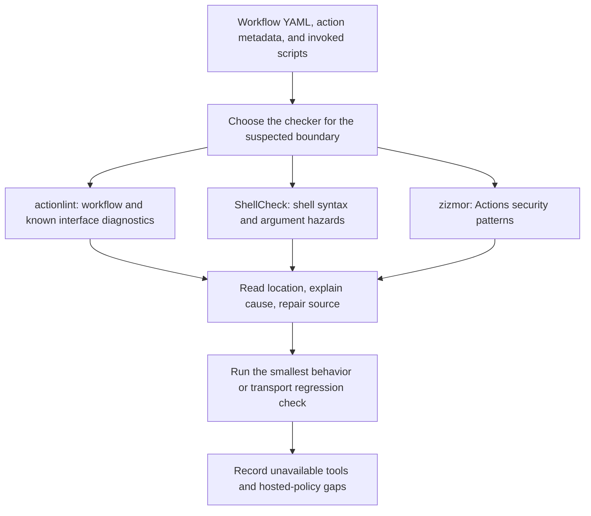

# 0008 · Workflow linting, shell diagnostics, metadata checks, and security analysis

!!! note "Authored reference lesson"
    The intentionally defective examples under `labs/0008/` are diagnostic fixtures. Inspect the unsafe workflow; do not execute it. Predictions and collapsed solutions support a guided session without claiming learner mastery.

## Prerequisites and goal

Read [0007 · Shared command contracts](0007-taskfile-shared-command-contract.md), and retrieve [0004 · Expressions versus shell evaluation](0004-contexts-expressions-and-conditions.md). A workflow expression is evaluated before a shell interprets its script. That boundary explains several defects in this lesson.

Match an incorrect context, a wrong action input, a shell argument bug, and untrusted source interpolation to useful checkers. Success means you can interpret a diagnostic, repair the source, and name the claim a clean report leaves untested. Use installed tools; do not install ShellCheck or zizmor as part of validation.

## Static evidence answers source questions

**Static analysis** inspects source without executing the workflow's jobs. A workflow parser can accept valid YAML that still contains an invalid Actions expression. A shell checker can find argument handling defects but cannot establish GitHub token policy. Security analyzers examine trust and capability patterns; a clean report is not proof that every execution path is safe.



| Layer | Useful question | What a clean result does not establish |
| --- | --- | --- |
| actionlint | Are workflow keys, expressions, and known local action inputs valid? | Arbitrary program output, credentials, or all runtime conditions |
| ShellCheck | Does a shell expansion split or glob unexpectedly? | The workflow's complete event and authorization policy |
| zizmor | Does the workflow expose recognized Actions security risks? | Absence of all vulnerabilities or correct application behavior |
| Direct process test | Did this concrete input preserve arguments, outputs, and failure status? | All possible inputs or actual GitHub enforcement |

There is overlap. The installed actionlint **also detects potentially untrusted expression interpolation**. Do not teach that a security problem can only be found by one dedicated tool. The maintained [actionlint checks](https://github.com/rhysd/actionlint/blob/main/docs/checks.md) describe its scope; [its usage guide](https://github.com/rhysd/actionlint/blob/main/docs/usage.md) explains optional external shell analysis.

## Read two precise workflow diagnostics

Run from the repository root. First check the repaired workflow:

```bash
.tools/bin/actionlint -no-color labs/0008/good.yml
```

Expected: **exit 0 and no diagnostics**. The workflow uses `github.ref`, checks out repository files, then passes `name: Ada` to `./examples/javascript-action`. It is inactive under `labs/`, and linting does not run any action.

!!! tip "Prediction"
    The bad context is `${{ githb.ref }}`. The bad action input is `recipient: Ada`. Which mistake belongs to expression scope, and which belongs to the action's published interface?

Run the defective fixtures separately from the passing check:

```bash
.tools/bin/actionlint -no-color labs/0008/bad-expression.yml labs/0008/bad-metadata.yml
```

Expected: **exit 1** with these diagnostic fragments and source locations:

```text
bad-expression.yml:11:20: undefined variable "githb"
bad-metadata.yml:14:11: input "recipient" is not defined
```

The second diagnostic names `JavaScript greeting` and lists its supported input `name`. The tool reads known local action metadata to validate the call. Checking a consumer is different from executing that action, and actionlint is not a general validator for every arbitrary `action.yml` implementation.

??? tip "Repair both boundaries"
    Correct `githb` to `github`, then inspect `examples/javascript-action/action.yml` and change `recipient` to `name`. The repaired fixture is `good.yml`. A shell quoting change cannot repair an unknown context, and changing token permissions cannot create an unsupported input.

For active workflows the existing shared command is `task lint:workflows`. It does not automatically discover every inactive lesson recipe; pass explicit lab workflow paths as above. Do not pass `action.yml` to a workflow linter as if it were itself a workflow.

## Why suppressing a shell warning can leave a real bug

A workflow can pass event text through `env`, then lose its argument boundary in an invoked shell script:

```bash title="labs/0008/bad.sh — intentionally defective excerpt"
# shellcheck disable=SC2086
printf '<%s>\n' $TITLE # (1)!
```

1. Without quotes, Bash splits the variable's contents into words and expands wildcard patterns. The suppression changes the analyzer's report, not Bash's behavior.

The repaired program is one line:

```bash title="labs/0008/good.sh — repair"
printf '<%s>\n' "$TITLE"
```

[ShellCheck SC2086](https://www.shellcheck.net/wiki/SC2086) documents the argument-splitting and globbing problem. This is the amount of shell knowledge needed here: one Actions data value should remain one argument.

!!! tip "Predict before running"
    `TITLE` contains `two words * $(printf injected)`, and the working directory contains `visible.txt`. Does the bad script print one record? Will the shell-like text be evaluated as a new command merely because it arrived through an environment variable?

```bash
uv run --no-sync python labs/0008/shell_probe.py --bad
```

Expected: the **script** exits zero, but the **probe** exits **1** because it expected one literal argument. Its observed stdout is:

```text
<two>
<words>
<visible.txt>
<$(printf>
<injected)>
```

Now run the repair:

```bash
uv run --no-sync python labs/0008/shell_probe.py
```

Expected: **exit 0**, one record containing the literal `*` and `$(printf injected)`, followed by:

```text
PASS: spaces, glob, and shell-like text stayed in one data argument
```

The helper uses a temporary directory, a known fixture value, and actual Bash processes. It performs no external write or network call.

??? tip "Worked diagnosis"
    The bad program's zero status only says `printf` ran. Word splitting changed the interface, and `*` expanded to the fixture filename. Ordinary variable expansion does not recursively parse its value as shell source, so the command-substitution-looking text remained data. Quote the variable and keep the argument assertion. Removing the suppression would expose a useful warning when ShellCheck is available, but would not itself repair the runtime behavior.

ShellCheck and zizmor were **not installed** in the authoring environment. No claim that they ran is justified. If an environment already provides ShellCheck, use `shellcheck labs/0008/good.sh`. To see SC2086 on the bad case, remove its explicit suppression in a disposable copy before checking it. Actionlint invokes ShellCheck for applicable inline shell scripts when that executable is available; its own zero status does not establish that optional integration ran.

## Source interpolation crosses a different trust boundary

Inspect `labs/0008/unsafe-template.yml`:

```yaml title="Inspect only — intentionally unsafe step"
- shell: bash
  run: printf '%s\n' "${{ github.event.pull_request.title }}" # (1)!
```

1. Actions substitutes contributor-controlled text into script source before Bash parses it. Shell quotes written around the expression do not make that substitution safe: the inserted text can itself contain syntax.

The repair in `safe-template.yml` preserves the data boundary:

```yaml title="labs/0008/safe-template.yml — step excerpt"
- shell: bash
  env:
    TITLE: ${{ github.event.pull_request.title }}
  run: printf '%s\n' "$TITLE"
```

Run the static pair as two commands:

```bash
.tools/bin/actionlint -no-color labs/0008/unsafe-template.yml
.tools/bin/actionlint -no-color labs/0008/safe-template.yml
```

Expected: the unsafe example exits **1**, identifies `github.event.pull_request.title` as potentially untrusted, and recommends an environment variable. The repair exits **0**. Do not dispatch or run the unsafe example with `act`; static diagnosis is sufficient for this fixture.

GitHub's [secure-use reference](https://docs.github.com/en/actions/reference/security/secure-use) and zizmor's [template-injection audit](https://docs.zizmor.sh/audits/#template-injection) explain this source/data distinction. If zizmor is already installed, an optional independent check is:

```bash
zizmor --offline labs/0008/unsafe-template.yml
zizmor --offline labs/0008/safe-template.yml
```

The first should include a template-injection finding; either file can receive other diagnostics depending on the installed rules and configuration. Review the actual rule names rather than assuming the repaired file has no other findings. [Offline mode](https://docs.zizmor.sh/usage/) avoids network-dependent audits and therefore provides less coverage than a separately configured online audit. Neither command was executed here.

## Transfer and retrieval

A workflow passes a contributor's branch name to a script that invokes a reporting tool. The linter is quiet after a broad ignore rule was added. Specify the transport, runtime assertion, and review evidence you would require.

??? tip "Worked transfer"
    Map the branch name through a step environment variable and pass it as a quoted argument. Test a name containing spaces, wildcard characters, and shell-like text against the receiving program's argument contract. Remove or narrow the broad ignore and explain any remaining exception. Review whether the reporting tool itself interprets option-like input or performs writes; shell quoting alone does not establish its domain policy.

Retrieve without reopening the examples:

1. Why can valid YAML contain an invalid Actions context?
2. What can inspecting local action metadata catch before a runner starts?
3. Why can a suppressed warning and a zero script exit still hide a defect?
4. How do direct expression interpolation and quoted environment expansion differ?
5. What evidence would show that optional ShellCheck analysis actually ran?

??? tip "Retrieval check"
    YAML structure and Actions expression scope are different languages. Metadata exposes supported input names. Suppression only changes diagnostics, and zero exit does not assert argument meaning. Interpolation edits source before parsing; quoted environment expansion supplies data during execution. Record the executable/version and actual ShellCheck invocation or integration log; actionlint's success alone is insufficient.

## Verification sequence and limits

For these labs, use explicit workflow linting and the direct argument probe. A changed program also needs its behavior tests; credentials, environment approvals, and actual event admission still require selected GitHub evidence. The next lesson develops fixture and output-file assertions.

!!! note "Documentation validation timing"
    Do not add root `task check` to this sequence: it includes documentation checks. The coordinator will run **one whole-site `task docs:verify` only after all 24 lessons and shared edits are integrated**. No Markdown, link, Mermaid, or Zensical validation runs in this module thread.

Primary tool and GitHub references linked above were checked on **2026-10-30**, starting from the [curated library](../references/resources.md). Record unavailable optional analyzers separately from passing installed-tool checks. No learner-produced diagnosis has yet been observed.

## Start this lesson in a new thread

```text
/teach 0008

Use docs/lessons/0008-workflow-shell-and-security-linting.md and labs/0008/.
Read docs/mission.md, NOTES.md, docs/lessons/teaching-guide.md, and lessons 0004 and 0007.
Ask me to classify expression, metadata, argument, and template-injection defects.
Pause for predictions before solutions; inspect the unsafe workflow without running it.
Use installed analyzers only. Record unavailable coverage and actual learner evidence.
Continue to lesson 0009; preserve coordinator-only documentation validation for this batch.
```

| Previous Lesson | All Lessons | Next Lesson |
| --- | --- | --- |
| [0007 · Taskfile command contract](0007-taskfile-shared-command-contract.md) | [Curriculum](index.md) | [0009 · Tests, fixtures, and output files](0009-unit-tests-fixtures-and-output-files.md) |
