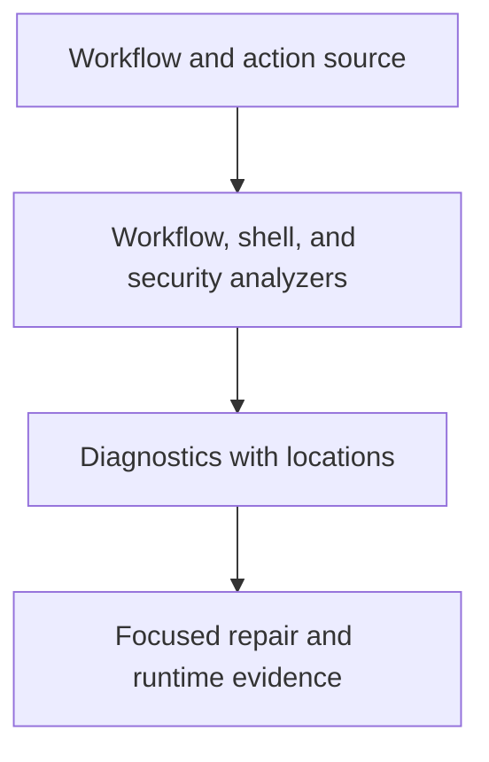

# 0008 · Workflow linting, shell diagnostics, metadata checks, and security analysis

!!! note "Placeholder for a future teaching thread"
    This page is a teaching brief. Expand it into a full interactive lesson in its own thread. The planned exercises and outcomes have not been completed or demonstrated.

**Level:** Beginner to intermediate.

## Prerequisites

- [0007 · Taskfile as the command contract shared by humans and CI](0007-taskfile-shared-command-contract.md)

## What you will learn to do

- Match a configuration, shell, or trust-boundary defect to an appropriate checker.
- Interpret a diagnostic and show the behavior it cannot establish.

## Explain the Actions behavior

Start from the prerequisite workflow or action behavior and introduce these concepts with focused examples:

1. Static checks inspect source without executing the workflow.
2. Workflow, shell, and security tools examine different classes of mistakes.
3. A clean static report complements runtime evidence instead of replacing it.

Explain the relevant workflow YAML, expressions, and action code in context. Follow the [shared teaching guide](teaching-guide.md) for pacing, expected output, and progression toward independent design.

## Planned local lab

Create an isolated exercise under `labs/0008/` when the lesson is developed. Explain setup and expected output before each command; reuse installed tools rather than reinstalling them on every step.

1. Run the installed workflow checker on the existing workflows.
2. Introduce isolated examples of a bad expression and an unquoted shell value, then inspect relevant diagnostics.
3. Consult primary tool documentation before adding ShellCheck or zizmor to the local contract; keep installation separate from validation.

## Break it and diagnose it

Suppress a diagnostic without repairing the underlying input or trust problem. Explain why the program can still fail despite a clean report.

Ask for a prediction first. Capture the smallest reproducer, the actual result, and the corrected behavior. State which remaining claim requires a real GitHub or external-service check.

## Planning diagram



When expanding this lesson, refine the diagram to show the actual processes, branches, data exchange, and trust boundaries being taught.

## Retrieval questions

1. Which mistakes can be found without a runner?
2. What does a security diagnostic say about an execution path?
3. When is a runtime regression test still required?

## Evidence to capture in the teaching thread

- A working learner-produced example and an explanation of why it works.
- A reproduced failure, a reasoned repair, and the smallest check that verifies it.
- A short account of remaining limits, unresolved questions, and readiness for the next lesson.

Use [primary references](../references/resources.md) to verify current syntax, runtime support, and tool behavior. Add learning records only for real statements or demonstrated understanding; a placeholder or generated page does not establish mastery.

## Start this lesson in a new thread

```text
/teach 0008

Expand docs/lessons/0008-workflow-shell-and-security-linting.md in place using docs/lessons/teaching-guide.md.
Read docs/mission.md, NOTES.md, and the prerequisite lesson pages first.
Begin with a short check of the Actions prerequisites. Explain relevant YAML,
expressions, and action contracts, one concept at a time. Let me predict and
try each exercise before revealing its answer. Keep feedback local where possible.
Finish with retrieval questions and a truthful handoff for the next thread.
```

| Previous | All lessons | Next |
| --- | --- | --- |
| [0007 · Taskfile as the command contract shared by humans and CI](0007-taskfile-shared-command-contract.md) | [Curriculum](index.md) | [0009 · Unit tests, event fixtures, and temporary output files](0009-unit-tests-fixtures-and-output-files.md) |
