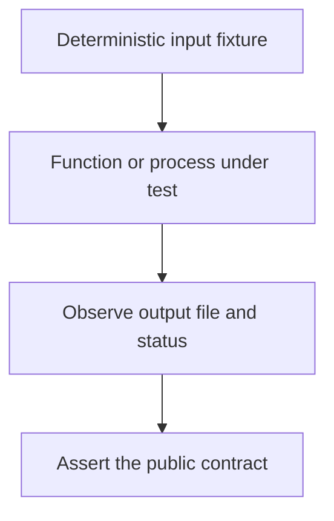

# 0009 · Unit tests, event fixtures, and temporary output files

!!! note "Placeholder for a future teaching thread"
    This page is a teaching brief. Expand it into a full interactive lesson in its own thread. The planned exercises and outcomes have not been completed or demonstrated.

**Level:** Beginner to intermediate.

## Prerequisites

- [0008 · Workflow linting, shell diagnostics, metadata checks, and security analysis](0008-workflow-shell-and-security-linting.md)
- [0005 · Environment files and step, job, and workflow output contracts](0005-environment-files-and-output-contracts.md)

## What you will learn to do

- Write complementary function and entrypoint tests.
- Demonstrate failure without publishing a success output.

## Explain the Actions behavior

Start from the prerequisite workflow or action behavior and introduce these concepts with focused examples:

1. Pure-function tests isolate transformation and validation behavior.
2. Process-adapter tests observe real environment input, output files, stderr, and exit status.
3. Fixtures should make successful, invalid, and missing-input cases reproducible without real credentials.

Explain the relevant workflow YAML, expressions, and action code in context. Follow the [shared teaching guide](teaching-guide.md) for pacing, expected output, and progression toward independent design.

## Planned local lab

Create an isolated exercise under `labs/0009/` when the lesson is developed. Explain setup and expected output before each command; reuse installed tools rather than reinstalling them on every step.

1. Inspect the existing JavaScript unit tests and shared action-process tests.
2. Add an input fixture and an assertion on the actual output-file contents.
3. Cover missing output paths, prior file content, invalid values, and shell-like text treated as literal data.

## Break it and diagnose it

Return a successful exit code after input validation fails. Use a process test to expose the false success.

Ask for a prediction first. Capture the smallest reproducer, the actual result, and the corrected behavior. State which remaining claim requires a real GitHub or external-service check.

## Planning diagram



When expanding this lesson, refine the diagram to show the actual processes, branches, data exchange, and trust boundaries being taught.

## Retrieval questions

1. What boundary does a function test miss?
2. Why test stderr and exit status separately?
3. How would you detect a partially written success result after a failure?

## Evidence to capture in the teaching thread

- A working learner-produced example and an explanation of why it works.
- A reproduced failure, a reasoned repair, and the smallest check that verifies it.
- A short account of remaining limits, unresolved questions, and readiness for the next lesson.

Use [primary references](../references/resources.md) to verify current syntax, runtime support, and tool behavior. Add learning records only for real statements or demonstrated understanding; a placeholder or generated page does not establish mastery.

## Start this lesson in a new thread

```text
/teach 0009

Expand docs/lessons/0009-unit-tests-fixtures-and-output-files.md in place using docs/lessons/teaching-guide.md.
Read docs/mission.md, NOTES.md, and the prerequisite lesson pages first.
Begin with a short check of the Actions prerequisites. Explain relevant YAML,
expressions, and action contracts, one concept at a time. Let me predict and
try each exercise before revealing its answer. Keep feedback local where possible.
Finish with retrieval questions and a truthful handoff for the next thread.
```

| Previous | All lessons | Next |
| --- | --- | --- |
| [0008 · Workflow linting, shell diagnostics, metadata checks, and security analysis](0008-workflow-shell-and-security-linting.md) | [Curriculum](index.md) | [0010 · Container engines, Linux images, sockets, and CPU architecture](0010-container-engines-images-and-architecture.md) |
