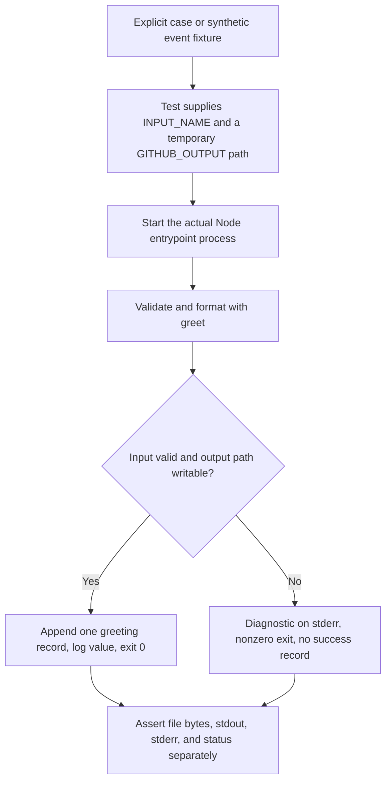

# 0009 · Unit tests, event fixtures, and temporary output files

Use the isolated implementation in `labs/0009/` to test the function and the real Node process. Predict which defects each test can catch.

## Separate behavior from transport

The lab copies the existing greeting example into `labs/0009/`, so experiments do not alter shared actions. `greet.cjs` exports a **pure function**: it accepts a name, returns a greeting, and rejects nonstring, blank, or multiline input. It does not read environment variables or write files.

`index.cjs` is the **process adapter**. It reads `INPUT_NAME`, supplies the default `World` when that environment value is absent, calls the function, appends a record to `GITHUB_OUTPUT`, and logs the greeting. Errors go to stderr and set a nonzero process status.



A function-only test can prove formatting and validation while missing a wrong environment variable, an incorrect output path, or a swallowed exception. A process-only failure is harder to locate without a focused function check. Choose both when both boundaries matter, rather than forcing every assertion through a runner.

## Run the smallest behavior tests first

Use the installed Node 24 and Python. These tests need no container engine, credentials, or network access.

Before running, predict the greeting for `  Ada  `, the result for `रोहित`, and whether `$(exit 99)` is executed.

```bash
node --test labs/0009/greet.test.cjs
```

Expected: **2 tests pass**, exit **0**. One test checks whitespace normalization, Unicode, and literal shell-like text. The other checks nonstrings, blank values, and CR/LF rejection. [Node's test runner](https://nodejs.org/docs/latest-v24.x/api/test.html) provides `node --test` without a third-party testing framework.

??? tip "Worked prediction"
    The function returns `Hello, Ada!` after trimming and preserves Unicode. Shell-like text is a string passed to JavaScript, with no shell evaluation. Blank names and embedded newlines throw before a greeting exists. The default `World` belongs to the adapter; calling the function with `undefined` should still fail.

Inspect the adapter's public boundary:

```javascript title="labs/0009/index.cjs, adapter excerpt"
try {
  const greeting = greet(process.env.INPUT_NAME ?? 'World'); // (1)!
  if (!process.env.GITHUB_OUTPUT) {
    throw new Error('GITHUB_OUTPUT must be set');
  }
  appendFileSync(process.env.GITHUB_OUTPUT, `greeting=${greeting}\n`, 'utf8'); // (2)!
  console.log(greeting);
} catch (error) {
  console.error(error.message);
  process.exitCode = 1; // (3)!
}
```

1. Absent input uses the default. An explicitly empty string remains empty and is rejected. This direct test does not ask a runner to apply metadata defaults.
2. The simple `name=value` output format is safe for this deliberately single-line value. `appendFileSync` preserves earlier records. A log line alone would not publish a named output.
3. A diagnostic does not fail a process automatically. Setting the status makes the error visible to the caller and eventually the workflow step.

The [GitHub output-file protocol](https://docs.github.com/en/actions/reference/workflows-and-actions/workflow-commands#setting-an-output-parameter) specifies the runner boundary. Arbitrary multiline values need the documented delimiter format or another transport; this lab rejects them rather than pretending a single-line parser is general.

## Fixtures make cases repeatable

A **fixture** is controlled test data. `cases.json` has ten named cases with independent expected values or error fragments. The test script treats JSON `null` as an instruction to leave `INPUT_NAME` unset.

| Case group | Expected contract |
| --- | --- |
| Absent input | `greeting=Hello, World!` plus newline |
| Ordinary, padded, Unicode names | Correct normalized greeting |
| Shell-like text and `a=b` | Literal text stays in the value |
| Empty or whitespace-only | Nonzero exit; diagnostic; no greeting record |
| Name containing LF or CR | Nonzero exit; no injected output record |

The expected string is stored in each fixture; the process assertion does not call `greet()` to calculate its own expected answer. Otherwise the same formatting bug could affect both sides of the comparison.

```bash
node --test labs/0009/contract.test.cjs
```

Expected: **14 tests pass**, exit **0**: ten fixture cases and four additional file/failure cases. Running both suites together produces **16 passing tests**:

```bash
node --test labs/0009/greet.test.cjs labs/0009/contract.test.cjs
```

Each process case creates its own temporary directory and an output filename containing spaces. The test script removes inherited `INPUT_NAME` and `GITHUB_OUTPUT` values, then sets the values for that case. It invokes Node without a shell and removes the directory afterward. This prevents a developer's input values or leftover output file from making a test pass accidentally.

!!! tip "Predict the four extra cases"
    What should happen when the file already contains `existing=value`, when validation fails with that prior record present, when the output variable is absent, and when its path points at a directory?

??? tip "Worked file assertions"
    Success appends `greeting=Hello, Ada!` after `existing=value`; it does not truncate the earlier record. Invalid input leaves the prior bytes unchanged. Missing `GITHUB_OUTPUT` fails with a named diagnostic. A directory cannot receive an appended output record, so the real write fails and the adapter must return nonzero. For either failure, the test requires no success log and no new greeting record. It does not depend on the operating system's error wording.

The tests observe the actual file bytes, stdout, stderr, and status. They do not source the output file as shell code, and they do not implement GitHub's complete parser. Exact byte comparisons are sufficient for the small single-line contract.

## Bridge one event fixture to the action input

`dispatch.json` contains a minimal synthetic manual payload:

```json title="labs/0009/dispatch.json"
{"inputs": {"name": "Grace"}}
```

Run the local bridge:

```bash
uv run --no-sync python labs/0009/event_probe.py labs/0009/dispatch.json
```

Expected:

```text
fixture inputs.name='Grace'
exit=0; stdout='Hello, Grace!\n'; output='greeting=Hello, Grace!\n'
```

The bridge reads `inputs.name`, sets the action's environment input, supplies temporary output storage, and invokes the real lab entrypoint. It also supplies `GITHUB_EVENT_NAME` and `GITHUB_EVENT_PATH` for an explicit local event context; this particular action reads `INPUT_NAME`, not the payload itself. The bridge is test code acting like a caller, not a GitHub dispatcher or an Actions expression evaluator.

In a disposable copy, remove `name` from the `inputs` object and predict the default. Then set `name` to an empty string and predict failure. Removing the whole `inputs` object instead produces a fixture-shape diagnostic. These are different contracts. A PR fixture cannot prove dispatch defaults or fork permission behavior merely by containing similar text. Revisit [0003 · Payload shape and event admission](0003-events-payloads-and-filters.md).

## Break failure signaling while keeping validation correct

`broken.cjs` deliberately catches the same exception and prints the same diagnostic but omits `process.exitCode = 1`. Predict which suites can detect that defect before running:

```bash
env LAB_ADAPTER=broken node --test labs/0009/contract.test.cjs
```

Expected: the test command exits **1**, with **7 passing and 7 failing tests**. Success cases still pass. Invalid-input, prior-record failure, missing-output-path, and write-failure cases expose status zero where a failure was required. The pure function tests remain green because the validation function did not change.

??? tip "Diagnose and repair"
    Begin with the assertion `invalid input must fail the process`, then inspect the child's status and stderr. A visible error message with status zero indicates the adapter swallowed failure. Restore `process.exitCode = 1` in your own experimental copy, or select the already repaired `index.cjs` by running without `LAB_ADAPTER=broken`. The ordinary combined command should again report 16 passing tests. Do not weaken the test to accept a log line as failure evidence.

A second mutation exercise is replacing append with overwrite in an isolated copy. Predict which specific file test fails and why ordinary empty-file success cases might still pass. Restore append behavior after observing the mismatch.

## Transfer and retrieval

A repository-report action accepts an event payload and returns a numeric finding count plus a report file. Design one pure-function test, one adapter test, and one downstream wiring check. Include a malformed payload and a failed output write.

??? tip "Worked transfer"
    Unit-test the report transformation with deterministic event data. Invoke the real adapter with a temporary event path and output directory, asserting the count record, report bytes, stderr, and status. On validation or write failure, require nonzero status and no new success output. Use a selected workflow job to check the consumer's named-output mapping; neither the function nor the adapter test evaluates that mapping. If partial files can remain after failure, define their cleanup or invalid-state contract explicitly.

Answer from memory:

1. Which adapter defects can a function test miss?
2. Why is an absent input different from an empty input?
3. Why prepopulate the output file in one case?
4. What does the event bridge test, and what does it leave untested?
5. Why must a failed process publish neither status zero nor a success result?

??? tip "Retrieval check"
    Transport names, file writes, and exit propagation live outside the pure function. Absence can trigger a default while empty text violates validation. A prior record detects accidental truncation and failure-path corruption. The bridge checks payload-to-input handling for a fixture, not trigger delivery, metadata evaluation, or permission policy. Downstream steps commonly trust both success status and outputs, so misleading evidence can admit invalid work.

## Check sequence and limits

Use the function/process tests while editing these isolated files. The shared `task test` checks the project's existing examples, so it does **not** automatically include new lab tests. A passing direct suite leaves action metadata, caller output mapping, image compatibility, and actual GitHub output processing outside its scope. The next lesson diagnoses the container environment before attempting that extra boundary.

Primary Node and GitHub references linked above were checked on **2026-10-30** through the [source library](../references/resources.md). The module handoff records author test results.

| Previous lesson | All lessons | Next lesson |
| --- | --- | --- |
| [0008 · Workflow linting, shell diagnostics, metadata checks, and security analysis](0008-workflow-shell-and-security-linting.md) | [Curriculum](index.md) | [0010 · Container engines, Linux images, sockets, and CPU architecture](0010-container-engines-images-and-architecture.md) |
