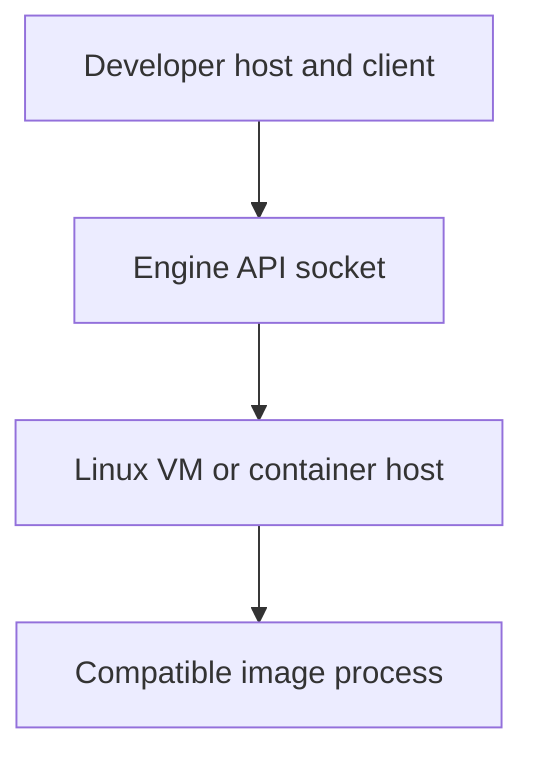

# 0010 · Container engines, Linux images, sockets, and CPU architecture

!!! note "Placeholder for a future teaching thread"
    This page is a teaching brief. Expand it into a full interactive lesson in its own thread. The planned exercises and outcomes have not been completed or demonstrated.

**Level:** Beginner to intermediate.

## Prerequisites

- [0009 · Unit tests, event fixtures, and temporary output files](0009-unit-tests-fixtures-and-output-files.md)

## What you will learn to do

- Locate the actual container engine and diagnose an unavailable socket.
- Explain an architecture mismatch separately from an action-code defect.

## Explain the Actions behavior

Start from the prerequisite workflow or action behavior and introduce these concepts with focused examples:

1. An image packages a filesystem and startup configuration; a container is a running instance.
2. A container engine may run in a VM and exposes an API socket to clients.
3. Operating system and CPU architecture affect executable and image compatibility.

Explain the relevant workflow YAML, expressions, and action code in context. Follow the [shared teaching guide](teaching-guide.md) for pacing, expected output, and progression toward independent design.

## Planned local lab

Create an isolated exercise under `labs/0010/` when the lesson is developed. Explain setup and expected output before each command; reuse installed tools rather than reinstalling them on every step.

1. Inspect the installed Docker or Podman client and engine connection without changing global configuration.
2. Identify host, VM, image, and process architectures in a small environment map.
3. Plan a minimal image run and document the connection prerequisites before attempting container tests.

## Break it and diagnose it

Use an unavailable socket or incompatible image architecture in a disposable test and classify the resulting environment failure.

Ask for a prediction first. Capture the smallest reproducer, the actual result, and the corrected behavior. State which remaining claim requires a real GitHub or external-service check.

## Planning diagram



When expanding this lesson, refine the diagram to show the actual processes, branches, data exchange, and trust boundaries being taught.

## Retrieval questions

1. How does an image differ from a running container?
2. Which machine must provide the engine socket?
3. Why can a command named docker still connect to a different engine?

## Evidence to capture in the teaching thread

- A working learner-produced example and an explanation of why it works.
- A reproduced failure, a reasoned repair, and the smallest check that verifies it.
- A short account of remaining limits, unresolved questions, and readiness for the next lesson.

Use [primary references](../references/resources.md) to verify current syntax, runtime support, and tool behavior. Add learning records only for real statements or demonstrated understanding; a placeholder or generated page does not establish mastery.

## Start this lesson in a new thread

```text
/teach 0010

Expand docs/lessons/0010-container-engines-images-and-architecture.md in place using docs/lessons/teaching-guide.md.
Read docs/mission.md, NOTES.md, and the prerequisite lesson pages first.
Begin with a short check of the Actions prerequisites. Explain relevant YAML,
expressions, and action contracts, one concept at a time. Let me predict and
try each exercise before revealing its answer. Keep feedback local where possible.
Finish with retrieval questions and a truthful handoff for the next thread.
```

| Previous | All lessons | Next |
| --- | --- | --- |
| [0009 · Unit tests, event fixtures, and temporary output files](0009-unit-tests-fixtures-and-output-files.md) | [Curriculum](index.md) | [0011 · Run one event and one job with act](0011-act-targeted-workflow-smoke-tests.md) |
