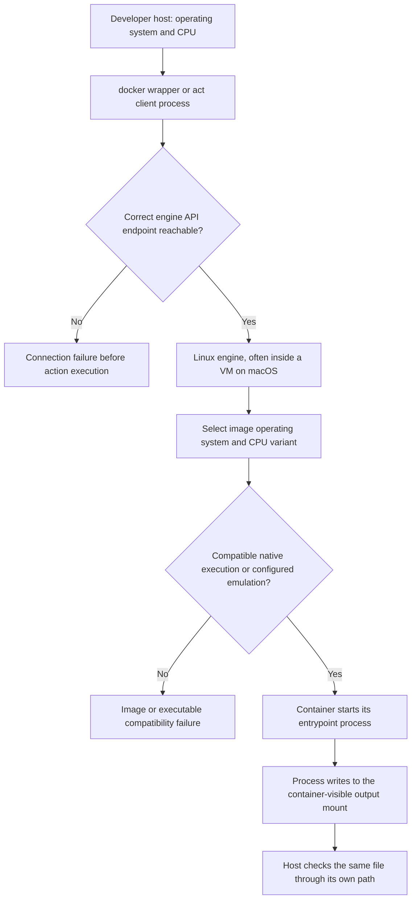

# 0010 · Container engines, Linux images, sockets, and CPU architecture

!!! note "Authored reference lesson"
    Host diagnostics and a small image probe are developed under `labs/0010/`. The authoring environment had a stopped Podman VM, so image execution is explicitly deferred. A developed exercise is not evidence that its container ran or that the learner mastered it.

## Prerequisites and goal

Read [0009 · Function and process boundaries](0009-unit-tests-fixtures-and-output-files.md). Explain why running a Docker action's Python program on macOS does not prove its Linux image, entrypoint, or mounted output path works.

Locate a failure at the client, engine connection, image, CPU, or process boundary before editing action code. Success means you can draw an environment map with measured values, leave unknown values unknown, and choose the next diagnostic. Reuse installed clients; this lesson does not require creating or starting infrastructure.

## Identify the machines and processes

An **image** packages a filesystem and startup configuration. A **container** is an instance created from an image, with a running or completed process and its own runtime state. The **engine** stores images and creates containers. The command-line **client** requests work through an engine API connection.

For the Linux containers used by Docker actions and this `act` exercise, a macOS host normally reaches a Linux engine inside a VM. GitHub's [Docker action guide](https://docs.github.com/en/actions/tutorials/use-containerized-services/create-a-docker-container-action) describes the Linux execution requirement. Installing a client does not create a reachable Linux engine. A **socket** is a connection endpoint; a local Unix socket path is one way for clients to reach a Docker-compatible API. Some clients reach a VM over a different transport.



**OS** and **CPU architecture** are separate dimensions. A Darwin/ARM64 host is not a Linux/ARM64 process. Docker platform notation uses `linux/amd64` and `linux/arm64`; a Linux program often reports those CPUs as `x86_64` and `aarch64`. Those names refer to corresponding architectures, not separate additional machines.

## Gather read-only evidence first

Run from the repository root:

```bash
uv run --no-sync python labs/0010/environment.py
uv run --no-sync python labs/0010/probe.py
```

`environment.py` reports the host, client locations, whether `DOCKER_HOST` is set, the Podman machine list when available, and the actual `docker info` result. Each subprocess has a short timeout. It never starts a VM or changes global configuration. Its own exit **0** means the report completed; read the final `engine=` line before claiming readiness.

`probe.py` prints the current process's OS and architecture. On the author's machine it produced:

```json
{"machine": "arm64", "system": "Darwin"}
```

That is **host-process evidence**. It cannot fill in a Linux VM or container row.

The measured authoring map on **2026-10-30** was:

| Boundary | Observation | Implication |
| --- | --- | --- |
| Host | Darwin/arm64 | Native host tests are macOS ARM tests |
| `docker` executable | Podman compatibility wrapper, version 6.0.2 | The command name alone does not identify Docker Engine |
| Existing Podman machine | `podman-machine-default`, `Running: false` | No running VM was observed |
| `docker info` | Exit 125; connection to `127.0.0.1:62183` refused | Engine connection failed before any image ran |
| `act` engine discovery | No `DOCKER_HOST`; invalid/absent container socket | A working CLI wrapper would not alone establish act API connectivity |
| VM, image, and container CPU | Not measured while engine unavailable | Leave these fields deferred |

Do not copy these observations as permanent truths about your own machine. Record the actual command, date, and result. The [shared local testing guide](../cheatsheet/local-testing.md#run-the-docker-boundary) explains the project's existing engine setup route.

!!! tip "Prediction"
    If `docker --version` succeeds and `docker info` fails, did the action entrypoint run? Would editing `action.yml` or changing `--container-architecture` repair connection refused?

??? tip "Worked boundary diagnosis"
    The client executable ran; the engine request failed. No container or action process started, so this result says nothing about action behavior. Investigate the selected endpoint and existing engine state first. CPU selection is a later boundary and cannot create a missing API service.

## A Docker-compatible client and API are different contracts

`act` normally talks to a Docker-compatible API. Its [custom-engine documentation](https://nektosact.com/usage/custom_engine.html) describes selecting a custom endpoint through `DOCKER_HOST`. A Podman CLI wrapper can use its own connection settings while act still lacks a suitable socket.

For an **already configured** Podman machine, these are read-only discovery commands:

```bash
podman machine list
podman machine inspect --format '{{.ConnectionInfo.PodmanSocket.Path}}'
```

The printed path must actually exist and be served by the intended running engine before act can use it. When your existing environment is deliberately made available, a command-scoped setting has this form:

```bash
DOCKER_HOST='unix:///actual/socket/path' act workflow_dispatch \
  -W labs/0011/smoke.yml -j smoke -l
```

Replace the illustrative endpoint with the inspected one; it is not a path to copy literally. Listing is still only discovery. On this authoring run the VM remained stopped, so no setting was guessed and no machine was provisioned. Keep host tests useful while that environment boundary is deferred.

## Reproduce an unavailable socket without changing configuration

The lab creates a temporary directory containing **no** engine socket, then attempts a Unix-socket connection:

```bash
uv run --no-sync python labs/0010/socket_failure.py
```

Expected: **exit 1**, including:

```text
EXPECTED CONNECTION FAILURE: [Errno 2] No such file or directory
No engine API request, image pull, or action process ran.
```

Operating-system wording can vary. The important result is that connection establishment failed before an API request. This deliberately negative command leaves global `DOCKER_HOST` and client configuration untouched.

??? tip "Diagnosis and repair"
    An absent endpoint, a stopped server, a permission denial, and an incompatible API can all stop execution before image startup, but they require different evidence. Check existence and ownership of the intended endpoint, engine status, and the client's API compatibility. Repair the actual environment boundary, then repeat the original connection check. Creating an empty file named `engine.sock` cannot turn it into a serving API. For this disposable exercise, the expected failure is the lesson result; no infrastructure repair is required.

## Add the smallest real image boundary when available

The lab image copies only the probe:

```dockerfile title="labs/0010/Dockerfile"
FROM python:3.14-slim
WORKDIR /probe
COPY probe.py /probe/probe.py
ENTRYPOINT ["python", "/probe/probe.py"]
```

`FROM` selects a Linux Python base. `COPY` puts the program into the build context's image filesystem; `.dockerignore` keeps other lab files out. `ENTRYPOINT` starts the same program directly. The upstream [Python image manifest](https://github.com/docker-library/official-images/blob/master/library/python) lists the `3.14-slim` tag and supported CPU variants; that source check does not establish a successful build or run here. The base tag is mutable and is suitable for this exploratory probe, not a claim of a reproducibly pinned release. Record an image digest when reproducibility becomes the requirement in [the Docker module](0014-dockerfiles-layers-and-build-context.md).

After a successful engine check, run:

```bash
uv run --no-sync python labs/0010/smoke.py --platform linux/amd64
```

The helper checks the engine **before** building. It builds the lab image, runs it at the selected platform, mounts a temporary host directory at `/runner`, and supplies this container path:

```text
GITHUB_OUTPUT=/runner/runner output.txt
```

The host path and container path are different names for the mounted storage. The output begins with `existing=value`; success must append:

```text
platform=Linux/x86_64
```

It then reports:

```text
PASS: Linux process ran at selected architecture and appended to host-visible output
```

This observes image construction, entrypoint execution, CPU selection, and a real output mount. It does not execute action metadata or a GitHub job. The temporary output directory is removed; the locally tagged probe image remains available for inspection. First builds may download the base image.

If your engine and image support native ARM64, the alternative is `--platform linux/arm64`, whose expected process CPU is `aarch64`. An AMD64 image on an ARM host may need emulation and may run more slowly. Selecting an architecture does not install emulation. The [act runner-image guide](https://nektosact.com/usage/runners.html) also explains why local runner images differ from hosted VMs; the next lesson selects one explicitly.

!!! note "Author execution boundary"
    Here, `smoke.py` exited **2** with `DEFERRED: engine unavailable; no image build or container run attempted`. The existing Podman connection was refused. No image pull, build, mount, or Linux CPU claim was verified. This outcome is recorded as deferred, not passed.

## Classify symptoms before changing action code

| Symptom | Earliest useful investigation | Evidence needed after repair |
| --- | --- | --- |
| Connection refused or missing socket | Client endpoint and engine state | Successful API connection |
| Permission denied at socket | Endpoint ownership and authorized client access | Successful API connection using intended identity |
| No matching image manifest | Requested image tag and platform availability | Compatible image selected |
| Exec format error | Image executable CPU, format, and startup configuration | Actual entrypoint starts; CPU and exit recorded |
| Empty host output despite container success | Mount source, destination, and supplied path | Same appended bytes visible from host |

`exec format error` can have causes beyond CPU, such as a malformed executable/script header. Diagnose with image and entrypoint evidence rather than assuming architecture from the error wording alone. A missing tool inside a runner image is also different from an unavailable engine.

## Transfer and retrieval

Your teammate's direct adapter tests pass on macOS. Their Linux smoke run cannot find an output file, but a log says the program succeeded. Draw the two filesystem paths and propose the smallest next check.

??? tip "Worked transfer"
    Identify the host directory mounted into the container, the container destination, and the exact path passed in `GITHUB_OUTPUT`. Run a tiny append probe against that mount and read the host file. A success log proves neither that the expected path was used nor that the host is inspecting the same storage. Verify write access and mount mapping before changing greeting logic.

Retrieve from memory:

1. What is the difference between an image, a container, and an engine client?
2. Why does `docker --version` not establish engine readiness?
3. Which architecture values were actually observed on the author's machine?
4. Which boundary would `--platform` affect, and which would it leave unchanged?
5. Why can host tests continue when container evidence is deferred?

??? tip "Retrieval check"
    An image supplies files/startup configuration; a container instantiates it; a client requests work from the engine. A version command only runs the client. Only the Darwin/arm64 host process was measured here. Platform selects image/container CPU and OS, not socket availability. Host tests execute ordinary programs directly and therefore do not depend on a Linux engine.

## Verification timing and next session

Use the read-only map and direct probe first. Run the image helper only when its engine prerequisite is satisfied. Do not claim that a Python host result verifies a Docker action or that a probe image verifies GitHub orchestration. Continue to [0011 · A selected act job](0011-act-targeted-workflow-smoke-tests.md).

The linked act sources and [curated library](../references/resources.md) were checked on **2026-10-30**. The module handoff records the authoring environment without inventing learner evidence.

| Previous Lesson | All Lessons | Next Lesson |
| --- | --- | --- |
| [0009 · Unit tests, event fixtures, and temporary output files](0009-unit-tests-fixtures-and-output-files.md) | [Curriculum](index.md) | [0011 · Run one event and one job with act](0011-act-targeted-workflow-smoke-tests.md) |
