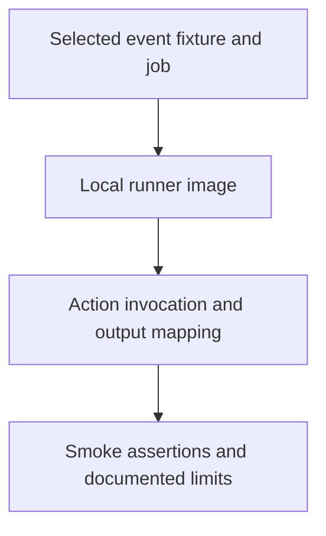

# 0011 · Run one event and one job with act

!!! note "Placeholder for a future teaching thread"
    This page is a teaching brief. Expand it into a full interactive lesson in its own thread. The planned exercises and outcomes have not been completed or demonstrated.

**Level:** Beginner to intermediate.

## Prerequisites

- [0010 · Container engines, Linux images, sockets, and CPU architecture](0010-container-engines-images-and-architecture.md)
- [0009 · Unit tests, event fixtures, and temporary output files](0009-unit-tests-fixtures-and-output-files.md)

## What you will learn to do

- Select exactly one workflow, event, and smoke job.
- Interpret an act result without treating it as GitHub policy enforcement.

## Explain the Actions behavior

Start from the prerequisite workflow or action behavior and introduce these concepts with focused examples:

1. Workflow emulation is most useful when a selected job exercises wiring that direct tests cannot see.
2. Event fixtures and runner-image selection shape the local execution environment.
3. Secrets and external writes require an explicit test boundary; local execution is still real code execution.

Explain the relevant workflow YAML, expressions, and action code in context. Follow the [shared teaching guide](teaching-guide.md) for pacing, expected output, and progression toward independent design.

## Planned local lab

Create an isolated exercise under `labs/0011/` when the lesson is developed. Explain setup and expected output before each command; reuse installed tools rather than reinstalling them on every step.

1. List only the dedicated smoke workflow and inspect its operations.
2. Run that job with the synthetic dispatch fixture when a compatible daemon is available.
3. Verify caller-visible outputs and record image, architecture, tool versions, and remaining unsupported behavior.

## Break it and diagnose it

Change a composite output mapping while leaving its script correct, then compare direct-test and smoke-workflow evidence.

Ask for a prediction first. Capture the smallest reproducer, the actual result, and the corrected behavior. State which remaining claim requires a real GitHub or external-service check.

## Planning diagram



When expanding this lesson, refine the diagram to show the actual processes, branches, data exchange, and trust boundaries being taught.

## Retrieval questions

1. Which wiring is exercised by this smoke job?
2. What could an arbitrary workflow write even when run locally?
3. Why does a passing emulated permission check not establish real authorization?

## Evidence to capture in the teaching thread

- A working learner-produced example and an explanation of why it works.
- A reproduced failure, a reasoned repair, and the smallest check that verifies it.
- A short account of remaining limits, unresolved questions, and readiness for the next lesson.

Use [primary references](../references/resources.md) to verify current syntax, runtime support, and tool behavior. Add learning records only for real statements or demonstrated understanding; a placeholder or generated page does not establish mastery.

## Start this lesson in a new thread

```text
/teach 0011

Expand docs/lessons/0011-act-targeted-workflow-smoke-tests.md in place using docs/lessons/teaching-guide.md.
Read docs/mission.md, NOTES.md, and the prerequisite lesson pages first.
Begin with a short check of the Actions prerequisites. Explain relevant YAML,
expressions, and action contracts, one concept at a time. Let me predict and
try each exercise before revealing its answer. Keep feedback local where possible.
Finish with retrieval questions and a truthful handoff for the next thread.
```

| Previous | All lessons | Next |
| --- | --- | --- |
| [0010 · Container engines, Linux images, sockets, and CPU architecture](0010-container-engines-images-and-architecture.md) | [Curriculum](index.md) | [0012 · Define the local/hosted coverage boundary and usage budget](0012-local-hosted-coverage-and-usage-budget.md) |
