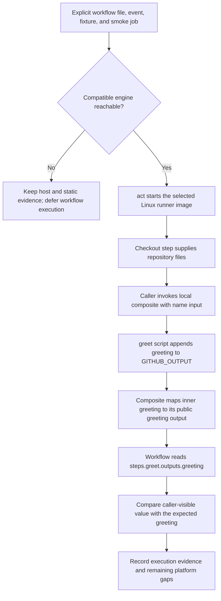

# 0011 · Run one event and one job with act

!!! note "Authored reference lesson"
    The good and deliberately broken workflow recipes under `labs/0011/` are developed. Host tests and job listing ran; container-backed workflow execution remains deferred because the existing engine was unavailable. Predict the mapping failure before opening the explanation.

## Prerequisites and goal

Read [0010 · Engine, socket, and CPU boundaries](0010-container-engines-images-and-architecture.md), [0009 · Process tests](0009-unit-tests-fixtures-and-output-files.md), and recall [0005 · Output mappings](0005-environment-files-and-output-contracts.md).

Select a particular workflow file, event, fixture, and job. Explain what its assertions observe and why it cannot establish real GitHub policy. Success means you can distinguish a passing script from a passing caller-visible output, and stop at an unavailable prerequisite without calling the smoke test successful.

## Use emulation for a concrete wiring question

`act` executes selected workflow jobs locally. In this lesson its Ubuntu runner is a Linux container supplied by a Docker-compatible engine. A **smoke test** is a small execution that checks a useful integration path; it is not comprehensive coverage.

The question here is specific: “Does the greeting published by a composite's inner step reach the caller through `action.yml`?” Direct script tests cannot evaluate that expression mapping. A selected act job can exercise it with runner-like output processing, while real GitHub integration remains a separate environment.



The [act usage guide](https://nektosact.com/usage/index.html) documents event, workflow, job, and fixture selection. Read the selected workflow's actual operations before executing it: locally run code can still make network requests and external writes when supplied credentials or access.

## Inspect the intentionally small caller

`labs/0011/smoke.yml` admits `push` and `workflow_dispatch`, but defines only one job, `smoke`, with no `needs` dependencies. It checks out files, calls a local composite, and asserts its output. There is no release, deployment, API mutation, or model call.

```yaml title="labs/0011/smoke.yml — action and assertion excerpts"
- id: greet
  uses: ./labs/0011/action # (1)!
  with:
    name: ${{ inputs.name || 'Ada' }}
- name: Assert the caller-visible contract
  shell: bash
  env:
    ACTUAL: ${{ steps.greet.outputs.greeting }} # (2)!
    EXPECTED: Hello, ${{ inputs.name || 'Ada' }}!
  run: |
    printf 'caller-visible greeting=%s\n' "$ACTUAL"
    test "$ACTUAL" = "$EXPECTED" # (3)!
```

1. A local path resolves within the checked-out workspace. The composite groups steps inside this job; it does not provision its own runner.
2. The caller consumes the composite's **public** output after the action step completes. Its internal script output alone is insufficient.
3. A missing or incorrect mapping makes this comparison fail. Values are supplied through environment data rather than interpolated into shell source.

The manual input is a string with default `Ada`. The push path has no dispatch input, so the expression supplies `Ada`. The smoke contract intentionally uses ordinary, unpadded names; full trimming and invalid-input behavior already belong to the process suite. A padded name would be normalized by the script while this simple caller expects the original spelling, producing an assertion failure rather than a complete input-validation exercise.

The full recipe reuses the existing checkout commit pin, sets `contents: read`, disables persisted checkout credentials, and declares a five-minute hosted job timeout. Under act, the workflow timeout declaration is not a reliable local execution budget; use a bounded invocation and stop a stalled local run deliberately. The [documented limitations](https://nektosact.com/not_supported.html) include ignored timeout behavior.

Files under `labs/` remain inactive on GitHub. Act's explicit `-W` can read them locally. No active workflow installation or hosted dispatch is requested in this lesson.

## Establish the direct-test baseline

The good and broken action directories contain identical greeting scripts. Run:

```bash
uv run --no-sync python labs/0011/direct.py
```

Expected, exit **0**:

```text
action: PASS script output; metadata was not executed
broken-action: PASS script output; metadata was not executed
```

The harness runs both real scripts with `GREETING_NAME=Ada` and temporary output files. It asserts `greeting=Hello, Ada!` plus newline. A correct script is necessary, but these results intentionally say nothing about either metadata mapping.

Static linting also accepts both callers:

```bash
.tools/bin/actionlint -no-color labs/0011/smoke.yml labs/0011/broken-smoke.yml
```

Expected: **exit 0**, no diagnostics. The misspelled inner output is produced by arbitrary shell code, so the clean source report cannot prove its runtime value.

## List exactly the intended scope

Use explicit selection and empty default data files so act does not automatically load a workspace `.env`, `.secrets`, `.vars`, or `.input` file:

```bash
act workflow_dispatch \
  -W labs/0011/smoke.yml -j smoke -l \
  --container-architecture linux/amd64 \
  --env-file /dev/null --secret-file /dev/null \
  --var-file /dev/null --input-file /dev/null
```

Expected: one listed job, `smoke`, in `Module 2 selected output smoke`. The table can list both admitted event names. On the authoring machine act also warned that it could not obtain a valid Docker connection, then returned **0** after listing. **Listing did not run steps or prove engine readiness.**

Repeat with `push` in place of `workflow_dispatch`; the same job is selected because the recipe admits both events. Existing act configuration files can contribute flags, so inspect your `.actrc` settings when selection or runner behavior is surprising. The explicit empty input files reduce accidental data loading; they do not sandbox the process or erase all inherited configuration.

!!! tip "Prediction"
    If you omit `-W`, can `-j smoke` uniquely select this lab across the entire repository? If a future `smoke` job gains `needs: build`, would selecting it still mean only one job executes?

??? tip "Worked scope explanation"
    `-W` narrows the workflow file; the event narrows admitted workflows; `-j` selects a job ID. Without a file selection, matching jobs in other admitted workflows can be included. Act also runs a selected job's dependencies. This recipe has no dependencies, which makes the one-job scope explicit. Recount the graph after adding `needs`; a job flag is not a universal execution-cost cap.

## Run one synthetic dispatch when the engine is available

First run `docker info` and verify a compatible act API connection as explained in 0010. If that boundary fails, keep this step deferred. The authoring run stopped there.

`dispatch.json` contains a synthetic branch ref and `inputs.name=Grace`. The same input is explicit on the command line so the intended typed workflow input is clear:

```bash
act workflow_dispatch \
  -W labs/0011/smoke.yml -j smoke \
  -e labs/0011/dispatch.json --input name=Grace \
  -P ubuntu-latest=catthehacker/ubuntu:act-latest \
  --container-architecture linux/amd64 \
  --env-file /dev/null --secret-file /dev/null \
  --var-file /dev/null --input-file /dev/null
```

The [runner-image guide](https://nektosact.com/usage/runners.html) explains `-P` mapping from a workflow label to a local image. `ubuntu-latest` on GitHub names a hosted runner selection; here it maps to a community-maintained container image. That image is an approximation, and its mutable tag can change. Record the resolved digest and tool versions for reproducible evidence. Use `linux/arm64` only when the chosen image and existing engine support it; choosing a platform does not provision emulation.

Expected if the prerequisites are met: the inner script logs `Hello, Grace!`, the assertion prints `caller-visible greeting=Hello, Grace!`, and act exits **0**. The first execution can download a runner image and checkout action source. This spends local CPU, storage, and network; it does not create a GitHub Actions run merely by using act.

For the push fixture, use:

```bash
act push \
  -W labs/0011/smoke.yml -j smoke -e labs/0011/push.json \
  -P ubuntu-latest=catthehacker/ubuntu:act-latest \
  --container-architecture linux/amd64 \
  --env-file /dev/null --secret-file /dev/null \
  --var-file /dev/null --input-file /dev/null
```

Expected caller-visible value: `Hello, Ada!`, because no dispatch name is supplied. This does not prove GitHub admitted a real push or evaluated branch/path filters. The fixture's synthetic commit is input data, not a hosted commit provenance claim. Run the dispatch case first; use the second case when event-dependent fallback is the boundary you changed.

## Break only the composite output mapping

Compare these mappings:

```yaml title="Good action metadata"
outputs:
  greeting:
    description: Validated greeting returned to the caller
    value: ${{ steps.greet.outputs.greeting }}
```

```yaml title="labs/0011/broken-action/action.yml — intentional defect"
outputs:
  greeting:
    description: Deliberately maps an output the script never publishes
    value: ${{ steps.greet.outputs.greetings }} # (1)!
```

1. The script publishes `greeting`, singular. The nonexistent plural property does not acquire a value just because the program ran successfully.

The [metadata reference](https://docs.github.com/en/actions/reference/workflows-and-actions/metadata-syntax#outputs-for-composite-actions) defines the mapping from inner step outputs to composite outputs.

!!! tip "Predict the three observations"
    Will the broken script's direct test pass? What will its log say? What value should the workflow caller assert against?

With a working engine, run the explicit negative recipe:

```bash
act workflow_dispatch \
  -W labs/0011/broken-smoke.yml -j smoke \
  -P ubuntu-latest=catthehacker/ubuntu:act-latest \
  --container-architecture linux/amd64 \
  --env-file /dev/null --secret-file /dev/null \
  --var-file /dev/null --input-file /dev/null
```

Expected: the script logs `Hello, Ada!`, the caller-visible greeting is empty, the `test` command fails, and act returns nonzero. This execution remains **unverified here**, because the engine was unavailable; the passing direct and static checks must not be substituted for it.

??? tip "Trace and repair the failure"
    Start at the consuming `ACTUAL` value. Trace `steps.greet.outputs.greeting` to the composite's public output, then its `value` expression, then the inner step ID and actual output record. Correct `greetings` to `greeting` in a disposable lab copy, or select the already repaired `smoke.yml`. Re-run the same smallest dispatch case. Adding checkout permissions or changing the greeting function would not address this mapping error.

## Transfer, retrieval, and remaining limits

A reusable job returns a package version, while its log and process tests are correct. Identify the additional mappings and propose a selected smoke assertion that would expose an empty result.

??? tip "Worked transfer"
    Trace the action's public output, producer job output, reusable workflow output, and caller's `needs` output. Assert the final consumer-visible version against a controlled fixture. Select the smallest graph that actually includes those boundaries, including required jobs. A single action-level smoke cannot establish the reusable-workflow mapping chain.

Retrieve without opening the examples:

1. What does each selection flag control: event, `-W`, `-j`, `-e`, and `-P`?
2. Why can the broken composite pass direct tests and linting?
3. Which evidence distinguishes listing from step execution?
4. What could an arbitrary local workflow do with real credentials?
5. Why must a green act result leave GitHub policy claims open?

??? tip "Retrieval check"
    They select the event kind, workflow source, job ID, payload file, and runner-image mapping. Direct tests skip metadata, and lint cannot infer every shell-generated output name. Executed step logs, assertion results, and final status provide runtime evidence; a job table does not. Local code can still call APIs or publish if given access. Act does not reproduce the real platform's identity, approvals, and scheduling enforcement.

Actual token permissions, OIDC federation, environment approvals, concurrency/cancellation, hosted services, and the target OS matrix require deliberate platform evidence. The [support limitations](https://nektosact.com/not_supported.html) document important gaps. Continue to 0012 to record those claims and bound the remaining verification work.

## Verification timing and evidence handoff

Record the event and fixture, revision, exact job graph, act version, image digest, architecture, assertion output, and final status. Here act **0.2.89** listed both event selections; both script tests and static callers passed. No container-backed good or broken workflow was executed. Primary references were checked on **2026-10-30**, starting from the [curated library](../references/resources.md).

!!! note "Documentation validation timing"
    The coordinator runs **one combined whole-site `task docs:verify` after all four modules, 24 lessons, and shared edits are ready**. Do not run root `task check` or any Markdown/link/Mermaid/Zensical checks in this module thread. An act run is separate evidence and does not replace documentation validation.

## Start this lesson in a new thread

```text
/teach 0011

Use docs/lessons/0011-act-targeted-workflow-smoke-tests.md and labs/0011/.
Read docs/mission.md, NOTES.md, docs/lessons/teaching-guide.md, and lessons 0005, 0009, and 0010.
Ask me to select the workflow/event/job and predict the broken composite mapping.
Pause before solutions. Run only the reviewed smoke path with an existing compatible engine.
If unavailable, record deferred runtime evidence and keep direct/static observations distinct.
Continue to lesson 0012; preserve coordinator-only documentation validation for this batch.
```

| Previous Lesson | All Lessons | Next Lesson |
| --- | --- | --- |
| [0010 · Engines, sockets, and architecture](0010-container-engines-images-and-architecture.md) | [Curriculum](index.md) | [0012 · Coverage boundary and usage budget](0012-local-hosted-coverage-and-usage-budget.md) |
