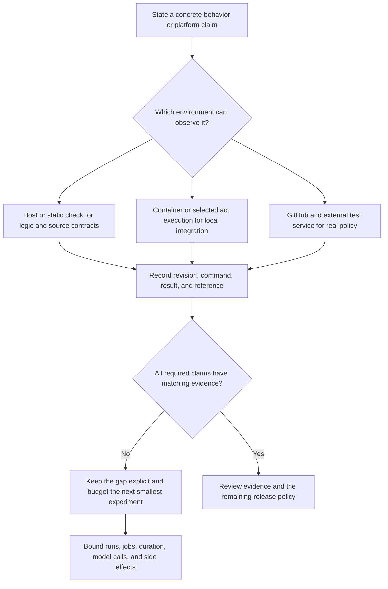

# 0012 · Define the local/hosted coverage boundary and usage budget

!!! note "Authored reference lesson"
    The coverage declarations and executable audit under `labs/0012/` are developed. The saved plan deliberately retains unexecuted and deferred states. A consistent plan does not establish passing checks, release readiness, or learner mastery.

## Prerequisites and goal

Read [0011 · Selected act execution](0011-act-targeted-workflow-smoke-tests.md). Retrieve [0006 · Required evidence joins](0006-matrices-dependencies-and-cancellation.md): a skipped or absent required check cannot silently become success.

Write a verification plan that maps each claim to an observing environment, records actual results at a revision, and limits further runner/model usage. Success means you can reject a false “all locally green, therefore deployment approved” conclusion while keeping the next integration experiment small. No hosted workflow, credential request, or model call is needed to complete this lab.

## Start with the claim rather than a tool checklist

**Coverage** here means which behavioral contracts have evidence. It is broader than a line-coverage percentage. A test can execute every line of a mock OIDC client while proving nothing about real token issuance or a cloud provider's trust policy.

A useful evidence record names the claim, subject revision, observing layer, exact command or run reference, result, and remaining gap. Test output from a previous revision may help diagnosis, but cannot automatically attest a changed interface. A fixture-derived result must retain its simulated scope.



The environments are not a universal ranking. A GitHub run of an unrelated smoke test does not replace a missing function assertion. A static report cannot prove an output was emitted; an act assertion cannot prove real authorization was enforced. Choose a check whose observation matches the claim.

## Build a coverage matrix for one action and caller

Use the greeting adapter and composite smoke from 0009–0011 as the small subject. Add platform claims only when the intended consumer actually needs them.

| Claim | Smallest useful local evidence | Remaining platform evidence |
| --- | --- | --- |
| Blank or multiline names fail | Function and process cases in `labs/0009/` | Target runtime/OS behavior if part of support policy |
| Output appends and failure publishes no success | Real adapter with temporary files, stdout/stderr/status assertions | Runner consumption and any platform output limits |
| Workflow expressions and known inputs are valid | actionlint against explicit workflow files | Real event admission and runtime-dependent behavior |
| Container entrypoint and output mount work | `labs/0010/smoke.py` with a reachable engine | Intended hosted runner/container combination |
| Caller receives the composite output | Selected `labs/0011/smoke.yml` assertion | Actual GitHub caller behavior at the intended revision |
| Token has only intended access | Mock denied response tests error handling | Real GitHub token and controlled API observation |
| OIDC identity is accepted by the intended provider | Fixed claims test application decisions | Real token claims, provider trust, and test-resource access |
| Environment protection gates a job | Source review of the environment declaration | Actual configured protection and observed admission/rejection |
| Concurrency/cancellation behaves as intended | Source review and recovery-policy tests | Two real runs and observed platform/job outcomes |
| Hosted cache/artifact exchange works | Deterministic key and file-selection tests | Actual service exchange, scope, and retention configuration |

Act's [documented unsupported functionality](https://nektosact.com/not_supported.html) includes ignored job permissions, environment behavior, concurrency, and missing OIDC URL support. Thus a passing emulation cannot certify those policies. The [local testing cheatsheet](../cheatsheet/local-testing.md#what-still-needs-a-github-run) keeps this boundary visible.

!!! tip "Prediction"
    A fake token file has the expected audience and subject; a unit test accepts it. Which claim is established: handling of supplied claims, real token issuance, or provider authorization? What further evidence would distinguish them?

??? tip "Worked prediction"
    Only handling of the supplied test claims is established. Real issuance requires GitHub identity evidence, and federation requires the intended provider to validate that identity under its real trust policy. An environment approval is another independent configured platform decision. Keep these as separate claims instead of upgrading a fixture result to a platform success.

## Inspect the explicit plan

`labs/0012/plan.json` is an exercise declaration, not an automatically populated report. It names a synthetic revision, six claims, required scopes, evidence layers/statuses, and a usage budget. It intentionally leaves function/static claims `not-run`, caller mapping `deferred`, token policy `not-run`, OIDC `simulated`, and environment approval `not-run`.

Those are the template's declarations. Actual author checks are recorded separately in `labs/module-2-handoff.md`; the template does not impersonate a live evidence ledger or silently import those results.

One claim has this shape:

```json title="labs/0012/plan.json — OIDC claim excerpt"
{
  "id": "oidc-federation",
  "required_for": "deployment",
  "minimum_layer": "github",
  "evidence": {
    "layer": "act",
    "status": "simulated",
    "reason": "A fake token fixture tests application handling, not real identity"
  }
}
```

`minimum_layer` identifies the observing environment required for this particular claim; it is not a numeric ordering. A claimed pass must use that same layer. The audit also knows that these example token, OIDC, and approval claims require GitHub evidence, so changing both the layer requirement and the result cannot legitimize local platform proof.

Run the declaration audit:

```bash
uv run --no-sync python labs/0012/coverage.py labs/0012/plan.json
```

Expected: **exit 0**, all six states printed, followed by:

```text
planned execution ceiling=5 job-minutes (not a billing quote)
PLAN CONSISTENT: declarations accepted; unexecuted checks remain unverified
```

The program executes no test, workflow, or model request. It checks internal consistency and prints the declared budget. Its zero result says that open gaps are represented honestly, not that the subject is verified.

Now request the sample release gate:

```bash
uv run --no-sync python labs/0012/coverage.py labs/0012/plan.json --require-release
```

Expected: **exit 1**, with four `BLOCKED` messages: input validation and workflow structure are `not-run`, caller mapping is `deferred`, and actual token permissions are `not-run`.

The sample flag requires the `local-candidate` and `platform-release` scopes. Deployment-only claims remain separately visible and are **not covered by this flag**. A real deployment gate must also require its OIDC and environment claims, with policies specific to the intended provider and environment. This small declaration audit is teaching code, not a signed attestation or a generic production release system.

## Break the evidence claim, then repair the plan

Predict the outcomes before running the four-scenario exercise:

```bash
uv run --no-sync python labs/0012/exercise.py
```

It writes temporary plan copies and expects these results:

| Scenario | Required outcome |
| --- | --- |
| Honest open gaps | Plan consistency accepted |
| Mark locally simulated OIDC as a pass | Blocked: wrong observing layer and no platform proof |
| Claim a pass from an older revision | Blocked: evidence revision mismatch |
| Record two hosted runs against a limit of one | Blocked: usage exceeds declaration |

The exercise exits **0** only when the positive declaration and all three negative cases behave as expected. It ends with:

```text
PASS: false platform coverage, stale evidence, and budget overrun rejected
```

??? tip "Worked diagnosis and repair"
    A false OIDC pass is an evidence defect, not an action-code defect. Keep it `simulated` or `not-run` until a real bounded federation test exists. For stale evidence, rerun the relevant check at the current revision and record the resulting log reference; changing the revision string alone is not new evidence. For an over-budget record, stop further runs and explain the overrun rather than erasing history. A revised budget needs an explicit engineering decision. The audit checks declarations; a reviewer must still inspect whether referenced evidence is true and relevant.

For a transfer exercise, copy the plan under `labs/0012/`, replace the synthetic subject/revision with the code you actually tested, and add a truthful local result with its command and log reference. Keep unavailable engine and hosted claims open. Do not invent a hosted run ID to make the sample gate green.

## Budget the next experiment before executing it

The sample budget is deliberately small:

```json title="Budget excerpt"
{
  "max_hosted_runs_per_revision": 1,
  "planned_jobs": 1,
  "job_timeout_minutes": 5,
  "matrix_size": 1,
  "max_model_calls": 0,
  "max_external_writes": 0,
  "actual_hosted_runs": 0,
  "actual_model_calls": 0,
  "actual_external_writes": 0
}
```

The declared hosted experiment has one job instance and a five-minute job timeout. Its planned execution ceiling is therefore five job-minutes for one run. Parallelizing jobs can reduce wall-clock time without reducing aggregate runner use; expanding a matrix multiplies job instances. Timeouts constrain execution, but retries, setup, queueing, billing rules, and additional runs require separate accounting. The audit's arithmetic is not an invoice estimate or a monetary enforcement mechanism.

GitHub's [workflow syntax](https://docs.github.com/en/actions/reference/workflows-and-actions/workflow-syntax#jobsjob_idtimeout-minutes) documents job timeouts, and its [billing and usage overview](https://docs.github.com/en/actions/concepts/billing-and-usage) distinguishes plan/runner charging. Record the actual runner type and account usage instead of applying a guessed per-minute rate. Local act/image downloads consume developer resources even though they do not dispatch GitHub runs.

Use this operating policy for the greeting integration:

1. Run the relevant deterministic host and static checks first. A failing local contract blocks spending the hosted attempt on the same known defect.
2. Review the selected job graph and external operations. The greeting path requires no model access or write credentials.
3. At an intentionally authorized later integration session, choose one reviewed revision and one manual smoke job. Record its run URL, attempt, runner, duration, and assertions.
4. After failure, inspect the earliest failing boundary. Reproduce locally where possible before budgeting another hosted attempt. Do not rerun repeatedly without a changed hypothesis.
5. Observe actual usage and side effects. A manual dispatch trigger does not itself enforce “one run per revision”; the declaration needs operator or automation enforcement outside this teaching audit.

The known Module 2 local checks performed here used **zero hosted workflow runs and zero model calls**. They did not request external writes. These counts describe this authoring task, not unrelated repository activity.

## Keep agentic compilation and execution separate

The later [agentic module guide](agentic-workflows.md) adds another boundary:

```bash
# Specification validation; no agent execution requested.
gh aw compile examples/agentic/repo-report.md --no-emit --strict
```

This is a reference command for a later lesson, **not executed in Module 2**. Compilation can resolve references over the network; local validation does not mean fully offline. `gh aw trial` and `gh aw run` are hosted execution paths and can consume runner and model usage. Confirm current installed help and review the [primary CLI reference](https://github.github.com/gh-aw/setup/cli/) before scheduling either. A successful compile cannot certify model behavior, output quality, or a zero-cost hosted trial.

Keep the Module 2 model-call budget at zero. An action-output smoke test does not need an AI request to answer its wiring question.

## Transfer and retrieval

A deployment action passes unit, image, and act tests. Its release policy requires OIDC, environment approval, and a Windows consumer. Design the smallest remaining evidence plan and state what blocks release.

??? tip "Worked transfer"
    Keep the local results at their actual scope. Add a test-environment GitHub job for the real identity/provider policy and approval behavior, with narrowly bounded test-resource access. Add the intended Windows consumer because a Linux container cannot establish that runtime. Include accepted and rejected policy cases where needed; one successful deployment cannot prove denial behavior. Count the jobs and attempts, set timeouts, record observable run references and usage, and keep release blocked until the required claims have evidence. Do not replace platform tests with more repetitions of the Linux smoke.

Answer without reopening the coverage matrix:

1. Why can a plan consistency check pass while a release gate fails?
2. What makes evidence stale or irrelevant?
3. Why does adding parallel jobs not necessarily reduce usage?
4. Which controls enforce the sample budget, and which only describe it?
5. What does local agentic compilation leave untested?

??? tip "Retrieval check"
    Honest gaps can form a consistent plan; a release requires those gaps to be closed. A different revision, subject, event, environment, or assertion can invalidate relevance. Aggregate execution counts every job instance, even when wall-clock overlap is high. This audit detects declared overruns and the workflow can enforce timeouts, but the JSON does not prevent dispatches or cap bills. Compilation checks a specification; hosted policy, model behavior, and actual usage remain separate evidence.

## The next learning boundary

The course now moves from local testing to [0013 · Docker metadata and lifecycle](0013-docker-action-metadata-and-lifecycle.md), the start of Module 3. Continue in consecutive lesson order, using host checks before adding the image boundary.

Primary sources linked here were checked on **2026-10-30** from the [curated source library](../references/resources.md). `labs/module-2-handoff.md` records the actual author checks, deferred engine/act execution, checked URLs, and proposed shared integration.

| Previous Lesson | All Lessons | Next Lesson |
| --- | --- | --- |
| [0011 · Run one event and one job with act](0011-act-targeted-workflow-smoke-tests.md) | [Curriculum](index.md) | [0013 · Docker action metadata, arguments, and container lifecycle](0013-docker-action-metadata-and-lifecycle.md) |
