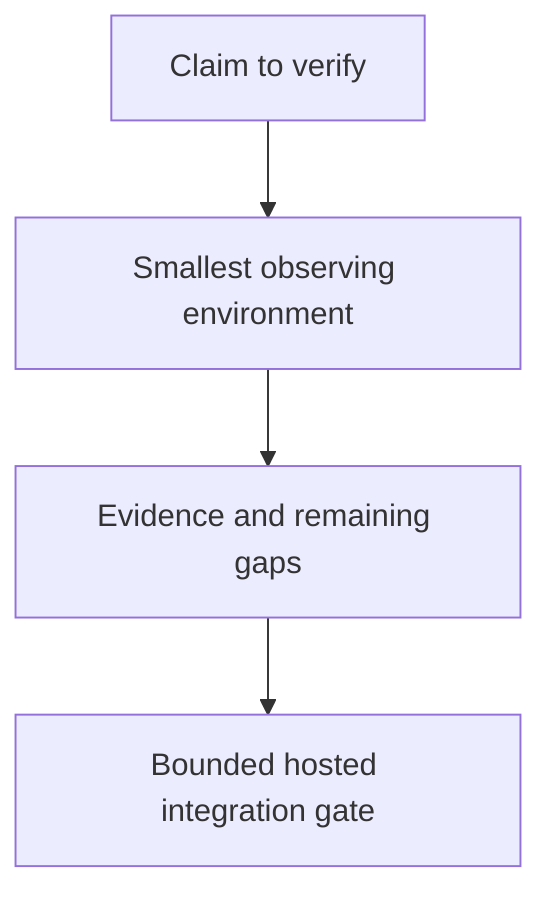

# 0012 · Define the local/hosted coverage boundary and usage budget

!!! note "Placeholder for a future teaching thread"
    This page is a teaching brief. Expand it into a full interactive lesson in its own thread. The planned exercises and outcomes have not been completed or demonstrated.

**Level:** Beginner to intermediate.

## Prerequisites

- [0011 · Run one event and one job with act](0011-act-targeted-workflow-smoke-tests.md)

## What you will learn to do

- Create a coverage matrix with explicit local and hosted evidence.
- Choose a small hosted integration gate after local checks pass.

## Explain the Actions behavior

Start from the prerequisite workflow or action behavior and introduce these concepts with focused examples:

1. A verification plan maps each claim to the environment that can observe it.
2. Real identity, permissions, scheduling, and hosted services need platform evidence.
3. Selective checks and bounded experiments reduce iteration cost without hiding untested contracts.

Explain the relevant workflow YAML, expressions, and action code in context. Follow the [shared teaching guide](teaching-guide.md) for pacing, expected output, and progression toward independent design.

## Planned local lab

Create an isolated exercise under `labs/0012/` when the lesson is developed. Explain setup and expected output before each command; reuse installed tools rather than reinstalling them on every step.

1. List the contracts for one action and its calling workflow.
2. Map each to a direct test, static checker, container, act job, or real GitHub run.
3. Define when checks are rerun, which failures block release, and how runner/model usage will be observed rather than guessed.

## Break it and diagnose it

Claim that local success proves OIDC or environment approval behavior. Identify the missing real-platform evidence and add a bounded check.

Ask for a prediction first. Capture the smallest reproducer, the actual result, and the corrected behavior. State which remaining claim requires a real GitHub or external-service check.

## Planning diagram



When expanding this lesson, refine the diagram to show the actual processes, branches, data exchange, and trust boundaries being taught.

## Retrieval questions

1. What exactly does each passing check establish?
2. Which platform behavior remains unverified?
3. How would you shorten the loop without simply removing important evidence?

## Evidence to capture in the teaching thread

- A working learner-produced example and an explanation of why it works.
- A reproduced failure, a reasoned repair, and the smallest check that verifies it.
- A short account of remaining limits, unresolved questions, and readiness for the next lesson.

Use [primary references](../references/resources.md) to verify current syntax, runtime support, and tool behavior. Add learning records only for real statements or demonstrated understanding; a placeholder or generated page does not establish mastery.

## Start this lesson in a new thread

```text
/teach 0012

Expand docs/lessons/0012-local-hosted-coverage-and-usage-budget.md in place using docs/lessons/teaching-guide.md.
Read docs/mission.md, NOTES.md, and the prerequisite lesson pages first.
Begin with a short check of the Actions prerequisites. Explain relevant YAML,
expressions, and action contracts, one concept at a time. Let me predict and
try each exercise before revealing its answer. Keep feedback local where possible.
Finish with retrieval questions and a truthful handoff for the next thread.
```

| Previous | All lessons | Next |
| --- | --- | --- |
| [0011 · Run one event and one job with act](0011-act-targeted-workflow-smoke-tests.md) | [Curriculum](index.md) | [0055 · Decide when to reuse, compose, or create your own action](0055-reuse-compose-or-create-an-action.md) |
