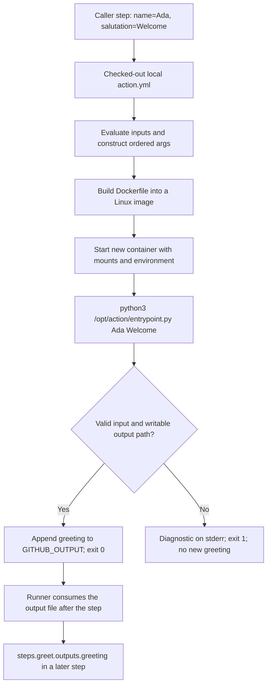

# 0013 · Docker action metadata, arguments, and container lifecycle

!!! note "Authored reference lesson"
    Predict each result before opening its worked solution. The page and isolated lab are developed; author checks do not establish learner mastery. Commands below run from the repository root.

## Prerequisites and goal

Continue from [0060 · Release an action](0060-own-action-release-and-marketplace.md). Revisit [0012 · Coverage boundaries](0012-local-hosted-coverage-and-usage-budget.md), [0010 · Engines and architecture](0010-container-engines-images-and-architecture.md), and [0005 · Output contracts](0005-environment-files-and-output-contracts.md) if needed. You should be able to distinguish an action's source package from a workflow step that calls it.

Build an observable chain from two named inputs to two container arguments, a Python process, a named output, and a caller assertion. Success means you can locate a defect at the correct boundary, including a process that exits zero with the wrong answer.

The lab is `labs/0013/`. It extends the existing Docker greeting action in its own `action/` directory. Keep shared examples unchanged. The greeting is deliberately small: the purpose is to learn a reusable action interface, not to teach Python or container administration.

## A container action is one step implementation

A **Docker container action** packages its program and runtime into a Linux image. An **image** contains a filesystem and startup configuration; a **container** is a running instance of that image. The caller's runner builds or obtains the image, provides arguments, environment and mounts, starts the container, then observes the process status and output commands.

This differs from `jobs.<id>.container`, which chooses the environment for a job's steps, and from a service container such as a database. Calling this action does not give every later step the action image's Python installation. See GitHub's [container action tutorial](https://docs.github.com/en/actions/tutorials/use-containerized-services/create-a-docker-container-action).

GitHub Docker actions require Linux runners with Docker available. A host Python check on macOS can test the program; it cannot make the action portable to a macOS or Windows GitHub runner. On a laptop, a Linux VM and compatible engine can supply the local container boundary.



The first failure might happen before Python starts: unavailable engine, failed base pull, failed build, or an invalid entrypoint. A log from Python proves startup progressed further; a successful host test proves none of those container stages.

## Metadata translates names into positions

This is the complete interface in `labs/0013/action/action.yml`:

```yaml title="labs/0013/action/action.yml"
name: Module 4 argument contract
description: Map two named inputs to two positional container arguments
inputs:
  name:
    description: Nonempty single-line recipient
    default: World
  salutation:
    description: Nonempty single-line salutation
    default: Hello
outputs:
  greeting:
    description: Validated greeting
runs:
  using: docker # (1)!
  image: Dockerfile # (2)!
  args:
    - ${{ inputs.name }} # (3)!
    - ${{ inputs.salutation }}
```

1. This runtime is distinct from a `run: docker ...` command in a workflow. The runner interprets this metadata when the caller uses the action.
2. The Dockerfile belongs to this action directory. `image: docker://...` would instead select an already published image.
3. The Actions expression resolves a named input into the first argument. List order is part of the program's contract; it is independent of the order of `with` keys in the caller.

The metadata declares a default for omitted input. It does not validate that an explicitly supplied value is nonempty or single-line. Even `required: true` does not automatically produce the runtime error an action author may expect; validation belongs in the program. GitHub documents these fields in the [metadata reference](https://docs.github.com/en/actions/reference/workflows-and-actions/metadata-syntax).

Use explicit `runs.args` transport for this Docker action. Its program reads `sys.argv[1]` and `sys.argv[2]`; it does not read `INPUT_NAME`. Setting that environment variable in a host test does not supply these arguments or apply metadata defaults. The probe intentionally sets `INPUT_NAME=Ignored` to expose that distinction. Read environment values such as `GITHUB_OUTPUT` with `os.environ`; do not put a literal `$GITHUB_OUTPUT` in `args` and expect exec-form startup to expand it.

## The image starts a program without a shell

```dockerfile title="labs/0013/action/Dockerfile"
FROM python:3.14-alpine
ENV PYTHONDONTWRITEBYTECODE=1
COPY entrypoint.py /opt/action/entrypoint.py
# (1)!
ENTRYPOINT ["python3", "/opt/action/entrypoint.py"]
```

1. Exec form names the executable and fixed argument directly. Metadata arguments are appended, so Python sees `entrypoint.py`, `Ada`, `Welcome` as `sys.argv`. The program file need not have executable permissions because Python reads it.

`FROM` supplies Python and a Linux filesystem. `ENV` avoids bytecode cache files. `COPY` packages the action program at an absolute path, separate from the caller's mounted workspace. The mutable `python:3.14-alpine` teaching tag is inherited from the starter; it is not a reviewed immutable release dependency. [0014](0014-dockerfiles-layers-and-build-context.md) examines the build; [0018](0018-container-security-and-release-tradeoffs.md) develops the pin/update decision.

The full entrypoint validates both arguments, constructs the greeting, and catches validation or filesystem errors. Its output boundary is:

```python title="labs/0013/action/entrypoint.py — output boundary"
destination = os.environ.get("GITHUB_OUTPUT")
if not destination:
    raise ValueError("GITHUB_OUTPUT must be set")
with Path(destination).open("a", encoding="utf-8") as output: # (1)!
    output.write(f"greeting={greeting}\n")
print(greeting) # (2)!
```

1. Append preserves prior records. UTF-8 and a terminating newline follow the environment-file protocol. Rejecting CR/LF in both values keeps one input from injecting a second record.
2. Stdout supplies a readable log. It is a separate channel from the named result. Printing `greeting=...` alone would not populate this output.

The runner processes the file supplied through `GITHUB_OUTPUT` and exposes the named result after the step. Declaring `outputs.greeting` documents that interface; it does not write the file. A zero process exit status means successful execution; the caller still needs to assert domain behavior. See [workflow commands](https://docs.github.com/en/actions/reference/workflows-and-actions/workflow-commands).

## Predict and run the host boundary

!!! tip "Prediction"
    With `name=Ada` and `salutation=Hello`, what reaches argv, stdout, the output file, and the process exit status? Does the deliberately different `INPUT_NAME` affect the result?

```bash
uv run --no-sync python labs/0013/probe.py
```

The probe creates a temporary file containing `prior=kept`, starts the real Python adapter, captures channels, checks exact bytes, and removes the temporary directory. Expected:

```text
argv=['Ada', 'Hello']; exit=0
stdout='Hello, Ada!\n'; stderr=''
output='prior=kept\ngreeting=Hello, Ada!\n'
PASS: argv order, append protocol, and process status
```

The displayed `\n` denotes newline bytes. This command executes the program with explicitly constructed arguments. It does not evaluate the action metadata or start a container.

??? tip "Worked prediction"
    The program uses `Ada` and `Hello` from argv. It ignores `INPUT_NAME`. Stdout contains a greeting for logs; the file contains the named greeting plus the preserved prior record. The process exits zero, and the probe separately verifies the expected value.

## Deliberate failure: valid data in the wrong order

```bash
uv run --no-sync python labs/0013/probe.py --reverse
```

Predict before running. Expected: the **program exits 0**, prints `Ada, Hello!`, and appends `greeting=Ada, Hello!`. The **probe exits 1** because that result violates the documented interface.

??? tip "Diagnose and repair"
    Both strings pass validation, so neither a runtime exception nor a token permission can detect the swap. Trace `inputs.name` to the first `runs.args` entry and `sys.argv[1]`, then salutation to the second. Remove `--reverse` to repair the probe. In a disposable copy of the action metadata, swap the two `args` entries to reproduce the same defect through a container-action caller; restore name first. A host probe alone cannot prove the YAML order is correct.

Now run `uv run --no-sync python labs/0013/probe.py --name ''`. The program exits 1, stderr says `name must be a nonempty, single-line string`, and the file retains only `prior=kept`. The success-oriented probe also exits 1. Invalid input must not publish a new greeting. [0016](0016-docker-action-direct-and-image-tests.md) turns those negative outcomes into an explicitly passing test matrix.

## From a local caller to runner-visible output

`labs/0013/consumer.yml` is a complete inactive manual-dispatch recipe. Its relevant steps are:

```yaml title="labs/0013/consumer.yml — caller excerpt"
- id: greet
  uses: ./labs/0013/action
  with:
    name: Ada
    salutation: Welcome
- name: Assert runner-visible result
  env:
    GREETING: ${{ steps.greet.outputs.greeting }} # (1)!
  run: test "$GREETING" = 'Welcome, Ada!'
```

1. `greet` is the step ID, not the action's display name. Transporting the result through `env` keeps it out of shell source code.

The full recipe selects `ubuntu-latest`, a five-minute job timeout, read-only contents permission, and the existing course checkout commit pin with persisted credentials disabled. Checkout must precede this local `uses` path: the runner needs the action files in its workspace. Nothing under `labs/` registers a hosted workflow automatically.

Static check, with the installed tool:

```bash
.tools/bin/actionlint -color labs/0013/consumer.yml
```

Expected: exit 0 and no diagnostics. It does not execute the action. After `docker info` succeeds, an optional isolated local caller run is:

```bash
act workflow_dispatch -W labs/0013/consumer.yml -j lifecycle \
  -P ubuntu-latest=catthehacker/ubuntu:act-latest \
  --container-architecture linux/amd64
```

Expected when supported by the local engine and images: the `Welcome, Ada!` assertion passes. This can download images and action sources. Do not run it when the engine is unavailable; record that boundary. No hosted or model execution is needed for the host exercise.

## Optional hooks are additional lifecycles

A Docker action can declare `pre-entrypoint` and `post-entrypoint`; metadata can also override the image's `ENTRYPOINT` with `entrypoint`. Pre/post hooks run in separate containers using the same image. Their process memory and container-only temporary files do not automatically survive into another hook. State must use supported shared paths or `GITHUB_STATE`, exposed to a later hook as `STATE_<name>` within that action.

Hook conditions default to `always()` and can be changed with `pre-if`/`post-if`; that is a scheduling rule, not a guarantee that cleanup survives a runner loss or forced termination. This action needs no hooks. [0017](0017-container-errors-signals-and-cleanup.md) first designs cleanup inside its actual process lifetime.

## Transfer exercise and retrieval

A report action needs `format` and `source-directory`. Sketch the metadata and entrypoint signature, preserving paths containing spaces as single arguments. State the validation rule for each and the output that a later step consumes.

1. Which component evaluates `${{ inputs.name }}`? Which reads argv?
2. What differs between a build failure, startup failure, and application rejection?
3. Why can a zero exit code coexist with a wrong greeting?
4. Could a post hook read a global variable set by the main Python process?

??? tip "Worked transfer and recall"
    Map each named input to one `args` element and read positions in the same order, without a command shell. Validate supported formats and the directory contract in the adapter. The Actions machinery evaluates expressions; Python reads argv. A builder error precedes a running program, an entrypoint error prevents it from starting, and validation fails inside it. A status reports execution outcome, not every domain assertion. Separate hook processes cannot share a Python global.

## Evidence, limits, and next session

The author ran the successful probe, reversed and empty-input failures, and actionlint. The existing Podman engine connection was refused, so container/`act` execution is deferred. Host evidence covers arguments, channels, append behavior and status; it leaves image packaging, actual mounts, metadata execution and runner ingestion unproven. `act` also leaves GitHub identity, permissions and hosted policy outside its evidence.

Primary documentation was checked on **2026-10-30**; see the [source library](../references/resources.md) and `labs/module-4-handoff.md`. A guided session should record the learner's own trace and repair. Continue to [0014](0014-dockerfiles-layers-and-build-context.md).

## Start this lesson in a new thread

```text
/teach 0013

Use docs/lessons/0013-docker-action-metadata-and-lifecycle.md and labs/0013/.
Read docs/mission.md, NOTES.md, docs/lessons/teaching-guide.md, lessons 0060,
0012, 0010, and 0005. Ask me to trace with -> args -> argv -> output file.
Pause before the reversed-argument solution. Test the host boundary first,
record actual learner evidence, and hand off to lesson 0014.
```

| Previous Lesson | All Lessons | Next Lesson |
| --- | --- | --- |
| [0060 · Release your action](0060-own-action-release-and-marketplace.md) | [Curriculum](index.md) | [0014 · Dockerfiles and build context](0014-dockerfiles-layers-and-build-context.md) |
