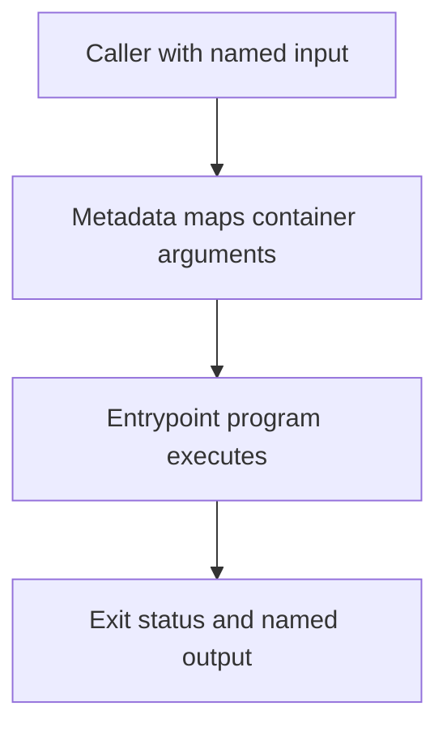

# 0013 · Docker action metadata, arguments, and container lifecycle

!!! note "Placeholder for a future teaching thread"
    This page is a teaching brief. Expand it into a full interactive lesson in its own thread. The planned exercises and outcomes have not been completed or demonstrated.

**Level:** Intermediate.

## Prerequisites

- [0012 · Define the local/hosted coverage boundary and usage budget](0012-local-hosted-coverage-and-usage-budget.md)
- [0010 · Container engines, Linux images, sockets, and CPU architecture](0010-container-engines-images-and-architecture.md)

## What you will learn to do

- Trace an input through metadata into the container program.
- Explain how an exit status and output file become caller-visible behavior.

## Explain the Actions behavior

Start from the prerequisite workflow or action behavior and introduce these concepts with focused examples:

1. Action metadata defines the caller-visible interface and selects the Docker runtime.
2. The entrypoint receives explicit arguments and environment supplied by its execution context.
3. Container startup, program execution, and container exit are separate debugging stages.

Explain the relevant workflow YAML, expressions, and action code in context. Follow the [shared teaching guide](teaching-guide.md) for pacing, expected output, and progression toward independent design.

## Planned local lab

Create an isolated exercise under `labs/0013/` when the lesson is developed. Explain setup and expected output before each command; reuse installed tools rather than reinstalling them on every step.

1. Read every line of the existing Docker action metadata and Dockerfile.
2. Run its Python entrypoint directly with a temporary output path.
3. Draw the full caller-to-container-to-output lifecycle before attempting the image smoke test.

## Break it and diagnose it

Change argument order in a disposable metadata copy and predict the program input that actually arrives.

Ask for a prediction first. Capture the smallest reproducer, the actual result, and the corrected behavior. State which remaining claim requires a real GitHub or external-service check.

## Planning diagram



When expanding this lesson, refine the diagram to show the actual processes, branches, data exchange, and trust boundaries being taught.

## Retrieval questions

1. What contract does action.yml describe?
2. Which values reach argv and which reach the environment?
3. Why can host program tests pass while container startup fails?

## Evidence to capture in the teaching thread

- A working learner-produced example and an explanation of why it works.
- A reproduced failure, a reasoned repair, and the smallest check that verifies it.
- A short account of remaining limits, unresolved questions, and readiness for the next lesson.

Use [primary references](../references/resources.md) to verify current syntax, runtime support, and tool behavior. Add learning records only for real statements or demonstrated understanding; a placeholder or generated page does not establish mastery.

## Start this lesson in a new thread

```text
/teach 0013

Expand docs/lessons/0013-docker-action-metadata-and-lifecycle.md in place using docs/lessons/teaching-guide.md.
Read docs/mission.md, NOTES.md, and the prerequisite lesson pages first.
Begin with a short check of the Actions prerequisites. Explain relevant YAML,
expressions, and action contracts, one concept at a time. Let me predict and
try each exercise before revealing its answer. Keep feedback local where possible.
Finish with retrieval questions and a truthful handoff for the next thread.
```

| Previous | All lessons | Next |
| --- | --- | --- |
| [0060 · Document, version, and publish your action for real consumers](0060-own-action-release-and-marketplace.md) | [Curriculum](index.md) | [0014 · Dockerfile layers, build context, reproducible bases, and entrypoints](0014-dockerfiles-layers-and-build-context.md) |
