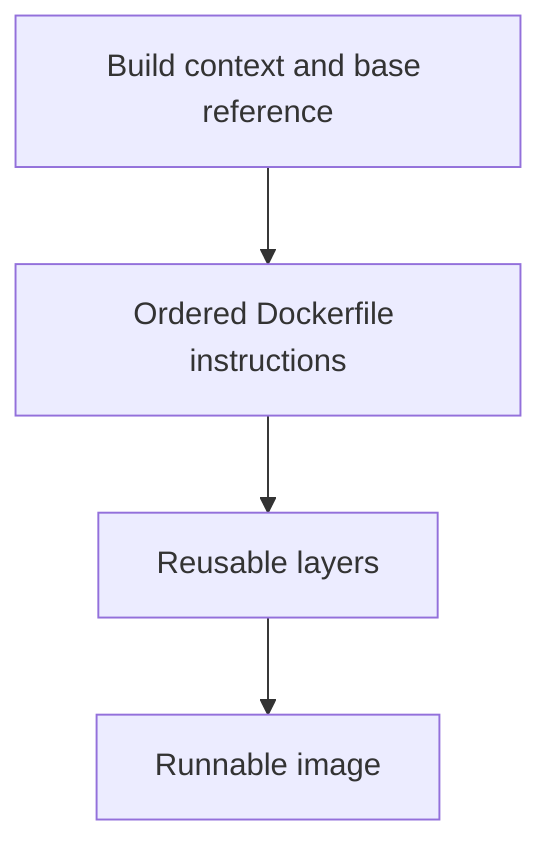

# 0014 · Dockerfile layers, build context, reproducible bases, and entrypoints

!!! note "Placeholder for a future teaching thread"
    This page is a teaching brief. Expand it into a full interactive lesson in its own thread. The planned exercises and outcomes have not been completed or demonstrated.

**Level:** Intermediate.

## Prerequisites

- [0013 · Docker action metadata, arguments, and container lifecycle](0013-docker-action-metadata-and-lifecycle.md)

## What you will learn to do

- Explain each instruction in a small Dockerfile.
- Predict which changes invalidate build layers or remove required runtime files.

## Explain the Actions behavior

Start from the prerequisite workflow or action behavior and introduce these concepts with focused examples:

1. A Docker build reads a context and executes build instructions to create an image.
2. Layer ordering affects reuse and which changes cause rebuilds.
3. Base references and copied files are dependencies that should be reviewed and made reproducible.

Explain the relevant workflow YAML, expressions, and action code in context. Follow the [shared teaching guide](teaching-guide.md) for pacing, expected output, and progression toward independent design.

## Planned local lab

Create an isolated exercise under `labs/0014/` when the lesson is developed. Explain setup and expected output before each command; reuse installed tools rather than reinstalling them on every step.

1. Copy the starter action into a disposable lab and inspect the build context.
2. Build the image, change only its program, and observe which steps repeat.
3. Compare readable tags with reviewed immutable base references and explain the update process.

## Break it and diagnose it

Copy an entrypoint from a path outside the build context or omit it from the image, then diagnose the failing stage.

Ask for a prediction first. Capture the smallest reproducer, the actual result, and the corrected behavior. State which remaining claim requires a real GitHub or external-service check.

## Planning diagram



When expanding this lesson, refine the diagram to show the actual processes, branches, data exchange, and trust boundaries being taught.

## Retrieval questions

1. Which files are available to COPY?
2. What makes a layer reusable?
3. Which dependency update process is needed after pinning an image?

## Evidence to capture in the teaching thread

- A working learner-produced example and an explanation of why it works.
- A reproduced failure, a reasoned repair, and the smallest check that verifies it.
- A short account of remaining limits, unresolved questions, and readiness for the next lesson.

Use [primary references](../references/resources.md) to verify current syntax, runtime support, and tool behavior. Add learning records only for real statements or demonstrated understanding; a placeholder or generated page does not establish mastery.

## Start this lesson in a new thread

```text
/teach 0014

Expand docs/lessons/0014-dockerfiles-layers-and-build-context.md in place using docs/lessons/teaching-guide.md.
Read docs/mission.md, NOTES.md, and the prerequisite lesson pages first.
Begin with a short check of the Actions prerequisites. Explain relevant YAML,
expressions, and action contracts, one concept at a time. Let me predict and
try each exercise before revealing its answer. Keep feedback local where possible.
Finish with retrieval questions and a truthful handoff for the next thread.
```

| Previous | All lessons | Next |
| --- | --- | --- |
| [0013 · Docker action metadata, arguments, and container lifecycle](0013-docker-action-metadata-and-lifecycle.md) | [Curriculum](index.md) | [0015 · Workspace mounts, user IDs, ownership, and output paths](0015-container-mounts-ownership-and-output-paths.md) |
