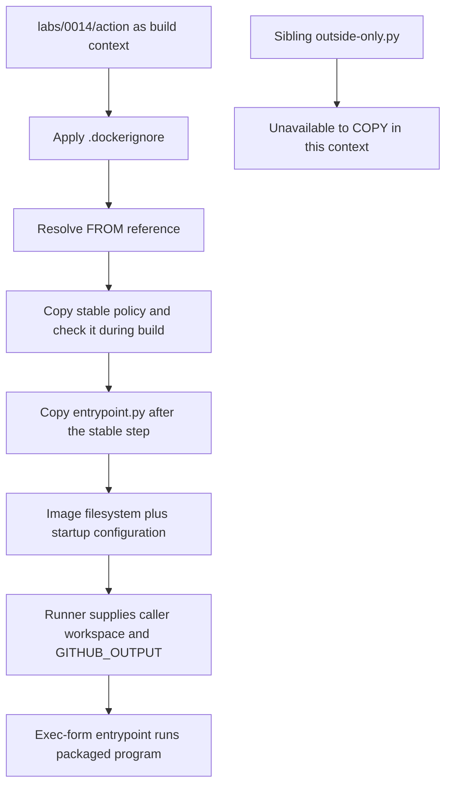

# 0014 · Dockerfile layers, build context, reproducible bases, and entrypoints

!!! note "Authored reference lesson"
    Work through each prediction before opening the answer. The runnable lab is isolated in `labs/0014/`; an authored page is not evidence of learner mastery.

## Prerequisites and goal

Start with [0013 · Metadata and lifecycle](0013-docker-action-metadata-and-lifecycle.md). Recall why metadata arguments reach a process only after the image builds and starts. Use [0010 · Engines and architecture](0010-container-engines-images-and-architecture.md) when an engine connection or executable format fails.

Explain what the builder can read, what is baked into the image, what can be reused, and what is supplied only when an action runs. Success means you can predict a program-only rebuild and diagnose a failed `COPY` without changing action inputs or workflow permissions.

Run commands from the repository root. The action package is `labs/0014/action/`; `labs/0014/outside-only.py` deliberately sits beside it, outside its build context. No dependency installation or VM setup is part of this lesson.

## Build context and runtime workspace are different inputs

The **build context** is the set of source files the builder can access. In this command, the final argument supplies the context; `-f` selects the Dockerfile:

```bash
docker build --tag actions-learn-0014:local \
  -f labs/0014/action/Dockerfile labs/0014/action
```

`COPY entrypoint.py ...` resolves its source against `labs/0014/action`, regardless of the terminal's current directory or the Dockerfile's absolute location. Selecting a Dockerfile does not automatically make its parent's parent the context. Docker's [context reference](https://docs.docker.com/build/concepts/context/) explains the directory and `.dockerignore` boundary.

At action runtime, the runner supplies the caller's workspace as a mount. That is not the same as the files present while the action image was built. A reusable remote action cannot bake a future caller's checked-out files into its published image. Package the tool in the image and read caller data from the runtime workspace.



The sibling file's existence on the host does not authorize `COPY` to read it. Broadening a context merely to silence an error can also include repository history, credentials or unrelated artifacts. Choose an action package boundary deliberately.

## Read each instruction in the lab

```dockerfile title="labs/0014/action/Dockerfile"
# (1)!
FROM python:3.14-alpine
ENV PYTHONDONTWRITEBYTECODE=1
COPY runtime-policy.txt /opt/action/runtime-policy.txt
# (2)!
RUN python3 -c "from pathlib import Path; assert Path('/opt/action/runtime-policy.txt').read_text().strip() == 'single-line-inputs'; print('runtime policy checked')"
# (3)!
COPY entrypoint.py /opt/action/entrypoint.py
ENTRYPOINT ["python3", "/opt/action/entrypoint.py"]
```

1. The base supplies Python and Linux userland. It is an external dependency, even though the application imports only standard-library modules.
2. `RUN` executes while building. This small stable-policy check is here to expose ordering and cache reuse; it is not a Python dependency installation. Its printed message is a build log, not an action output.
3. The frequently edited program comes after the stable step. `COPY` changes the image filesystem; `ENV` and `ENTRYPOINT` configure the image rather than adding application file contents.

The policy file contains exactly `single-line-inputs` followed by a newline. The copied entrypoint is the unchanged starter: a missing argument defaults to `World`, a nonempty single-line argument produces a greeting, and `GITHUB_OUTPUT` is required when it executes. It is not run during this build; therefore the builder does not need a runner output file.

The image has no `WORKDIR` or `USER` instruction. GitHub supplies the action's runtime workspace and documents additional Dockerfile constraints. Keeping the entrypoint at `/opt/action/entrypoint.py` prevents a caller workspace mount from hiding the packaged tool. The [GitHub Dockerfile support reference](https://docs.github.com/en/actions/reference/workflows-and-actions/dockerfile-support) also explains metadata entrypoint overrides.

`.dockerignore` excludes `__pycache__/` and `*.pyc` from this lab's context. It controls build inputs; it does not restrict which workspace files a running action can access. Explicit `COPY` sources keep the image small and understandable. Avoid `COPY . /...` when the action needs only two files.

## Predict cache reuse before measuring it

A **build cache** reuses a prior instruction result when the builder's cache key still matches. For `COPY`, relevant file content/metadata changes can invalidate reuse. Changing only a file's modification time does not invalidate Docker's copy checksum. Once a step changes, dependent later steps need reevaluation. Details are in Docker's [cache invalidation reference](https://docs.docker.com/build/cache/invalidation/).

| Change | Expected boundary affected |
| --- | --- |
| Only append a comment to `entrypoint.py` | Program copy and downstream image configuration; earlier policy check may reuse cache |
| Change `runtime-policy.txt` | Its copy and dependent steps; this policy assertion can now fail |
| Change the resolved base image | Instructions depending on that base need reevaluation |
| Change only a caller's `with.name` | Runtime arguments; it is not a source edit in this build context |
| Add a file excluded by `.dockerignore` | No new included build input from that file |

!!! tip "Prediction"
    If the second build reuses the policy step, will `runtime policy checked` necessarily print as a freshly executed command? If a build is cached, does that prove its Python program still satisfies the consumer contract?

??? tip "Worked cache model"
    A reused result can appear as `CACHED` or an engine-specific cache message without executing the command again. Cache reuse says the builder reused a result; it is not a behavior test. Run the image and assert the output separately. Network, builder choice, base resolution and cache availability affect observed reuse, so inspect actual logs rather than promising a fixed duration.

## First test the copied program on the host

```bash
uv run --no-sync python labs/0014/host_probe.py
```

Expected: exit 0 and `PASS: copied program; no image or build-cache claim`. The probe executes the packaged source with host Python and a temporary output path, verifies `greeting=Hello, Ada!\n`, and removes its files.

If this fails, repair validation or the output adapter before investigating layers. If it passes, an image can still fail to copy the file, supply Python, or start the configured command.

With a working engine only:

```bash
docker info
uv run --no-sync python labs/0014/cache_experiment.py
```

The experiment copies the action context into a temporary directory, builds it, appends a harmless comment to that copy's program, builds again under the same local tag, then runs the final image against a mounted output file. Expected behavior: both builds succeed; earlier steps are candidates for cache reuse; the final program copy changes; the image publishes `Hello, Ada!`; the script prints `PASS: edited image runs; inspect builder logs to determine actual cache reuse`.

The command preserves the checked-in action. It leaves a local image tag for inspection and cleans its temporary source/output files. It neither clears shared engine caches nor proves a cold build. Different Docker-compatible builders format cache logs differently; record the engine/version and actual lines if you run it.

!!! note "Current execution boundary"
    Host Python is available. The existing Docker command connects to Podman, whose connection was refused during authoring. The host probe ran successfully; no build, layer-cache observation or image run is claimed. Do not start or provision a VM to make this reference page appear tested.

## Break the context, then locate the failure stage

`labs/0014/action/Dockerfile.bad-context` contains:

```dockerfile title="Deliberately invalid context assumption"
FROM python:3.14-alpine
COPY ../outside-only.py /opt/action/entrypoint.py
ENTRYPOINT ["python3", "/opt/action/entrypoint.py"]
```

Predict whether Python will start. With an available engine, the negative experiment is:

```bash
docker build --tag actions-learn-0014:bad-context \
  -f labs/0014/action/Dockerfile.bad-context labs/0014/action
```

Expected: nonzero build status at the copy/checksum stage; no runnable new image is produced by that build. Docker normalizes parent traversal in copy sources rather than granting access outside the context; exact diagnostics vary by builder. Here there is no `outside-only.py` at the context root. If the base cannot be obtained first, that is a different earlier failure and does not demonstrate the copy problem.

??? tip "Diagnose and repair"
    Read the selected context in the command before inspecting Python arguments. The sibling file is outside that boundary. Use the good Dockerfile, which copies `entrypoint.py` already inside the action package. If the sibling really were a required runtime file, move a reviewed copy into the action package and use a relative source inside that context. Do not add unrelated repository files or secrets to the context.

A successful build can still omit a runtime file: `ENTRYPOINT` is stored configuration, not necessarily executed while building. [0016](0016-docker-action-direct-and-image-tests.md) supplies an image that builds a Python script onto `scratch` but cannot start Python. This is why both build and run evidence matter.

## Entrypoint, CMD and expressions meet at runtime

Exec-form `ENTRYPOINT ["python3", "/opt/action/entrypoint.py"]` invokes Python directly. `docker run IMAGE Ada` appends `Ada`; no shell splits it or evaluates `$(...)`. A value such as `$GITHUB_SHA` remains literal unless the program reads that environment variable or a shell is deliberately introduced.

`CMD` can provide default arguments for a direct image run. In an action, `runs.args` replaces the Dockerfile's `CMD`, and `runs.entrypoint` overrides `ENTRYPOINT`. Duplicating defaults across metadata, a Dockerfile, and program code creates drift: document which caller each default serves. This lab leaves `CMD` absent and retains the starter's program default for direct use. Docker documents the combination in its [Dockerfile reference](https://docs.docker.com/reference/dockerfile/#entrypoint).

## Reproducible dependencies require an update plan

The [Official Images Python entry](https://raw.githubusercontent.com/docker-library/official-images/master/library/python), checked **2026-10-30**, lists `3.14-alpine` and its source directory. That supports using the tag in a teaching example. It does not establish the digest resolved on this machine, a vulnerability assessment, or a tested target architecture.

A tag can move. A digest identifies immutable registry content; a multi-platform index digest identifies an index whose entries select platform images. A pinned base makes that input repeatable, but not every other build input: package repositories, downloads and source changes can still vary. This lab installs no extra packages, simplifying that dependency chain.

A release should resolve a digest from the registry, review its upstream source, record the intended platform, run image tests and review updates. Do not paste an invented digest into `FROM`. Pinning forever without reviewing fixes is a maintenance defect; [0018](0018-container-security-and-release-tradeoffs.md) builds the review policy. See Docker's [base pinning guidance](https://docs.docker.com/build/building/best-practices/#pin-base-image-versions).

## Transfer exercise and retrieval

A real action adds a requirements lockfile and a dependency install. Place those instructions relative to the program copy to avoid reinstalling unchanged dependencies. Decide which source files must be in the action context and which caller data must stay runtime-only.

1. Does `-f path/to/Dockerfile` determine the build context?
2. Can `COPY ../file` retrieve arbitrary sibling host files?
3. Which instructions run during build, and which select runtime startup?
4. Why is an image digest useful without being a vulnerability guarantee?

??? tip "Worked transfer and recall"
    Copy the reviewed dependency lockfile, install its pinned dependencies, then copy frequently changing program files. The final build argument selects the context; `-f` chooses the recipe. Parent traversal cannot escape that context. `RUN` executes during build; `ENTRYPOINT` configures startup. A digest freezes an input identity, including any vulnerabilities it contains, so an update owner and tests remain necessary.

## Evidence and next session

Host program evidence is available; engine/cache/image experiments remain deferred. A future GitHub check must still exercise actual action building, runtime workspace behavior and runner output processing. Continue to [0015](0015-container-mounts-ownership-and-output-paths.md).

Primary sources above were checked on **2026-10-30**; the [curated library](../references/resources.md) and `labs/module-3-handoff.md` preserve source context and unexecuted boundaries.

| Previous Lesson | All Lessons | Next Lesson |
| --- | --- | --- |
| [0013 · Docker action metadata, arguments, and container lifecycle](0013-docker-action-metadata-and-lifecycle.md) | [Curriculum](index.md) | [0015 · Workspace mounts, user IDs, ownership, and output paths](0015-container-mounts-ownership-and-output-paths.md) |
