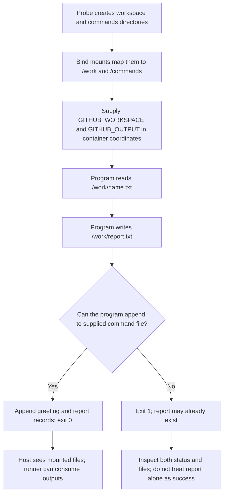

# 0015 · Workspace mounts, user IDs, ownership, and output paths

!!! note "Authored reference lesson"
    The lab is developed under `labs/0015/`. Predict file visibility and status before running commands or opening solutions. No learner mastery is inferred from author checks.

## Prerequisites and goal

Use [0014 · Build context](0014-dockerfiles-layers-and-build-context.md), [0005 · Output files](0005-environment-files-and-output-contracts.md), and [0010 · Engines and architecture](0010-container-engines-images-and-architecture.md). Recall that image files are packaged at build time, while a runner supplies workspace and command-file paths at execution time.

Make an action read a caller fixture, write a report visible to later steps, and publish a named result through the supplied output path. Success means you can map both filesystem views and diagnose an absent output without loosening unrelated permissions.

The program in `labs/0015/action/` reads `GITHUB_WORKSPACE/name.txt`, writes `report.txt` beside it, and appends two records to `GITHUB_OUTPUT`. This is a focused extension of the greeting example. All commands run from the repository root; the probe creates and cleans temporary fixture directories, including a path containing spaces.

## A mount maps paths; it does not copy results afterward

A **bind mount** exposes an engine-host file or directory at a container path. A process opening the container path acts on the mounted content, subject to mount access and filesystem permissions. A container-only file written elsewhere has no automatic return path to the host.

The lab deliberately uses two mounts, because workspace data and the runner's command file are different interfaces:

| Meaning | Host view created by the probe | Container view in this lab |
| --- | --- | --- |
| Caller data | Temporary `workspace/name.txt` | `/work/name.txt` |
| Generated report | Temporary `workspace/report.txt` | `/work/report.txt` |
| Output protocol file | Temporary `commands/output` | `/commands/output` |
| Environment pointing to workspace | Host workspace path | `GITHUB_WORKSPACE=/work` |
| Environment pointing to command file | Host output path | `GITHUB_OUTPUT=/commands/output` |

The `/work` and `/commands` names are this lab's choices. A GitHub action must consume the runner's supplied values; it must not assume these paths or guess an output file under its workspace. `GITHUB_OUTPUT` is a file path, not a directory and not an output value.



Bind-mount paths are resolved on the **engine host**. With a remote daemon, an arbitrary laptop path is not automatically present there. Docker Desktop or Podman machines can mediate host-directory sharing, which is another boundary to verify. See Docker's [bind mount documentation](https://docs.docker.com/engine/storage/bind-mounts/).

## Package code outside the mounted workspace

The Dockerfile copies the entrypoint to `/opt/action/entrypoint.py` and uses exec-form `ENTRYPOINT ["python3", "/opt/action/entrypoint.py"]`. It has no `WORKDIR` or `USER`. GitHub sets the working directory to its workspace and mounts that directory over the corresponding image location. Content baked into the image at that mount target can be obscured; putting tool code at an absolute path elsewhere avoids that collision.

For manual image tests, the probe supplies `--workdir /work` as well as `GITHUB_WORKSPACE=/work`. Those are distinct settings: an environment variable does not change the current directory by itself. This program uses `Path(os.environ["GITHUB_WORKSPACE"])` explicitly, so its file contract is not dependent on an accidental cwd.

The action metadata exposes `greeting` and `report`, selects `using: docker` and `image: Dockerfile`, and needs no arguments. The caller fixture is its input. Here is the program's essential path:

```python title="labs/0015/action/entrypoint.py — core operations"
workspace = Path(workspace_value)
name = (workspace / "name.txt").read_text(encoding="utf-8").strip()
if not name or "\n" in name or "\r" in name:
    raise ValueError("name.txt must contain one nonempty name")
greeting = f"Hello, {name}!"
(workspace / "report.txt").write_text(greeting + "\n", encoding="utf-8") # (1)!
with Path(output_value).open("a", encoding="utf-8") as output: # (2)!
    output.write(f"greeting={greeting}\nreport=report.txt\n")
```

1. The report is caller data, visible through the workspace mount. It is not a named Actions output merely because it exists.
2. The command file publishes small values for later expressions. `report=report.txt` is a workspace-relative locator for the report, not an artifact upload or cross-job filesystem transfer.

The complete program first requires both environment paths and catches validation/filesystem errors as stderr plus exit 1. It logs its effective user ID on success to help inspect ownership. It intentionally writes the report before publishing outputs so the failure lab can expose a partial-side-effect policy.

!!! tip "Prediction"
    If writing the report succeeds but opening `GITHUB_OUTPUT` fails, which file remains? Should a later step treat that file as proof the action succeeded?

??? tip "Worked prediction"
    `report.txt` can remain, while the action exits 1 and publishes no new named result. The two writes are separate filesystem operations. The caller must inspect status; a preexisting or partial report is not a substitute. A production action can stage artifacts and publish only after validation, but still needs an explicit policy for a failure between artifact commit and output publication.

## Observe paths on the host first

```bash
uv run --no-sync python labs/0015/mount_probe.py
uv run --no-sync python labs/0015/mount_probe.py --mode missing
```

The first command runs the actual entrypoint with host paths. Expected: adapter exit 0, no stderr, output bytes `greeting=Hello, Ada!\nreport=report.txt\n`, and report bytes `Hello, Ada!\n`. It also prints the process's effective UID and the report owner's UID. Exact temporary paths and user IDs vary; authoring observed UID **501** for this host run.

The second supplies an output file in a nonexistent parent directory. Expected: adapter exit 1, a file-not-found diagnostic, an empty original output file, and a report that still exists. The **probe exits 0** because it asserts that intended failure and the remaining side effect. It ends with `PASS: observed the selected path boundary (including intended failure)`.

These host runs prove the application uses the supplied paths and expose write ordering. They do not test Docker mounts, VM sharing, root user behavior or a read-only filesystem.

## Add the image and mount boundary when available

Check the existing engine; if it is available, build and run:

```bash
docker info
docker build --tag actions-learn-0015:local labs/0015/action
uv run --no-sync python labs/0015/mount_probe.py --container
```

The probe effectively executes the following mapping, using absolute temporary source paths rather than literal `HOST_WORKSPACE` placeholders:

```text
docker run --rm --network none
  --mount type=bind,source=HOST_WORKSPACE,target=/work
  --mount type=bind,source=HOST_COMMANDS,target=/commands
  --workdir /work
  --env GITHUB_WORKSPACE=/work
  --env GITHUB_OUTPUT=/commands/output
  actions-learn-0015:local
```

This is a path diagram of the invocation; run the probe for an executable command. It passes each mount as one subprocess argument, so spaces in source paths stay intact. `--rm` removes the container after exit, `--network none` limits this deterministic runtime test, and bind-mounted output/report files remain observable until the probe removes its temporary directory.

Expected container behavior matches the host file bytes. The process commonly reports UID 0 inside this image; do not prescribe the host ownership number from that alone. Rootless engines and VM file sharing can translate identities. The report's `stat` output is the actual host observation.

## Deliberate failure: successful write into a private container path

```bash
uv run --no-sync python labs/0015/mount_probe.py --container --mode private
```

Predict first. This selects `GITHUB_OUTPUT=/tmp/private-output`, while the host still observes the original mounted `commands/output` file. Expected: adapter exit 0, report visible on the host, original output file empty. The private file disappears with the removed container. The probe regards that discrepancy as the intended observation and exits 0.

??? tip "Diagnose and repair"
    Trace the exact environment string to a container path, then find the mount that backs it. `/tmp/private-output` has no mapping to the host command file. Restore `GITHUB_OUTPUT=/commands/output` through the normal `--container` mode. Changing the output name, metadata description or token scope cannot repair a missing mount relationship. On GitHub, consume the runner-provided path rather than constructing your own.

A second negative case keeps the right path but removes write access:

```bash
uv run --no-sync python labs/0015/mount_probe.py --container --mode read-only
```

Expected: adapter exit 1, filesystem diagnostic on stderr, empty command file, and an existing report. This marks the command-file mount read-only; workspace writes remain permitted. A read-only mount provides a meaningful negative check even if the container user is root. A `chmod` test alone can be misleading when privileged processes bypass some mode-bit checks.

!!! note "Deferred container evidence"
    During authoring, the existing Podman connection was refused. The image, private-path and read-only tests above are developed but unexecuted. An engine/socket error is earlier than these intended mount failures and cannot be counted as reproducing them.

## Ownership is part of the caller contract

A numeric **UID** identifies a process/file owner within a system's identity mapping. A root process in a conventional Linux container can create UID-0 files in a bind mount, which may inconvenience later non-root host steps. In a rootless engine, user namespace mapping can produce a different host UID. Inspect effective process identity, mount access and host file ownership separately.

For Docker **actions**, GitHub's [Dockerfile support reference](https://docs.github.com/en/actions/reference/workflows-and-actions/dockerfile-support) specifically requires the default root user and advises against `USER`, because a changed user can lose workspace access. Do not copy generic non-root service-container advice into this action and assume compatibility. Keep the action's permissions and side effects narrow, avoid broad recursive ownership/permission changes, and use an explicit mounted-directory policy when designing a separate manually run container.

When diagnosing an unwritable result:

1. Confirm the adapter actually started; a missing runtime is a different defect.
2. Inspect the path in the program's environment, in container coordinates.
3. Verify its parent exists and the mount maps the intended source.
4. Inspect read-only flags, effective identity, user namespace/VM mapping and file modes.
5. Repair the narrow path or access defect, then rerun the same assertion.

Do not apply `chmod -R 777` to a repository as a diagnostic shortcut. It cannot expose a private path to the host or make a read-only mount writable.

## Consume the report in the same job

`labs/0015/consumer.yml` is an inactive manual-dispatch recipe. After the pinned checkout and `printf '%s\n' Ada > name.txt`, it calls:

```yaml title="labs/0015/consumer.yml — caller excerpt"
- id: report
  uses: ./labs/0015/action
- env:
    GREETING: ${{ steps.report.outputs.greeting }} # (1)!
    REPORT: ${{ steps.report.outputs.report }}
  run: |
    test "$GREETING" = 'Hello, Ada!'
    test "$REPORT" = report.txt
    test "$(cat "$REPORT")" = 'Hello, Ada!'
```

1. The runner must ingest the command file before this expression becomes available. The following shell reads the report through its own workspace view.

The recipe asserts the relative path before opening it. If untrusted action output were allowed to select arbitrary paths in a privileged consumer, that would introduce another trust boundary. This teaching action returns a fixed path. A different job needs an explicit artifact transfer; sharing a relative path string does not share the file.

Static check: `.tools/bin/actionlint -color labs/0015/consumer.yml`. A selected optional workflow test, after the engine works, is `act workflow_dispatch -W labs/0015/consumer.yml -j report -P ubuntu-latest=catthehacker/ubuntu:act-latest --container-architecture linux/amd64`. Both local-action discovery and output mapping need execution evidence beyond linting.

## Transfer exercise and retrieval

A formatter reads a caller checkout and should return a report while leaving source files unchanged. Design separate read-only input, writable report and writable command-file locations for a manual image test. Then explain what must change when packaging it as a GitHub Docker action with runner-managed mounts.

1. Why must a host path be translated when passed through `GITHUB_OUTPUT` into a container?
2. Can a mount hide code copied into the image?
3. Can a report exist even though the action failed?
4. Does UID 0 inside a rootless container prove host root ownership?

??? tip "Worked transfer and recall"
    A manual run can mount input read-only and expose separate writable report/command directories. A Docker action consumes GitHub's supplied workspace and output paths; it cannot assume your manual flags are reproduced by `uses`. Environment path values must name locations visible inside the process's filesystem. A mount obscures preexisting image content at its target. The report can precede a later failed output write. Rootless/VM mappings make host ownership a separate observation.

## Evidence and next session

The author executed both host modes and linted the consumer. Mount behavior, image ownership and GitHub runner ingestion remain deferred. In a live session, capture the learner's two-view path map, failure diagnosis and narrow repair. Continue to [0016](0016-docker-action-direct-and-image-tests.md).

Primary sources were checked on **2026-10-30**; see the [reference library](../references/resources.md) and `labs/module-3-handoff.md`. Documentation checks are deferred to the coordinator's combined pass.

## Start this lesson in a new thread

```text
/teach 0015

Use docs/lessons/0015-container-mounts-ownership-and-output-paths.md and labs/0015/.
Read docs/mission.md, NOTES.md, docs/lessons/teaching-guide.md, and lessons
0014, 0005, and 0010. Ask me to map host and container paths before running.
Pause at private-output and read-only predictions. Distinguish partial files
from success, record observed ownership, and hand off to lesson 0016.
```

| Previous Lesson | All Lessons | Next Lesson |
| --- | --- | --- |
| [0014 · Dockerfile layers, build context, reproducible bases, and entrypoints](0014-dockerfiles-layers-and-build-context.md) | [Curriculum](index.md) | [0016 · Test container logic directly and the built image separately](0016-docker-action-direct-and-image-tests.md) |
