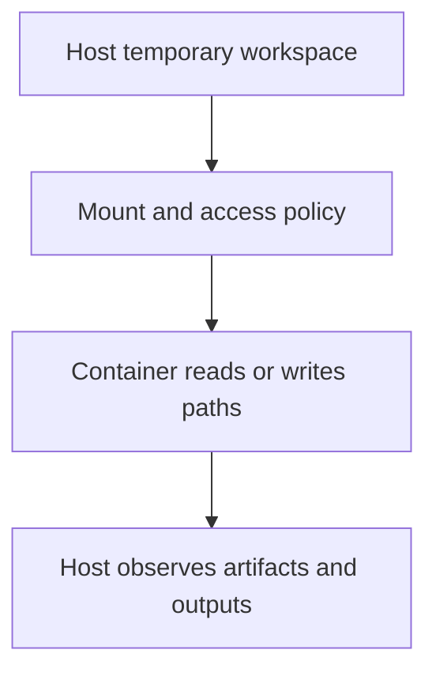

# 0015 · Workspace mounts, user IDs, ownership, and output paths

!!! note "Placeholder for a future teaching thread"
    This page is a teaching brief. Expand it into a full interactive lesson in its own thread. The planned exercises and outcomes have not been completed or demonstrated.

**Level:** Intermediate.

## Prerequisites

- [0014 · Dockerfile layers, build context, reproducible bases, and entrypoints](0014-dockerfiles-layers-and-build-context.md)
- [0005 · Environment files and step, job, and workflow output contracts](0005-environment-files-and-output-contracts.md)
- [0010 · Container engines, Linux images, sockets, and CPU architecture](0010-container-engines-images-and-architecture.md)

## What you will learn to do

- Map a file path between host and container.
- Diagnose a missing or unwritable output file without changing unrelated permissions.

## Explain the Actions behavior

Start from the prerequisite workflow or action behavior and introduce these concepts with focused examples:

1. A mount exposes a host path at a container path with specific access permissions.
2. The user inside a container can affect ownership and writable files outside it.
3. Output paths supplied by the runner must be used as contracts rather than guessed.

Explain the relevant workflow YAML, expressions, and action code in context. Follow the [shared teaching guide](teaching-guide.md) for pacing, expected output, and progression toward independent design.

## Planned local lab

Create an isolated exercise under `labs/0015/` when the lesson is developed. Explain setup and expected output before each command; reuse installed tools rather than reinstalling them on every step.

1. Draw host and container views of a temporary workspace.
2. Run the container smoke fixture with a mounted output directory.
3. Inspect produced files, ownership, and failure behavior for an unavailable or read-only target.

## Break it and diagnose it

Write the result to an unmounted container-only path and explain why the host cannot observe it after exit.

Ask for a prediction first. Capture the smallest reproducer, the actual result, and the corrected behavior. State which remaining claim requires a real GitHub or external-service check.

## Planning diagram



When expanding this lesson, refine the diagram to show the actual processes, branches, data exchange, and trust boundaries being taught.

## Retrieval questions

1. Which path does the program see inside the container?
2. Who owns a generated file after the process exits?
3. Why should an output-file location be supplied instead of hardcoded?

## Evidence to capture in the teaching thread

- A working learner-produced example and an explanation of why it works.
- A reproduced failure, a reasoned repair, and the smallest check that verifies it.
- A short account of remaining limits, unresolved questions, and readiness for the next lesson.

Use [primary references](../references/resources.md) to verify current syntax, runtime support, and tool behavior. Add learning records only for real statements or demonstrated understanding; a placeholder or generated page does not establish mastery.

## Start this lesson in a new thread

```text
/teach 0015

Expand docs/lessons/0015-container-mounts-ownership-and-output-paths.md in place using docs/lessons/teaching-guide.md.
Read docs/mission.md, NOTES.md, and the prerequisite lesson pages first.
Begin with a short check of the Actions prerequisites. Explain relevant YAML,
expressions, and action contracts, one concept at a time. Let me predict and
try each exercise before revealing its answer. Keep feedback local where possible.
Finish with retrieval questions and a truthful handoff for the next thread.
```

| Previous | All lessons | Next |
| --- | --- | --- |
| [0014 · Dockerfile layers, build context, reproducible bases, and entrypoints](0014-dockerfiles-layers-and-build-context.md) | [Curriculum](index.md) | [0016 · Test container logic directly and the built image separately](0016-docker-action-direct-and-image-tests.md) |
