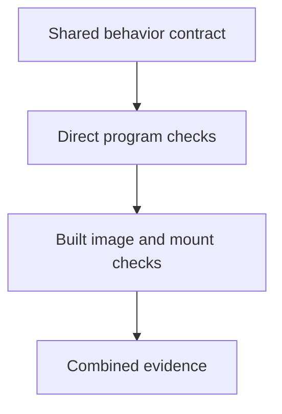

# 0016 · Test container logic directly and the built image separately

!!! note "Placeholder for a future teaching thread"
    This page is a teaching brief. Expand it into a full interactive lesson in its own thread. The planned exercises and outcomes have not been completed or demonstrated.

**Level:** Intermediate.

## Prerequisites

- [0015 · Workspace mounts, user IDs, ownership, and output paths](0015-container-mounts-ownership-and-output-paths.md)
- [0009 · Unit tests, event fixtures, and temporary output files](0009-unit-tests-fixtures-and-output-files.md)

## What you will learn to do

- Explain what evidence a direct test and an image smoke test add.
- Build a small valid/invalid input matrix for both layers.

## Explain the Actions behavior

Start from the prerequisite workflow or action behavior and introduce these concepts with focused examples:

1. Direct program tests isolate behavior from image construction.
2. Image tests add entrypoint, runtime dependencies, arguments, and mount behavior.
3. Both layers should assert an observable contract, including failed execution.

Explain the relevant workflow YAML, expressions, and action code in context. Follow the [shared teaching guide](teaching-guide.md) for pacing, expected output, and progression toward independent design.

## Planned local lab

Create an isolated exercise under `labs/0016/` when the lesson is developed. Explain setup and expected output before each command; reuse installed tools rather than reinstalling them on every step.

1. Run the existing Python action through the shared host tests.
2. With a working engine, build and run the actual container against temporary mounted outputs.
3. Compare exit status, stderr, and file contents for success, invalid input, and missing output paths.

## Break it and diagnose it

Use an image with a missing runtime dependency while keeping the host program correct. Identify why only one testing layer catches it.

Ask for a prediction first. Capture the smallest reproducer, the actual result, and the corrected behavior. State which remaining claim requires a real GitHub or external-service check.

## Planning diagram



When expanding this lesson, refine the diagram to show the actual processes, branches, data exchange, and trust boundaries being taught.

## Retrieval questions

1. Which defect belongs to application behavior versus packaging?
2. How should invalid input appear to the caller?
3. Why should temporary output files be isolated between tests?

## Evidence to capture in the teaching thread

- A working learner-produced example and an explanation of why it works.
- A reproduced failure, a reasoned repair, and the smallest check that verifies it.
- A short account of remaining limits, unresolved questions, and readiness for the next lesson.

Use [primary references](../references/resources.md) to verify current syntax, runtime support, and tool behavior. Add learning records only for real statements or demonstrated understanding; a placeholder or generated page does not establish mastery.

## Start this lesson in a new thread

```text
/teach 0016

Expand docs/lessons/0016-docker-action-direct-and-image-tests.md in place using docs/lessons/teaching-guide.md.
Read docs/mission.md, NOTES.md, and the prerequisite lesson pages first.
Begin with a short check of the Actions prerequisites. Explain relevant YAML,
expressions, and action contracts, one concept at a time. Let me predict and
try each exercise before revealing its answer. Keep feedback local where possible.
Finish with retrieval questions and a truthful handoff for the next thread.
```

| Previous | All lessons | Next |
| --- | --- | --- |
| [0015 · Workspace mounts, user IDs, ownership, and output paths](0015-container-mounts-ownership-and-output-paths.md) | [Curriculum](index.md) | [0017 · Container exit codes, stderr, signals, timeouts, and cleanup](0017-container-errors-signals-and-cleanup.md) |
