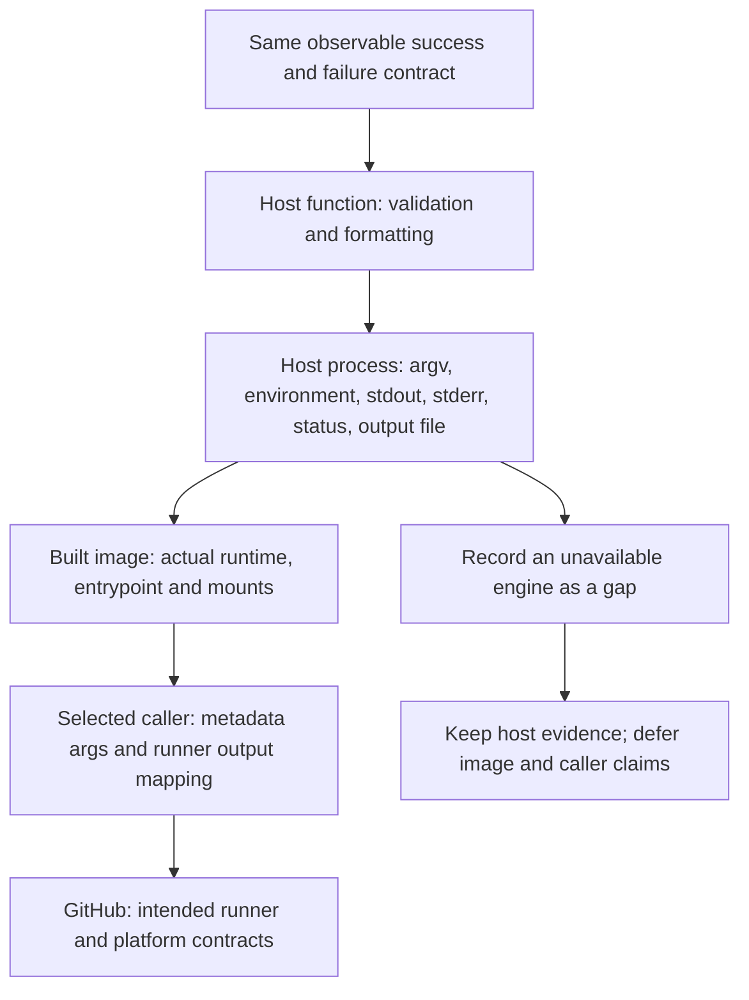

# 0016 · Test container logic directly and the built image separately

Test the program on the host, then test the built image with the same cases. The fixture in `labs/0016/` makes the extra image and mount checks explicit.

## Define the observations before selecting a test

The action accepts a single-line name and returns `greeting`. Its metadata maps `${{ inputs.name }}` into the first argument and defaults omitted input to `World`. Its Python program also has a `World` fallback for direct calls with no argument. These defaults apply to different callers. A direct host call does not read metadata.

For a valid argument, require all of the following:

- Process status 0.
- No diagnostic on stderr.
- Exact log line on stdout.
- Exact UTF-8 output record appended to the supplied file, preserving prior contents.

For invalid input or an unavailable output path, require status 1, a useful stderr message, no success log, and no newly appended greeting. A nonzero exit alone does not prove input validation ran. A missing Python interpreter would also fail.



This order makes failures cheaper to diagnose. Choose checks for the change. A greeting-format change needs direct tests. A Dockerfile change needs an image test. Token-policy changes need GitHub checks.

## Read the shared matrix

`labs/0016/contract.py` runs two pure-function assertions in host mode, then these **11 process cases**. Each case creates an independent temporary output file beginning with `prior=kept\n`:

| Case | Input or environment | Expected contract |
| --- | --- | --- |
| Default | No argv name | `Hello, World!` |
| Ordinary | `Ada` | `Hello, Ada!` |
| Trim | ` Ada ` | `Hello, Ada!` |
| Unicode | `Zoë` | `Hello, Zoë!` |
| Literal shell-like data | `$(exit 99)` | `Hello, $(exit 99)!`; no shell execution |
| Empty | Empty string as one argv item | Validation failure; prior file unchanged |
| Spaces | Three spaces | Validation failure; prior file unchanged |
| Newline | `Ada\nother=injected` | Validation failure; no injected output |
| Carriage return | `Ada\rX` | Validation failure; prior file unchanged |
| Unset output | No `GITHUB_OUTPUT` | Path-contract failure; prior file unchanged |
| Missing parent | Output points below nonexistent directory | Filesystem failure; prior file unchanged |

The newline/carriage-return notation in this table describes actual control characters supplied by the script. The adapter rejects them before producing a line-based output record. To publish genuinely multiline results, design a safe delimiter or file interface as discussed in [0005](0005-environment-files-and-output-contracts.md); do not weaken validation casually.

The test calls the real entrypoint with a subprocess argument list:

```python title="labs/0016/contract.py, host invocation"
command = [sys.executable, str(entrypoint), *values] # (1)!
environment = dict(os.environ)
environment.pop("GITHUB_OUTPUT", None) # (2)!
if path_mode != "unset":
    environment["GITHUB_OUTPUT"] = str(
        Path(directory) / "missing/output" if path_mode == "missing" else output
    )
```

1. Separate arguments preserve spaces and literal `$()` text. The test does not introduce a command shell.
2. Removing an inherited runner variable makes the missing-path case deterministic even when this suite is eventually run in CI.

The assertions check the input, output, and failure behavior promised to callers. They do not repeat the implementation's string manipulation. Each test gets its own directory and seeded file so a preceding success cannot supply a stale result to a later failure. Test timeouts stop stuck child processes. They do not set the action's GitHub job timeout.

## Predict and execute host checks

Run commands from the repository root using the installed Python, uv, and actionlint. The lab tests its own copy of the Docker starter in `labs/0016/action/`.

!!! tip "Prediction"
    If the pure greeting function is correct but the adapter writes only to stdout, which assertions fail? If the adapter publishes a greeting and then exits 1, is that an acceptable validation failure?

```bash
uv run --no-sync python labs/0016/contract.py host
```

Expected: exit 0, one `PASS host: <case>` line for each row, then:

```text
PASS: 11 process cases at the host boundary
```

The two function assertions verify trimmed formatting and empty-input rejection. The process cases also check arguments, output paths, stdout and stderr, appending, and exit status. They import the lab's copy of the program; neither shared starter code nor another module's lab is modified.

??? tip "Worked prediction"
    A stdout-only adapter can pass the pure function and log assertions but fails the file assertion. A validation failure that leaves a new success-shaped greeting violates this contract even with a nonzero exit. The suite requires the seeded file to remain byte-for-byte unchanged on the tested failures.

For a broader existing baseline, `task test` checks the project's four starter adapters and TypeScript distribution consistency. It does not automatically discover this new lab. Use the explicit command above for Module 3.

## Run the same matrix through the real image

First check the engine. Only when that succeeds:

```bash
docker info
docker build --tag actions-learn-0016:local labs/0016/action
uv run --no-sync python labs/0016/contract.py image
```

The image test script replaces the host command with `docker run --rm --network none`, mounts the case's temporary directory at `/contract`, and supplies `GITHUB_OUTPUT=/contract/output` except in the missing-path cases. The names and expected bytes are identical to host mode. Expected final line:

```text
PASS: 11 process cases at the image boundary
```

This adds evidence about the actual Linux runtime, executable configuration, argument preservation, image files and writable mount. The suite deliberately does not override the entrypoint with `--entrypoint python3`: doing so could hide a broken packaged entrypoint. It also does not run a test runner inside a separate tools image and mistake that for testing the production image.

The `.tools/bin/actionlint` result is complementary, not a substitute. It statically checks workflow structure and known metadata interfaces; it cannot run these Python cases or guarantee that Docker can start the image. GitHub documents action startup in the [container tutorial](https://docs.github.com/en/actions/tutorials/use-containerized-services/create-a-docker-container-action), while Docker's [entrypoint reference](https://docs.docker.com/reference/dockerfile/#entrypoint) defines direct image execution.

!!! note "Recorded checks"
    All 11 host process cases and the two function assertions passed. The existing Podman engine connection was refused. The image matrix is fully implemented but unexecuted; a blocked build is not an image-test pass.

## Deliberate failure: correct source, absent interpreter

`labs/0016/action/Dockerfile.missing-runtime` intentionally packages the program without a Python runtime:

```dockerfile title="labs/0016/action/Dockerfile.missing-runtime"
# (1)!
FROM scratch
COPY entrypoint.py /entrypoint.py
ENTRYPOINT ["python3", "/entrypoint.py"]
```

1. `scratch` begins with no base filesystem. Copying a Python source file does not supply a Python executable. The build can record this entrypoint without running it.

Predict which command first detects the defect. With a working engine:

```bash
docker build --tag actions-learn-0016:missing-runtime \
  -f labs/0016/action/Dockerfile.missing-runtime labs/0016/action
uv run --no-sync python labs/0016/contract.py host
uv run --no-sync python labs/0016/contract.py image \
  --image actions-learn-0016:missing-runtime
```

Expected: the image builds; the host suite still passes; the image suite fails its first success case. The runtime reports that it cannot locate/start `python3` and no greeting is appended. Exact engine status and diagnostic wording vary; the suite prints the failing case and captured stderr through its assertion. An engine connection failure earlier in this sequence is not the intended missing-runtime observation.

??? tip "Diagnose and repair"
    The program has not started, so adding Python imports, changing the greeting string or increasing token permissions cannot help. Compare the failing image's base and entrypoint to the good Dockerfile. Rebuild the good `python:3.14-alpine` fixture under `actions-learn-0016:local`, then run the image matrix against that tag. Keep the broken tag distinct so a stale good image cannot make the negative experiment appear to pass.

A second independent exercise is changing only the host test's expected greeting in a disposable copy. It should fail a contract assertion without touching the image. Explain why that is an expectation mismatch rather than evidence of a packaging defect.

## Test the caller's wiring separately

`labs/0016/consumer.yml` checks how the runner calls the action, which the image test script does not evaluate:

```yaml title="labs/0016/consumer.yml, central steps"
- id: good
  uses: ./labs/0016/action
  with:
    name: Ada
- id: bad
  continue-on-error: true # (1)!
  uses: ./labs/0016/action
  with:
    name: '   '
- name: Assert success and expected rejection
  env:
    GREETING: ${{ steps.good.outputs.greeting }}
    BAD_OUTCOME: ${{ steps.bad.outcome }} # (2)!
    BAD_GREETING: ${{ steps.bad.outputs.greeting }}
  run: |
    test "$GREETING" = 'Hello, Ada!'
    test "$BAD_OUTCOME" = failure
    test -z "$BAD_GREETING"
```

1. This allows the assertion step to execute after the **expected** rejection. It is not permission to ignore unexpected production failures.
2. `outcome` is the original result before `continue-on-error`; `conclusion` reflects that setting. Checking `outcome` verifies the action actually failed instead of silently accepting whitespace. See GitHub's [steps context](https://docs.github.com/en/actions/reference/workflows-and-actions/contexts#steps-context).

The full inactive recipe includes a Linux runner, bounded timeout, read-only contents permission and checkout before the local action. Whitespace is used to exercise a value clearly supplied through the caller rather than conflating direct-program missing/empty cases with metadata defaults.

```bash
.tools/bin/actionlint -color labs/0016/consumer.yml
```

Expected: exit 0 and no diagnostics. A later optional caller execution is:

```bash
act workflow_dispatch -W labs/0016/consumer.yml -j contract \
  -P ubuntu-latest=catthehacker/ubuntu:act-latest \
  --container-architecture linux/amd64
```

Expected when engine/image support is available: the success assertion passes, the deliberately invalid action step fails, and the final assertions pass. This checks selected workflow wiring locally; it still cannot establish GitHub token enforcement, approvals or hosted runner parity. See the [local testing guide](../cheatsheet/local-testing.md) and [act limitations](https://nektosact.com/not_supported.html).

## Transfer exercise and retrieval

A file-checking action passes its pure tests but fails on a Linux runner because a required data file was never copied. Choose the smallest new test, the assertion it needs, and the expected stage of failure. Then add a case for a readable empty fixture and decide whether it is a valid empty result or an error.

1. What can a function test miss that a process test observes?
2. What extra evidence does running the actual image add?
3. Why seed and preserve prior output records on negative cases?
4. Can the image suite establish `${{ steps.good.outputs.greeting }}` by itself?

??? tip "Worked transfer and recall"
    Run the packaged entrypoint from the built image against a mounted fixture and assert its actual output/status; a host import cannot detect an omitted image file. Define empty-file semantics before implementing the case. Function tests miss argv/environment/protocol handling. Image tests add runtime and filesystem packaging. Seeded prior records detect truncation and stale-result reuse. The image test script does not evaluate workflow expressions or read output files as a runner would. Test the workflow caller separately.

## Evidence and next session

The recorded host tests and consumer lint passed. Image tests, workflow execution, and hosted integration remain deferred. Continue to [0017](0017-container-errors-signals-and-cleanup.md) for interruptions and cleanup, where an ordinary return is no longer guaranteed.

Primary references were checked on **2026-10-30** and are recorded in `labs/module-3-handoff.md` alongside the [source library](../references/resources.md).

| Previous lesson | All lessons | Next lesson |
| --- | --- | --- |
| [0015 · Workspace mounts, user IDs, ownership, and output paths](0015-container-mounts-ownership-and-output-paths.md) | [Curriculum](index.md) | [0017 · Container exit codes, stderr, signals, timeouts, and cleanup](0017-container-errors-signals-and-cleanup.md) |
