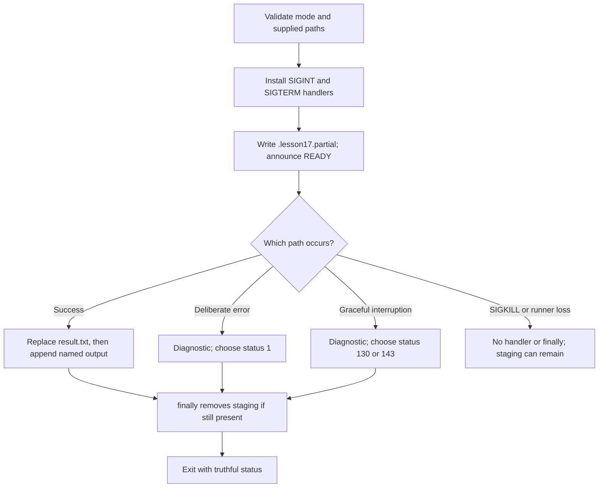

# 0017 · Container exit codes, stderr, signals, timeouts, and cleanup

!!! note "Authored reference lesson"
    The isolated lab in `labs/0017/` includes real host interruption tests and opt-in container tests. Predict each failure before opening its solution. Written content and author evidence do not establish learner mastery.

## Prerequisites and goal

Continue from [0016 · Host and image tests](0016-docker-action-direct-and-image-tests.md). Revisit [0006 · Cancellation and failure propagation](0006-matrices-dependencies-and-cancellation.md) for job-level results and [0005 · Outputs](0005-environment-files-and-output-contracts.md) for named data.

Design an action that reports ordinary failure truthfully, cleans temporary local work on a graceful interruption, and leaves forced-termination limits explicit. Success means you can explain what a caller should infer from status, diagnostics, output records and leftover files separately.

The lab stages one local report. It calls no APIs, acquires no external resources and needs no secrets. Run commands from the repository root. Signals here serve the action's process contract; this is not a general Linux process course.

## Failure needs both a status and a diagnosis

An action process exits **0** for success and nonzero for failure. A useful stderr message explains why; printing an error alone does not fail a step. Likewise, writing a success output does not override a nonzero process result. GitHub documents [action exit codes](https://docs.github.com/en/actions/how-tos/create-and-publish-actions/set-exit-codes).

A **signal** can interrupt the process instead of letting its normal work finish. `SIGINT` and `SIGTERM` are catchable interruption requests; `SIGKILL` forcibly terminates a process and cannot be handled. Cleanup code cannot execute after a kill, runner loss or machine shutdown. Python's [signal reference](https://docs.python.org/3.14/library/signal.html) describes the handler boundary.

The lab chooses these policies:

| Path | Process observation in host test | Output and file policy |
| --- | --- | --- |
| `success` | Exit 0, `DONE` log | Replace result, append `result=result.txt`, remove staging |
| `fail` | Exit 1, explanatory stderr | No new output; prior completed result preserved; staging removed |
| `wait`, then SIGINT | Handler returns exit 130 | No new output; prior result preserved; staging removed |
| `wait`, then SIGTERM | Handler returns exit 143 | Same graceful cleanup policy |
| `wait`, then SIGKILL | Python subprocess reports `-9` | No new output; staging remains until harness cleanup |

The 130/143 numbers are this adapter's explicit `128 + signal` policy. A container engine commonly reports 137 for a killed container. Do not infer that GitHub must show those numbers as the overall workflow result: platform cancellation has its own run/job status.



## Read the worker's publication boundary

`labs/0017/action/worker.py` accepts `success`, `fail`, or `wait` as its first argument. Metadata defaults `mode` to `success` and passes it through `runs.args`. It requires `GITHUB_WORKSPACE` and `GITHUB_OUTPUT`. Its controlled operation is:

```python title="labs/0017/action/worker.py — staged work"
signal.signal(signal.SIGINT, on_signal)
signal.signal(signal.SIGTERM, on_signal)
workspace = Path(os.environ["GITHUB_WORKSPACE"])
partial = workspace / ".lesson17.partial"
partial.write_text("completed local report\n", encoding="utf-8")
print("READY: staging file exists", flush=True) # (1)!
if mode == "wait":
    while True:
        time.sleep(0.05)
if mode == "fail":
    raise ValueError("deliberate failure before publication")
partial.replace(workspace / "result.txt") # (2)!
with Path(os.environ["GITHUB_OUTPUT"]).open("a", encoding="utf-8") as output:
    output.write("result=result.txt\n")
```

1. The test waits for an explicit readiness observation, rather than assuming the worker has started after a fixed delay. Handlers are installed before that message.
2. Staging and the final file share a directory. Replacing the completed file avoids exposing a half-written report at its final name during this operation. It does not create a transaction with the subsequent output-file write.

`on_signal` raises an `Interrupted` exception carrying the signal number. The main function catches that exception, logs `interrupted: SIGINT` or `interrupted: SIGTERM`, chooses the nonzero status, and runs a `finally` block that removes the staging path if it still exists. The ordinary validation/error branch chooses status 1. The module's real entrypoint uses `raise SystemExit(main())` so its selected status reaches the caller.

!!! note "The commit gap is real"
    If the result replacement succeeds and the output-file write then fails, a completed report can remain without a published output. Interruption can also land near publication. These tests interrupt the controlled **pre-publication** wait; they do not prove atomicity across files, every instruction, or an external service. Define a recovery policy for the actual side effects your action introduces.

The fixed `.lesson17.partial` name is safe here because every test uses its own temporary workspace and every normal caller uses one worker instance. Parallel workers writing the same directory need unique staging/result names or coordination. A rerun must not treat any leftover staging file as proof of a completed result.

## Keep the program at the container's signal boundary

The lab Dockerfile packages the worker and this wrapper:

```sh title="labs/0017/action/entrypoint.sh"
#!/bin/sh
exec python3 /opt/action/worker.py "$@" # (1)!
```

1. `exec` replaces the shell with Python, preserving the process at the container's main-process boundary. `"$@"` preserves each supplied argument.

The Dockerfile makes the wrapper executable and uses `ENTRYPOINT ["/opt/action/entrypoint.sh"]`. The wrapper has a purpose only to show this boundary; a direct `ENTRYPOINT ["python3", "/opt/action/worker.py"]` is also suitable here. Starting Python as an unforwarded child under shell-form startup can prevent the intended process from receiving the container stop signal. See Docker's [entrypoint behavior](https://docs.docker.com/reference/dockerfile/#entrypoint).

If your real action spawns child tools, this simple single-process fixture does not test child signal forwarding, process-group termination or zombie reaping. Add those cases when that process topology exists instead of assuming this example proves them.

## Predict and run six actual host cases

!!! tip "Prediction"
    Which path guarantees the `finally` block runs in this fixture? Which path leaves the staging file? Can a caller tell the difference between an empty valid result and an interrupted attempt merely by reading an absent output?

```bash
uv run --no-sync python labs/0017/test_host.py
sh -n labs/0017/action/entrypoint.sh
```

Expected: six Python tests pass and the shell syntax check exits 0 with no output. The tests cover success, ordinary failure, SIGINT, SIGTERM, SIGKILL and a deliberately broken adapter. Each test seeds `result.txt` with `prior completed report\n` to ensure a rejected pre-publication attempt does not erase prior work.

For graceful interruption, the test starts a real host subprocess, reads its `READY` message with a five-second bound, sends the chosen signal, collects its final channels/status, and inspects files. The forced-kill case asserts that staging remains; the parent harness then deletes its isolated temporary directory. That cleanup by the harness is not cleanup performed by the killed worker.

??? tip "Worked prediction"
    Normal return and caught errors/signals reach `finally` during this controlled execution. SIGKILL cannot. An absent result does not distinguish a valid empty result from failure by itself: combine process/step status with a documented presence or result contract. The worker has no valid empty result, so a successful caller expects `result=result.txt` and an actual completed file.

## Deliberate failure: swallow the selected status

`labs/0017/swallow.py` imports the same worker but ends with:

```python title="Intentionally broken adapter"
worker.main() # (1)!
```

1. Returning 1 from a Python function does not set the interpreter's exit code when the caller ignores it. No uncaught exception remains, so the interpreter exits 0.

The sixth host test runs this wrapper in `fail` mode. Expected: stderr describes the deliberate failure, the output file remains empty, and the **broken process exits 0**. The suite intentionally asserts this bad observation so the failure mechanism stays reproducible. Its passing result does not approve that wrapper for use as an action; metadata uses the correct worker/wrapper pair.

??? tip "Diagnose and repair"
    Trace the diagnostic back to the selected return status, then ask who turns that status into process exit. Replace the final call in a disposable copy with `raise SystemExit(worker.main())`, or invoke the real `action/worker.py`, which already does that. The caller now observes failure. A shell wrapper has an analogous defect if it runs the worker, then finishes with a successful unrelated command while discarding the worker status. Use `exec` for this single-program wrapper.

This is an especially dangerous workflow defect: downstream steps with implicit `success()` may run even though the action logged an error. The repair is truthful status propagation, not a broader `if: always()` condition downstream.

## Add real container stop and kill observations

With an available engine only:

```bash
docker info
docker build --tag actions-learn-0017:local labs/0017/action
uv run --no-sync python labs/0017/test_container.py
```

The script creates uniquely named containers and temporary mounts. It waits for the staging file, stops one container with a two-second grace period, and forcibly kills another. Expected:

```text
PASS container TERM: exit=143; no success output; staging policy observed
PASS container KILL: exit=137; no success output; staging policy observed
```

It inspects `.State.ExitCode`, checks no result/output was published, and removes only the containers it created in `finally`. The TERM case expects staging removal; the KILL case expects leftover staging. If the wrapper or handler is broken and stop escalates to a kill, the TERM assertion fails rather than silently treating it as graceful shutdown.

Docker's [stop reference](https://docs.docker.com/reference/cli/docker/container/stop/) specifies a stop signal, normally SIGTERM, followed by SIGKILL after the grace period. The script uses the compatible `--time 2` spelling for the installed engine family. This is not the same protocol as GitHub workflow cancellation.

!!! note "Current evidence"
    Host signals and shell syntax were checked. The Podman connection was refused, so container stop/kill is deferred. No VM was started, no Docker image was built, and no hosted cancellation was initiated.

## GitHub cancellation has an outer control plane

On cancellation, GitHub reevaluates job/step conditions and tells runners which work to cancel. For a container-action step, the runner first signals the step's entry process, **the Docker client**, rather than promising a direct SIGTERM to the Python PID. The documented escalation is SIGINT, a 7.5-second wait, SIGTERM, a 2.5-second wait, then process-tree termination; a server cancellation limit can force remaining work to end. See the current [workflow cancellation reference](https://docs.github.com/en/actions/reference/workflows-and-actions/workflow-cancellation).

Consequently, a host `send_signal` test proves your handler and local cleanup, and `docker stop` proves one container-engine path. Neither proves the exact signal delivery or outcome during GitHub cancellation. Reserve a bounded hosted cancellation test for that contract when needed; it is not requested in this authoring task.

A job's `timeout-minutes`, a local subprocess timeout, and `docker stop`'s grace period belong to different layers. A subprocess timeout does not magically clean up external resources. A workflow cleanup step or post-entrypoint hook can help while the runner remains healthy; `always()` is not a guarantee of execution after runner loss. A Docker post hook also runs in a separate container, so process-local state does not survive there automatically.

For real external resources, use recorded resource IDs, idempotent cleanup, expiry/leases where supported, and later reconciliation. Avoid publishing success-shaped results before all required work completes. Do not delete a prior successful artifact simply because a new attempt failed.

## Check an ordinary failure through a caller

`labs/0017/consumer.yml` selects mode `fail`, uses `continue-on-error: true` only for that expected negative step, then checks:

```yaml title="labs/0017/consumer.yml — assertion excerpt"
- name: Verify intended rejection and cleanup
  env:
    OUTCOME: ${{ steps.worker.outcome }} # (1)!
    RESULT: ${{ steps.worker.outputs.result }}
  run: |
    test "$OUTCOME" = failure
    test -z "$RESULT"
    test ! -e .lesson17.partial
```

1. `outcome` preserves the original failure even though the step's conclusion is affected by `continue-on-error`.

The complete recipe includes checkout, a Linux runner, read-only contents and a five-minute timeout. `.tools/bin/actionlint -color labs/0017/consumer.yml` should exit 0 without diagnostics. Optional local workflow execution is `act workflow_dispatch -W labs/0017/consumer.yml -j failure-contract -P ubuntu-latest=catthehacker/ubuntu:act-latest --container-architecture linux/amd64`. It checks an ordinary failure and runner-style output mapping; it is **not** a workflow-cancellation test.

## Transfer exercise and retrieval

An action creates a temporary cloud resource before generating a report. Propose a state record, a cleanup policy and a recovery path if the runner disappears. Identify which tests can use a fake service and which require a deliberate real-platform experiment.

1. Why does logging an error not establish a failed action?
2. What does `exec` change in this wrapper?
3. Can `finally`, a post hook or `always()` survive every forced termination?
4. Why does the SIGKILL test pass while asserting a leftover file?

??? tip "Worked transfer and recall"
    Record the resource ID durably, make deletion safe to retry, and use expiry or a later reconciler for runner loss. Mocked failures can test cleanup decisions; actual identity and cancellation delivery need platform evidence. An ignored return value leaves the process status successful. `exec` puts the worker at the wrapper's process boundary. None of the cleanup mechanisms guarantees execution after a forced kill or lost machine. The kill test passes because it accurately verifies and documents that limitation, then the harness removes its own fixture.

## Evidence and next session

Author evidence consists of six passing host tests, shell syntax and consumer lint. Container and GitHub cancellation checks remain deferred. Continue to [0018](0018-container-security-and-release-tradeoffs.md).

Sources above were checked on **2026-10-30**; see the [library](../references/resources.md) and `labs/module-3-handoff.md`.

| Previous Lesson | All Lessons | Next Lesson |
| --- | --- | --- |
| [0016 · Test container logic directly and the built image separately](0016-docker-action-direct-and-image-tests.md) | [Curriculum](index.md) | [0018 · Container scanning, dependency pinning, cold starts, and release tradeoffs](0018-container-security-and-release-tradeoffs.md) |
