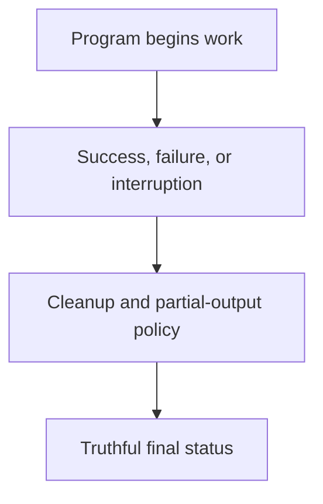

# 0017 · Container exit codes, stderr, signals, timeouts, and cleanup

!!! note "Placeholder for a future teaching thread"
    This page is a teaching brief. Expand it into a full interactive lesson in its own thread. The planned exercises and outcomes have not been completed or demonstrated.

**Level:** Intermediate.

## Prerequisites

- [0016 · Test container logic directly and the built image separately](0016-docker-action-direct-and-image-tests.md)

## What you will learn to do

- Trace success, validation failure, interruption, and cleanup paths.
- Explain which side effects may remain after a cancelled process.

## Explain the Actions behavior

Start from the prerequisite workflow or action behavior and introduce these concepts with focused examples:

1. A failure needs a truthful exit status and actionable diagnostics.
2. Signals and cancellation can interrupt work before its normal return path.
3. Cleanup and partial-output policy must be designed for both success and failure.

Explain the relevant workflow YAML, expressions, and action code in context. Follow the [shared teaching guide](teaching-guide.md) for pacing, expected output, and progression toward independent design.

## Planned local lab

Create an isolated exercise under `labs/0017/` when the lesson is developed. Explain setup and expected output before each command; reuse installed tools rather than reinstalling them on every step.

1. Add a controlled long-running operation in a disposable container lab.
2. Observe ordinary failure and deliberate interruption without changing external services.
3. Test cleanup and confirm that failed work does not publish a misleading success output.

## Break it and diagnose it

Swallow an exception or interruption and exit successfully. Diagnose the false signal sent to downstream jobs.

Ask for a prediction first. Capture the smallest reproducer, the actual result, and the corrected behavior. State which remaining claim requires a real GitHub or external-service check.

## Planning diagram



When expanding this lesson, refine the diagram to show the actual processes, branches, data exchange, and trust boundaries being taught.

## Retrieval questions

1. Who receives a stop signal at the container boundary?
2. Which cleanup can fail or be interrupted?
3. How should a caller distinguish no result from a valid empty result?

## Evidence to capture in the teaching thread

- A working learner-produced example and an explanation of why it works.
- A reproduced failure, a reasoned repair, and the smallest check that verifies it.
- A short account of remaining limits, unresolved questions, and readiness for the next lesson.

Use [primary references](../references/resources.md) to verify current syntax, runtime support, and tool behavior. Add learning records only for real statements or demonstrated understanding; a placeholder or generated page does not establish mastery.

## Start this lesson in a new thread

```text
/teach 0017

Expand docs/lessons/0017-container-errors-signals-and-cleanup.md in place using docs/lessons/teaching-guide.md.
Read docs/mission.md, NOTES.md, and the prerequisite lesson pages first.
Begin with a short check of the Actions prerequisites. Explain relevant YAML,
expressions, and action contracts, one concept at a time. Let me predict and
try each exercise before revealing its answer. Keep feedback local where possible.
Finish with retrieval questions and a truthful handoff for the next thread.
```

| Previous | All lessons | Next |
| --- | --- | --- |
| [0016 · Test container logic directly and the built image separately](0016-docker-action-direct-and-image-tests.md) | [Curriculum](index.md) | [0018 · Container scanning, dependency pinning, cold starts, and release tradeoffs](0018-container-security-and-release-tradeoffs.md) |
