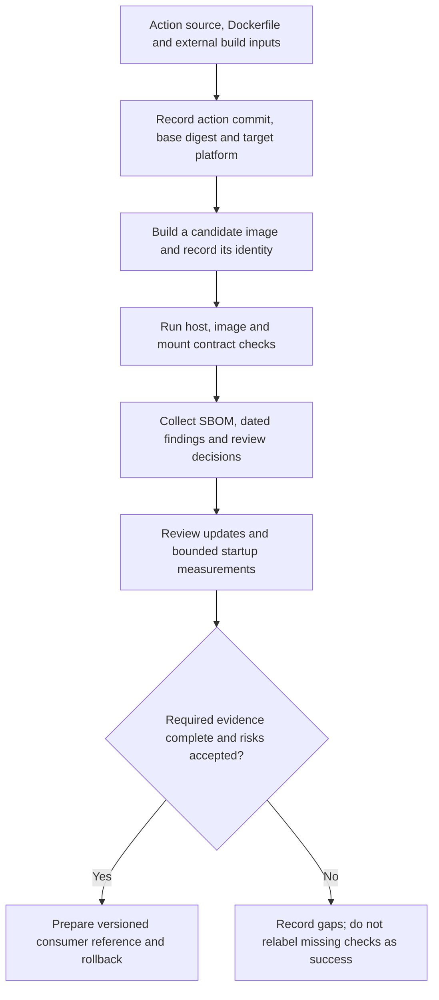

# 0018 · Container scanning, dependency pinning, cold starts, and release tradeoffs

!!! note "Authored reference lesson"
    This page and `labs/0018/` are developed. Predict the release and measurement outcomes before opening worked solutions. No image scan, release, publication or learner mastery is implied by the written material.

## Prerequisites and goal

Use [0017 · Errors and cleanup](0017-container-errors-signals-and-cleanup.md), [0014 · Build inputs](0014-dockerfiles-layers-and-build-context.md), and [0013 · Metadata and lifecycle](0013-docker-action-metadata-and-lifecycle.md). Recall that an action commit, a base image and the final built image are different identities. Module 9 later applies this release evidence to a complete custom-action package.

Prepare an evidence-based release review for a Docker action. Success means you can explain what a pin freezes, what a scanner observes, which updates still need review, and when runtime packaging justifies container startup and maintenance costs.

The lab copies the existing greeting action into `labs/0018/action/`. It supplies a source inventory, a review-freshness exercise, a bounded measurement harness and a release worksheet. All commands run from the repository root. No installation, image push, credential setup or hosted execution is needed for its host exercises.

## Inventory every dependency boundary

Start from the files you would release:

```dockerfile title="labs/0018/action/Dockerfile"
# (1)!
FROM python:3.14-alpine
ENV PYTHONDONTWRITEBYTECODE=1
COPY entrypoint.py /entrypoint.py
ENTRYPOINT ["python3", "/entrypoint.py"]
```

1. The source is tiny, but the runtime and base operating-system packages arrive through this reference. Standard-library-only application code still depends on an interpreter and a base image.

The [Official Images Python manifest](https://raw.githubusercontent.com/docker-library/official-images/master/library/python), checked **2026-10-30**, lists the `3.14-alpine` tag and its source directory. The checked [upstream Dockerfile](https://github.com/docker-library/python/blob/01dcc3d31fcd879f9af36e097bd96328a457f4bd/3.14/alpine3.24/Dockerfile) is source evidence for that listed variant. It is not evidence of a pulled local image, its resolved registry digest or its vulnerability state.

GitHub's [Dockerfile guidance](https://docs.github.com/en/actions/reference/workflows-and-actions/dockerfile-support) recommends official images and generally Debian-based images. This lab retains the existing Alpine starter to isolate the packaging lesson; choosing it here is not a claim of universal compatibility. Actions needing native libraries or prebuilt binary wheels must test the actual distribution, libc and CPU requirements rather than assuming a smaller base is always preferable.

```bash
uv run --no-sync python labs/0018/inventory.py
```

Expected:

```text
FROM python:3.14-alpine
program imports=os, pathlib, sys
explicit extra package installs=none
base OS and interpreter packages=not inventoried without image/SBOM
base digest, vulnerability scan, image timings=not collected
```

The script reads this fixture's Dockerfile and parses its Python imports. An import list is a **source inventory**, not a **software bill of materials (SBOM)** for the actual image. An SBOM enumerates discovered image components; scanner analysis then relates recognized components to vulnerability data. Neither replaces a review of what the action does with its mounts and credentials.



## Action commit, base digest and image digest solve different problems

| Reference | What it identifies | What it does not freeze by itself |
| --- | --- | --- |
| `uses: owner/action@<full commit>` | Reviewed action source at that commit | Mutable base tags or network downloads in its build |
| `FROM python:3.14-alpine` | A readable tag selected by its publisher | The bytes that tag will resolve to later |
| Base reference with a verified `@sha256:...` digest | Immutable registry content for that base reference | Your program source or other fetched dependencies |
| `runs.image: docker://<image>@sha256:...` | A published action image by immutable digest | The action metadata/source review or consumer permissions |
| Local image ID | An identity in the local engine's image model | Automatically the registry manifest/index digest used by consumers |

Angle-bracket entries in this table describe reference shapes, not runnable values. This lesson supplies no invented digest. GitHub recommends reviewing and using full action commit pins in its [secure use reference](https://docs.github.com/en/actions/reference/security/secure-use); Docker explains [base-image digest pinning](https://docs.docker.com/build/building/best-practices/#pin-base-image-versions).

A **multi-platform index digest** identifies a set of platform manifests; a **platform manifest digest** identifies one selected platform image. Record which one you pin and which platforms you actually test. An `amd64` smoke test cannot establish that the action's dependencies work on `arm64`, even if the base index offers both.

When an engine and registry tooling are already available, a review can collect:

```bash
docker pull python:3.14-alpine
docker image inspect python:3.14-alpine --format '{{json .RepoDigests}}'
docker image inspect python:3.14-alpine --format '{{.Os}}/{{.Architecture}}'
```

Expected result shapes: a JSON list of repository digest references and an OS/architecture string. Exact values require actual collection. Use registry inspection to distinguish an index from a selected manifest; do not rename a local image ID to a registry digest.

If Buildx is **already installed**, `docker buildx imagetools inspect python:3.14-alpine` displays registry media type, digest and platform entries. Consult its [maintainer reference](https://docs.docker.com/reference/cli/docker/buildx/imagetools/inspect/). A Podman-backed `docker` wrapper may not provide that plugin. Do not install tooling or invent the missing value just to complete the worksheet; record the gap.

Pinning controls identity; an update process controls maintenance. A pinned vulnerable image remains exactly that image. Updating a mutable tag without recording the resolved digest can change the build even when the action commit stays fixed.

## A scanner result needs an identity, time and interpretation

Docker Scout describes extracting an SBOM and checking it against advisory data in its [analysis documentation](https://docs.docker.com/scout/explore/analysis/). An applicable scan record should contain the tested image identity and platform, scanner/version, advisory-data time when available, full findings and the decision on each relevant finding.

A clean report means the scanner did not report matching findings under its data, recognition and filter settings at that point in time. It does not prove there are no vulnerabilities, no malicious code, safe handling of untrusted input, or correct workflow permissions. A scanner may miss unsupported packages; a newer advisory can change the assessment without any image bytes changing.

If Docker Scout is already installed and approved for the environment, an optional local-image query is:

```bash
docker scout cves local://actions-learn-0018:local
```

This requires the image to have been built first. `local://` prevents fallback to a registry lookup for the target image; it does not promise the scanner itself is offline or needs no service access. Consult [the current CLI reference](https://docs.docker.com/reference/cli/docker/scout/cves/) and the installed help before running it. No scanner was installed or executed during authoring.

For a deliberately limited high/critical gate, the documented options are `--only-severity critical,high --exit-code`. Findings matching that filter return status 2; tool or authentication failure must not be labeled a clean scan. Keep the unfiltered report too: a filter can hide findings and is not itself a risk assessment.

Prefer upgrading a fixable affected component, then rerunning behavior and image checks against the rebuilt identity. An accepted exception needs an owner, reason, mitigation and expiry. A report from the previous digest is not evidence about the new candidate. Do not fabricate severity counts in the worksheet to make an exercise look complete.

## Keep the action's trust boundary narrow

The container is a runtime packaging boundary, not permission to execute arbitrary caller content safely. The runner supplies workspace files and potentially sensitive environment or credentials. Untrusted input remains data only if the adapter avoids evaluating it as shell code. The greeting's `$()` case tests one such transport decision; it does not audit the whole supply chain.

Use read-only workflow permissions where sufficient, avoid passing secrets the action does not need, and do not mount the engine socket into an untrusted custom action. A socket can grant authority over containers and host mounts beyond the intended file-processing task. The manual probes use `--network none`, but a normal `uses` call does not automatically inherit those probe flags.

Keep secrets out of image layers, build arguments and `ENV`. If a real build needs credentials, use a supported short-lived secret-mount mechanism and review the build consumer. Docker's [build-secret guidance](https://docs.docker.com/build/building/secrets/) explains why ordinary build arguments/environment are unsuitable secret transport. This lab needs no build or runtime secret.

For Docker actions, retain GitHub's documented default-user/workspace compatibility rather than adding a generic `USER` instruction and assuming it works. Narrow input/output paths, explicit side effects and a reviewed runtime are the useful controls in this fixture. The wider security module develops privileged events and identity policy.

## Deliberate failure: a permanent pin without a fresh review

Assume a candidate is pinned to an immutable digest but its dependency review was last performed on 2026-01-01. Has identity stability made the 2026-10-30 release review current?

```bash
uv run --no-sync python labs/0018/review.py \
  --reviewed-on 2026-01-01 --as-of 2026-10-30
```

Expected: exit 1 and:

```text
FAIL: dependency review age=302 days is outside 0..30
```

This local policy fixture does not resolve or validate any digest. Its purpose is to show that a freshness gate is independent of a pin. Thirty days is this exercise's chosen review window, not a GitHub/Docker requirement. Relevant urgent advisories should trigger review sooner.

??? tip "Diagnose and repair"
    Reproducibility answers which dependency bytes were selected; freshness asks when their suitability was last reviewed. Inspect current upstream/advisory information and collect the required image tests and scan before recording a real new review. To test the date calculation alone, supply `--reviewed-on 2026-10-30 --as-of 2026-10-30`; it exits 0 with `PASS: review age=0 days; freshness only, no scan or release approval`. Changing a date in this demonstration does not perform the review or approve the release.

```bash
uv run --no-sync python labs/0018/test_review.py
```

Expected: four passing tests cover current review, the accepted 30-day boundary, rejection at 31 days and a future review date. They test the actual policy edge cases, not a vulnerability scanner.

## Measure a bounded local sample before making performance claims

The **cold-start cost** can include pulling base/action images, building the action, creating a container and starting its runtime. Workflow queueing, runner provisioning and checkout are additional costs outside a direct `docker run` measurement. A warm local engine can reuse images/layers; do not assume the next hosted job receives that same cache.

The harness verifies behavior while measuring complete subprocess wall time. Optional commands are:

```bash
# Host program samples; no engine needed.
uv run --no-sync python labs/0018/measure.py host --samples 3

# Only after docker info succeeds.
uv run --no-sync python labs/0018/measure.py build --samples 3
uv run --no-sync python labs/0018/measure.py image --samples 3
```

`build` tags `actions-learn-0018:local`; `image` tests that already-built image with a mounted temporary output. Each command emits JSON containing its boundary, raw numbered samples in seconds, and `cache_state: "not reset or controlled"`. Any process failure stops the measurement command; successful program/image samples must write the exact expected output. Timeouts cap each sample at 120 seconds. The harness removes temporary output files and leaves the local image available for review.

Do not copy someone else's timings into expected output. A first run in an already used engine is not necessarily cold. Run clean-runner experiments in a disposable environment when cold behavior matters; do not delete shared caches or prune other users' images. Record host, engine/version, architecture/emulation, image identity, network, cache state and sample count alongside raw measurements.

!!! tip "Prediction"
    Could a smaller image take longer to start in this environment? Could a warm second build appear fast while a GitHub consumer still pays a base pull and build cost?

??? tip "Worked measurement reasoning"
    Image size is only one input. Emulation, runtime initialization, compression, filesystem work and network/cache state affect observed time. Local warm reuse is evidence about that environment, not a universal hosted guarantee. Compare the same workload and input contract, separating build/pull cost from per-invocation startup. No Docker-versus-Node timing winner is established by this unexecuted comparison plan.

## Choose packaging for the actual action

| Packaging choice | Useful fit | Costs to account for |
| --- | --- | --- |
| Dockerfile-backed action | Custom Linux runtime/tools tightly packaged with the action | Consumer image build, base maintenance, Linux/architecture constraints, mounts/ownership |
| Registry-image-backed action | Prebuilt runtime where release binds source to an immutable image | Registry availability/access, pulls, per-platform images, provenance and digest/source alignment |
| Bundled JavaScript action | Behavior served by the Actions Node runtime and bundled dependencies | JS dependency/runtime maintenance, distribution artifact integrity, any external tool requirements |

A greeting does not itself justify Docker; it is a compact contract for learning. A domain tool requiring an exact Linux binary stack might. Prefer maintained actions for common build/push, registry login and metadata operations rather than rebuilding that platform glue in custom code. The [curated pre-built action guide](prebuilt-actions.md) and [Docker's maintained build action](https://github.com/docker/build-push-action) provide the later composition path; this lesson makes no registry writes.

A prebuilt image shifts build work to the publisher; it does not eliminate pulls, startup or maintenance. A bundled Node action avoids this custom image build but cannot magically supply unrelated native tools. Portability and security are properties to test against requirements, not labels conferred by the implementation language.

## Complete a reviewable release plan

Open `labs/0018/release-review.md`. It intentionally leaves digest, scan, image-test, timing and release fields uncollected. Populate only evidence you actually obtain:

1. Freeze the intended input/output and Linux/platform support contract.
2. Review the action source commit and all image/build dependencies; resolve real immutable references.
3. Build a candidate and record its image identity. Run direct/image/mount checks on that candidate.
4. Collect SBOM/findings and dated triage; rerun behavior after dependency updates.
5. Measure the relevant startup path and document remaining hosted checks.
6. Bind the reviewed source and image in a versioned consumer example; choose the prior tested source/image pair for rollback.

A Dockerfile-backed action can rebuild per consumer, so every external build input needs a reproducibility policy. A registry-backed action needs a tested published digest and a credible mapping to its reviewed source. A Marketplace listing improves discovery; it does not add missing test evidence. No publishing command is needed for this local plan.

## Transfer exercise and retrieval

A team wants to wrap a native document renderer used by many repositories. It must support Linux `amd64` and `arm64`, process untrusted documents, and produce a report within a tight CI budget. Choose a packaging boundary, describe the two-platform test evidence, identify what a scanner cannot establish, and name the release-blocking unknowns.

1. Does pinning the action commit freeze a mutable `FROM` tag?
2. What is the difference between source inventory and an image SBOM?
3. Why can the same image receive different scan findings later?
4. Does a fresh review date or three warm samples establish release readiness?

??? tip "Worked transfer and recall"
    A reviewed container may suit the native stack, provided both platform images, parser behavior, mounts and resource constraints are tested. Document whether a prebuilt digest or a consumer build is supported and bind it to reviewed source. A scanner cannot prove parser safety, absence of unknown vulnerabilities or workflow authorization. Action source pins leave external mutable inputs mutable. Imports describe source use; the SBOM describes discovered image components. Advisory data changes over time. Freshness and warm samples establish narrow observations, leaving scan triage, compatibility and intended hosted behavior as separate requirements.

## Evidence and transition to JavaScript actions

Authoring ran the inventory, four policy tests, the stale-review failure and the current-date policy success. A single host measurement smoke check validates the harness; it supports no speed comparison. The engine connection was refused, so base/image digests, scans, container measurements and release integration are deferred. No container-safety or release-readiness claim is made.

Continue in catalog order to [0019 · JavaScript runtime and Toolkit](0019-javascript-action-runtime-and-toolkit.md), even though its lower startup boundary must still be tested on its own terms.

Primary sources were checked on **2026-10-30**; details are preserved in `labs/module-3-handoff.md` with proposed additions to the [curated source library](../references/resources.md).

| Previous Lesson | All Lessons | Next Lesson |
| --- | --- | --- |
| [0017 · Container exit codes, stderr, signals, timeouts, and cleanup](0017-container-errors-signals-and-cleanup.md) | [Curriculum](index.md) | [0019 · JavaScript action metadata, the Node runtime, and the Actions Toolkit](0019-javascript-action-runtime-and-toolkit.md) |
