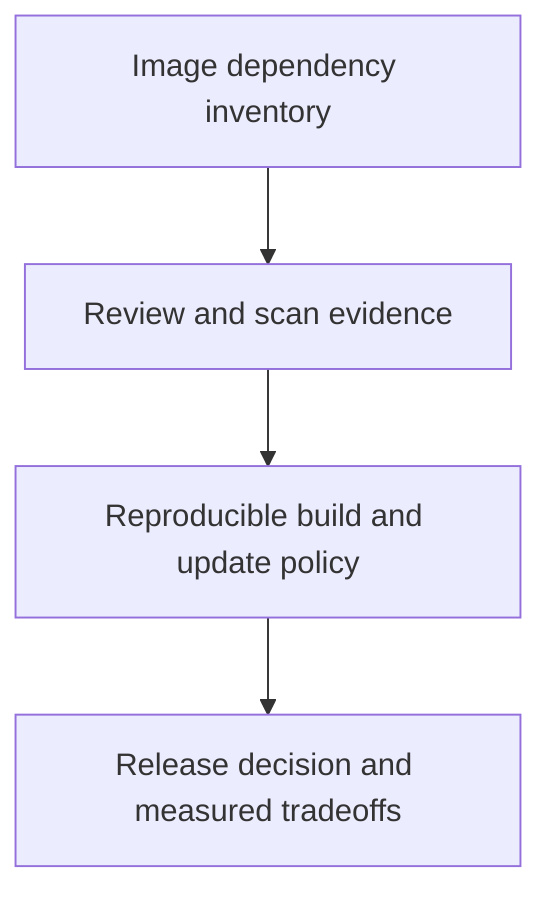

# 0018 · Container scanning, dependency pinning, cold starts, and release tradeoffs

!!! note "Placeholder for a future teaching thread"
    This page is a teaching brief. Expand it into a full interactive lesson in its own thread. The planned exercises and outcomes have not been completed or demonstrated.

**Level:** Intermediate.

## Prerequisites

- [0017 · Container exit codes, stderr, signals, timeouts, and cleanup](0017-container-errors-signals-and-cleanup.md)

## What you will learn to do

- Document a reproducible image dependency and update strategy.
- Choose Docker packaging with a defensible performance and security rationale.

## Explain the Actions behavior

Start from the prerequisite workflow or action behavior and introduce these concepts with focused examples:

1. Image dependencies are part of the action supply chain and need a maintenance process.
2. Scan results describe known findings at a point in time, not a proof of safety.
3. Image size, build reuse, platform support, and startup time are engineering tradeoffs.

Explain the relevant workflow YAML, expressions, and action code in context. Follow the [shared teaching guide](teaching-guide.md) for pacing, expected output, and progression toward independent design.

## Planned local lab

Create an isolated exercise under `labs/0018/` when the lesson is developed. Explain setup and expected output before each command; reuse installed tools rather than reinstalling them on every step.

1. Inventory the starter image base and runtime dependencies.
2. Plan a pinned update and vulnerability-review workflow using current maintainer documentation.
3. Measure a local build/run sample and compare the dependency boundary with the JavaScript alternative without claiming universal timings.

## Break it and diagnose it

Pin an image permanently but never review updates. Explain how reproducibility can coexist with an unmaintained dependency.

Ask for a prediction first. Capture the smallest reproducer, the actual result, and the corrected behavior. State which remaining claim requires a real GitHub or external-service check.

## Planning diagram



When expanding this lesson, refine the diagram to show the actual processes, branches, data exchange, and trust boundaries being taught.

## Retrieval questions

1. Which changes can affect a supposedly unchanged action image?
2. What does a clean scanner report leave unknown?
3. When is the container boundary worth its startup and maintenance cost?

## Evidence to capture in the teaching thread

- A working learner-produced example and an explanation of why it works.
- A reproduced failure, a reasoned repair, and the smallest check that verifies it.
- A short account of remaining limits, unresolved questions, and readiness for the next lesson.

Use [primary references](../references/resources.md) to verify current syntax, runtime support, and tool behavior. Add learning records only for real statements or demonstrated understanding; a placeholder or generated page does not establish mastery.

## Start this lesson in a new thread

```text
/teach 0018

Expand docs/lessons/0018-container-security-and-release-tradeoffs.md in place using docs/lessons/teaching-guide.md.
Read docs/mission.md, NOTES.md, and the prerequisite lesson pages first.
Begin with a short check of the Actions prerequisites. Explain relevant YAML,
expressions, and action contracts, one concept at a time. Let me predict and
try each exercise before revealing its answer. Keep feedback local where possible.
Finish with retrieval questions and a truthful handoff for the next thread.
```

| Previous | All lessons | Next |
| --- | --- | --- |
| [0017 · Container exit codes, stderr, signals, timeouts, and cleanup](0017-container-errors-signals-and-cleanup.md) | [Curriculum](index.md) | [0019 · JavaScript action metadata, the Node runtime, and the Actions Toolkit](0019-javascript-action-runtime-and-toolkit.md) |
