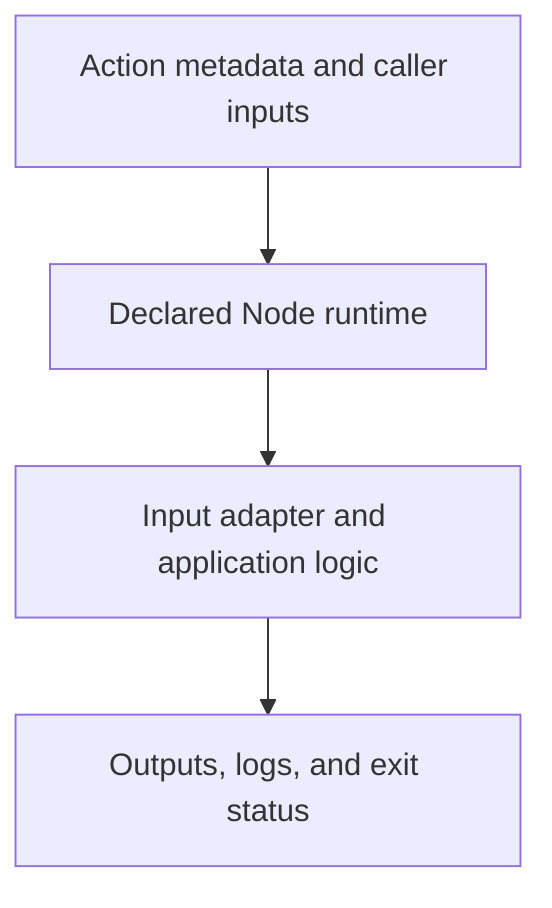

# 0019 · JavaScript action metadata, the Node runtime, and the Actions Toolkit

!!! note "Placeholder for a future teaching thread"
    This page is a teaching brief. Expand it into a full interactive lesson in its own thread. The planned exercises and outcomes have not been completed or demonstrated.

**Level:** Intermediate.

## Prerequisites

- [0018 · Container scanning, dependency pinning, cold starts, and release tradeoffs](0018-container-security-and-release-tradeoffs.md)
- [0005 · Environment files and step, job, and workflow output contracts](0005-environment-files-and-output-contracts.md)

## What you will learn to do

- Trace metadata into the real Node entrypoint and its output.
- Compare explicit standard-library code with the relevant toolkit helper.

## Explain the Actions behavior

Start from the prerequisite workflow or action behavior and introduce these concepts with focused examples:

1. A JavaScript action entrypoint runs in the runtime declared by metadata.
2. An adapter translates input values into calls, output files, logs, and an exit status.
3. Toolkit helpers simplify the runner protocol but do not remove the need to validate the contract.

Explain the relevant workflow YAML, expressions, and action code in context. Follow the [shared teaching guide](teaching-guide.md) for pacing, expected output, and progression toward independent design.

## Planned local lab

Create an isolated exercise under `labs/0019/` when the lesson is developed. Explain setup and expected output before each command; reuse installed tools rather than reinstalling them on every step.

1. Read the dependency-free JavaScript action line by line, including imports and error handling.
2. Verify the runtime declaration against current metadata documentation before extending it.
3. Add a focused toolkit-based variation in a lab and test equivalent input/output behavior without network calls.

## Break it and diagnose it

Declare an input as required but omit actual runtime validation. Use an invalid-input case to expose the incomplete contract.

Ask for a prediction first. Capture the smallest reproducer, the actual result, and the corrected behavior. State which remaining claim requires a real GitHub or external-service check.

## Planning diagram



When expanding this lesson, refine the diagram to show the actual processes, branches, data exchange, and trust boundaries being taught.

## Retrieval questions

1. Who supplies INPUT_NAME and GITHUB_OUTPUT?
2. What does the toolkit abstract for the caller?
3. Which checks remain the responsibility of action code?

## Evidence to capture in the teaching thread

- A working learner-produced example and an explanation of why it works.
- A reproduced failure, a reasoned repair, and the smallest check that verifies it.
- A short account of remaining limits, unresolved questions, and readiness for the next lesson.

Use [primary references](../references/resources.md) to verify current syntax, runtime support, and tool behavior. Add learning records only for real statements or demonstrated understanding; a placeholder or generated page does not establish mastery.

## Start this lesson in a new thread

```text
/teach 0019

Expand docs/lessons/0019-javascript-action-runtime-and-toolkit.md in place using docs/lessons/teaching-guide.md.
Read docs/mission.md, NOTES.md, and the prerequisite lesson pages first.
Begin with a short check of the Actions prerequisites. Explain relevant YAML,
expressions, and action contracts, one concept at a time. Let me predict and
try each exercise before revealing its answer. Keep feedback local where possible.
Finish with retrieval questions and a truthful handoff for the next thread.
```

| Previous | All lessons | Next |
| --- | --- | --- |
| [0018 · Container scanning, dependency pinning, cold starts, and release tradeoffs](0018-container-security-and-release-tradeoffs.md) | [Curriculum](index.md) | [0020 · Pure functions, process adapters, and Node unit tests](0020-pure-functions-and-node-tests.md) |
