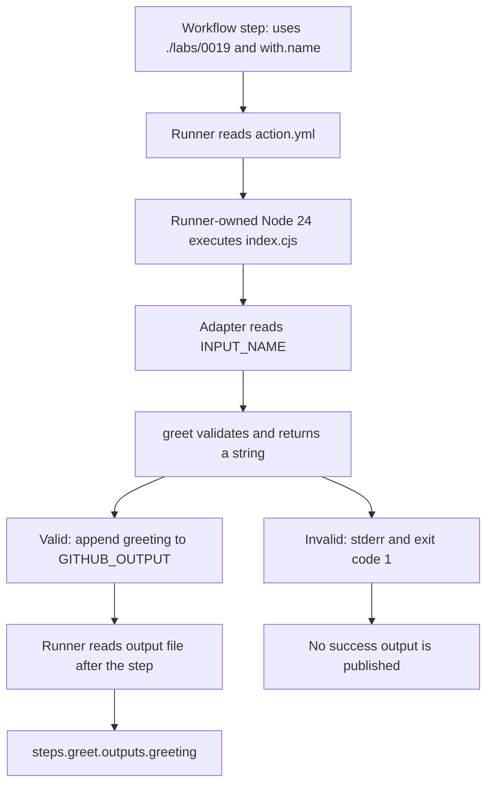

# 0019 · JavaScript action metadata, the Node runtime, and the Actions Toolkit

!!! note "Authored reference lesson"
    This lesson and `labs/0019/` are developed for a guided session. Predict before running the examples or opening solutions. Written material and author-run tests do not establish learner mastery.

## Prerequisites and observable goal

Read [0018 · Container release tradeoffs](0018-container-security-and-release-tradeoffs.md) and [0005 · Output contracts](0005-environment-files-and-output-contracts.md). Recall how a runner reads a named result from `GITHUB_OUTPUT`. If that is unclear, trace the greeting example in 0005 first.

Build and test a Node action that requires a recipient, returns a validated greeting, and fails without publishing a greeting when the input is invalid. Success means you can trace `with.name` through metadata, environment input, application code, output bytes, and the caller's expression.

## From a workflow step to a Node process

A **JavaScript action** is an action whose metadata tells the runner to execute a JavaScript file in a supported Node runtime. It runs directly on the runner. The lab has no container image, package installation step, or shell in its implementation. That reduces packaging requirements for this particular task; a Node action can still acquire external dependencies through its own code.

The complete `labs/0019/action.yml` declares this interface:

```yaml title="labs/0019/action.yml"
name: Module 4 required greeting
description: A dependency-free Node adapter with a required single-line input
inputs:
  name:
    description: Nonempty single-line recipient
    required: true # (1)!
outputs:
  greeting:
    description: Validated greeting
runs:
  using: node24 # (2)!
  main: index.cjs # (3)!
```

1. This documents the requirement. GitHub explicitly states that `required: true` alone does not automatically reject an omitted input. The implementation must enforce it.
2. The runner selects its Node 24 action runtime. This is separate from whichever `node` executable a later shell step finds on `PATH`.
3. The entrypoint is resolved relative to the action directory. The `.cjs` extension explicitly identifies CommonJS, which is the module format used by these small labs.

Current runtime declarations and input behavior were checked against the [metadata reference](https://docs.github.com/en/actions/reference/workflows-and-actions/metadata-syntax) on **2026-10-30**. A consumer does not need `actions/setup-node` just to invoke this Node action. A shell step that builds or tests source has a separate tool-version requirement. Older self-hosted runner installations also need compatibility review before adopting a newer action runtime.

Here is the consumer boundary as a workflow step excerpt:

```yaml title="Within a checked-out job"
- id: greet
  uses: ./labs/0019 # (1)!
  with:
    name: Ada
- name: Consume after greet completes
  env:
    GREETING: ${{ steps.greet.outputs.greeting }} # (2)!
  run: node -e "require('node:assert/strict').equal(process.env.GREETING, 'Hello, Ada!')"
```

1. A local `./` action uses files already present in the caller's workspace. Put checkout before this excerpt. The path is relative to that workspace, not to the workflow YAML file.
2. `id: greet` names the producer for expressions. The runner processes the output file after that producer executes. The later shell starts another process, with the named result explicitly placed in its environment.

This excerpt is explanatory; the executable host exercise below supplies the same input and output-file interfaces directly. No workflow is activated by keeping files under `labs/`.



## The adapter owns the runner protocol

An **adapter** translates a platform interface into application arguments and translates a result back into platform signals. The copied `greet.cjs` owns the greeting rule; the entrypoint owns environment access, output writing, and failure status.

```javascript title="labs/0019/index.cjs"
'use strict';
const { appendFileSync } = require('node:fs');
const { greet } = require('./greet.cjs');

try {
  const greeting = greet(process.env.INPUT_NAME ?? ''); // (1)!
  if (!process.env.GITHUB_OUTPUT) throw new Error('GITHUB_OUTPUT must be set');
  appendFileSync(process.env.GITHUB_OUTPUT, `greeting=${greeting}\n`, 'utf8'); // (2)!
  console.log(greeting);
} catch (error) {
  console.error(error.message);
  process.exitCode = 1; // (3)!
}
```

1. A missing input becomes an empty string and is rejected by `greet`. The runner normally supplies `INPUT_NAME` for `with.name`; a direct Node invocation has to supply it itself. Direct invocation does not read metadata or apply metadata defaults.
2. The output path belongs to this invocation. Appending preserves earlier records. UTF-8 preserves Unicode. The value is restricted to a single line, so it cannot insert a second output record.
3. stderr explains the failure; the nonzero exit code communicates failure to the caller. Printing an error alone would leave a misleading zero exit status. Setting `exitCode` lets normal process shutdown finish rather than immediately interrupting pending I/O.

`greet` rejects nonstrings, empty or whitespace-only input, and either newline character before trimming. It then returns `Hello, <trimmed name>!`. The nullish operator `??` substitutes only for an absent value; it does not silently turn an explicitly blank string into a default.

The output declaration is interface documentation, not a statement that writes a value. `console.log` writes a log. `appendFileSync` writes the runner protocol. These are separate observable channels, as described by [workflow commands](https://docs.github.com/en/actions/reference/workflows-and-actions/workflow-commands).

## Compare the Actions Toolkit interface

The **Actions Toolkit** is a set of maintained packages for action authors. `@actions/core` exposes input, output, state, logging, and failure helpers. `@actions/github` supplies an authenticated Octokit client and event context; it is not needed to format a greeting. See the [JavaScript action tutorial](https://docs.github.com/en/actions/tutorials/create-actions/create-a-javascript-action) and the [core package reference](https://github.com/actions/toolkit/blob/main/packages/core/README.md).

The installed workspace has neither package. The following is a **reference-only replacement adapter**, not an installed or executed lab file:

```javascript title="Toolkit reference excerpt — requires a packaged @actions/core dependency"
const core = require('@actions/core');
const { greet } = require('./greet.cjs');

try {
  const name = core.getInput('name', { required: true, trimWhitespace: false }); // (1)!
  core.setOutput('greeting', greet(name)); // (2)!
} catch (error) {
  core.setFailed(error instanceof Error ? error.message : String(error)); // (3)!
}
```

1. `required` here is an actual helper option. It checks presence; domain validation still belongs to `greet`. Disabling automatic trimming lets that function see and reject newline-bearing input before normalization.
2. The helper handles the runner's output-file protocol, including encoding multiline values. It does not decide whether a greeting should allow multiple lines.
3. `setFailed` sets a failure exit code and emits an error annotation. `core.error` alone logs an annotation and does not set the exit code.

| Public responsibility | Runnable standard-library lab | Toolkit reference |
| --- | --- | --- |
| Obtain a string | `process.env.INPUT_NAME` | `core.getInput('name', options)` |
| Enforce greeting rules | `greet(name)` | The same `greet(name)` |
| Publish a named result | Append a validated single-line record | `core.setOutput` |
| Communicate failure | stderr plus `process.exitCode = 1` | `core.setFailed` |

These approaches can preserve the same **semantic** contract. Do not assert identical bytes: Toolkit may use a delimiter record where the lab uses a single-line record. No Toolkit runtime compatibility or package-version claim is established by executing the dependency-free comparison. Packaging dependencies is developed in [0021](0021-typescript-bundling-and-dist-drift.md).

## Predict, then inspect all channels

From the repository root, predict the status, stdout, stderr, and output file for a recipient of `Ada`:

```bash
node labs/0019/demo.cjs
```

The helper starts the real entrypoint with a temporary output file, captures its channels, and deletes the temporary directory. Expected JSON:

```json
{
  "status": 0,
  "stdout": "Hello, Ada!\n",
  "stderr": "",
  "output": "greeting=Hello, Ada!\n"
}
```

The demo itself exits zero after displaying the child's result. Its `status` field describes the action process; use the test suite to assert that field automatically.

Next, predict whether the required input declaration can make the deliberately broken implementation reject an omitted recipient:

```bash
node labs/0019/demo.cjs --broken --missing
node labs/0019/demo.cjs --missing
```

The broken child exits **0** and writes `greeting=Hello, !`. The repaired child exits **1**, reports `name must be a nonempty, single-line string`, and leaves the output file empty.

??? tip "Worked diagnosis and repair"
    The broken process never calls validation. Metadata cannot supply the missing check. Follow `INPUT_NAME` into `broken.cjs`: it formats an empty string immediately. `index.cjs` repairs the boundary by calling `greet` before any output write. In an actual runner invocation, `required: true` still does not provide automatic runtime rejection. The direct exercise isolates the missing implementation check without pretending to execute metadata.

Run the full focused check:

```bash
node --test labs/0019/action.test.cjs
```

Expected: **8 tests pass**. Cases include append behavior, missing and blank input, CR/LF rejection, Unicode and literal shell-like text, missing output path, and reproduction of the broken implementation. The broken-example test passes because it accurately observes the deliberate defect; it does not certify the broken adapter as suitable for release.

## Guided change, transfer, and retrieval

1. Inspect `greet.cjs` and add a test case for a name with leading and trailing spaces. Explain why validation occurs before normalization.
2. Add a case for `$(exit 99)` as input. Decide whether any shell interprets it inside this action.
3. Transfer: design a `release-channel` input restricted to `stable` or `preview`. Identify what metadata can document and which code must reject an unknown value.

??? tip "Worked exercise"
    The existing append test uses `  Ada  ` and expects `Hello, Ada!`. The literal-data test already includes shell-like text: Node passes it through the string function and never invokes a shell. For a channel input, document the accepted strings, read `process.env['INPUT_RELEASE-CHANNEL']` or use `core.getInput('release-channel')`, validate membership, and fail before publishing a channel output. Hyphens in input IDs remain hyphens in environment names; bracket notation avoids treating the name as JavaScript subtraction.

Explain without rereading:

1. Who selects the runtime, and why would changing shell `PATH` not change `runs.using`?
2. Which three observables distinguish a truthful invalid-input failure from a successful greeting?
3. What does Toolkit simplify, and which application rules remain yours?
4. Does a direct Node test verify checkout order or `steps.greet.outputs.greeting`?

??? tip "Retrieval check"
    The runner interprets metadata and starts its action runtime. A failed child has nonzero status, diagnostic stderr, and no greeting output. Toolkit handles platform transport and convenience helpers; the application defines acceptable names and failure policy. A process test supplies environment/files directly, so checkout, metadata dispatch, and expression mapping still need workflow evidence.

## Verification limits and next session

The host suite exercises Node 24 on the current machine, real environment reads, file bytes, and child exit codes. It does not execute a GitHub runner or the uninstalled Toolkit excerpt. Actual runner selection, action input injection, output parsing, and hosted OS behavior remain integration checks. No container, `act`, API, or hosted run is needed to establish this greeting's function contract. Use the [local-testing guide](../cheatsheet/local-testing.md) to choose the next layer deliberately.

Continue to [0020](0020-pure-functions-and-node-tests.md), separating application logic from the process adapter. The Module 4 handoff records source checks dated **2026-10-30**; the [curated source library](../references/resources.md) remains the entry point for references.

| Previous Lesson | All Lessons | Next Lesson |
| --- | --- | --- |
| [0018 · Container scanning, dependency pinning, cold starts, and release tradeoffs](0018-container-security-and-release-tradeoffs.md) | [Curriculum](index.md) | [0020 · Pure functions, process adapters, and Node unit tests](0020-pure-functions-and-node-tests.md) |
