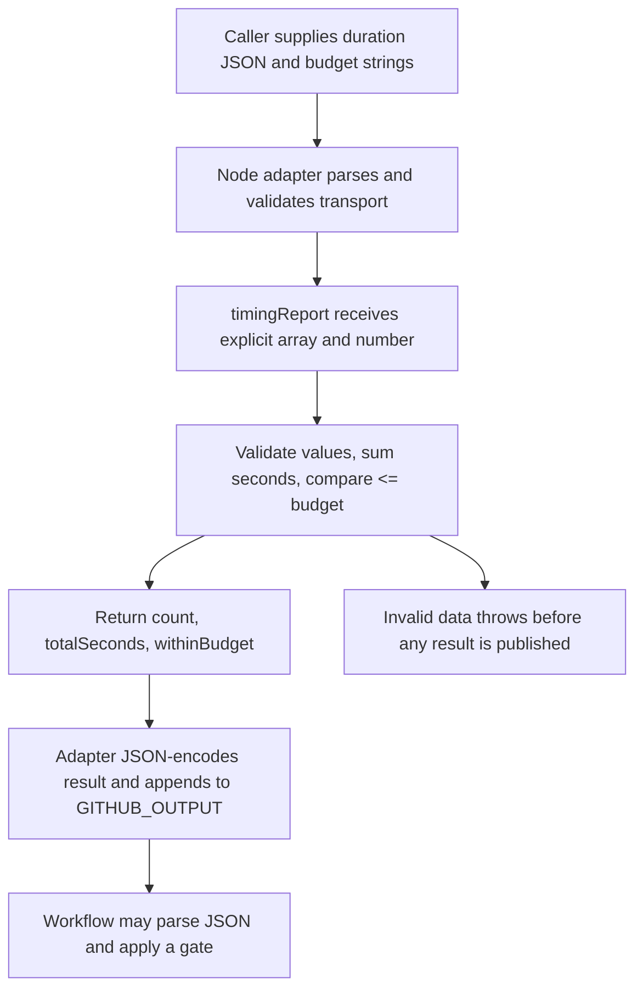

# 0020 · Pure functions, process adapters, and Node unit tests

`labs/0020/` separates a deterministic timing-report function from its Node adapter. Use the temporary mutation experiment to see which tests catch a broken failure path.

## Separate the policy from its transport

The existing `examples/javascript-action/greet.cjs` already receives a value and returns a value. Its companion entrypoint reads environment strings and writes outputs. Inspect that split before extending it into the timing-report lab. The shared example remains unchanged.

A **pure function** depends on explicit arguments and returns a result without reading environment variables, doing I/O, or changing its arguments. This makes a rule testable without constructing a workflow. The function sums the supplied durations and checks whether the total exceeds the supplied budget.

```javascript title="Core of labs/0020/report.cjs"
function timingReport(durations, budget) {
  if (!Array.isArray(durations) || durations.some(value => !Number.isFinite(value) || value < 0)) {
    throw new Error('durations must be an array of finite nonnegative seconds');
  }
  if (!Number.isFinite(budget) || budget < 0) {
    throw new Error('budget must be finite nonnegative seconds');
  }
  const totalSeconds = durations.reduce((total, value) => total + value, 0); // (1)!
  if (!Number.isFinite(totalSeconds)) throw new Error('total duration overflow');
  return { count: durations.length, totalSeconds, withinBudget: totalSeconds <= budget }; // (2)!
}
```

1. The explicit initial value `0` makes an empty array meaningful. Nothing is fetched from GitHub; the caller supplies durations.
2. Equality is within budget. The Boolean is a JavaScript value inside the returned object; publishing JSON later makes the enclosing action output a string.

This is a teaching contract for supplied finite JSON numbers, not a measurement system or a billing estimator. Floating-point decimals have ordinary JavaScript number semantics. If exact subsecond accounting becomes a requirement, accept integer milliseconds and update the documented unit deliberately.



## The adapter translates strings once

`labs/0020/action.yml` declares `durations` with default `'[]'`, `budget` with default `'10'`, and a JSON `report` output. The complete `index.cjs` uses those same defaults for direct invocation, because a local Node command does not interpret metadata.

```javascript title="Adapter excerpt"
const rawBudget = process.env.INPUT_BUDGET ?? '10';
if (!rawBudget.trim()) throw new Error('budget must not be blank'); // (1)!
const report = timingReport(
  JSON.parse(process.env.INPUT_DURATIONS ?? '[]'), // (2)!
  Number(rawBudget)
);
if (!process.env.GITHUB_OUTPUT) throw new Error('GITHUB_OUTPUT must be set');
appendFileSync(process.env.GITHUB_OUTPUT, `report=${JSON.stringify(report)}\n`, 'utf8');
```

1. `Number(' ')` would be zero. Rejecting a blank input before conversion prevents accidental acceptance as a zero-second budget.
2. JSON distinguishes `[3]` from `["3"]`. Parsing alone does not ensure the domain shape; the function rejects string elements and negative or nonfinite values. The outer `try/catch` prints a diagnostic and sets exit code 1 for malformed JSON, invalid domain data, or output failures.

An exceeded budget is **a valid report**, with `withinBudget: false` and process exit zero. This action computes information; the caller decides whether that information should fail a workflow. Invalid input is an execution failure and yields no report. That distinction prevents a policy choice from being accidentally hidden in transport code.

```yaml title="Caller excerpt after checkout"
- id: timing
  uses: ./labs/0020
  with:
    durations: '[2,3]'
    budget: '5'
- name: Gate the valid report
  if: ${{ !fromJSON(steps.timing.outputs.report).withinBudget }} # (1)!
  run: node -e "process.exitCode = 1"
```

1. `fromJSON` recovers the Boolean inside the JSON output. Comparing or using the raw output as a Boolean would instead operate on a nonempty string. See [0004 · Expressions](0004-contexts-expressions-and-conditions.md). With the supplied values the gate is skipped; using budget `'4'` makes it run and fail. Normal step success conditions prevent this gate from running after the producer fails.

This excerpt explains workflow mapping; host tests below verify the function and adapter separately.

## Predict the exact-budget case

Before running, write the expected object for `timingReport([2, 3], 5)` and `timingReport([], 0)`. Then execute from the repository root:

```bash
node --test labs/0020/report.test.cjs
```

Expected: **4 tests pass**. The exact-budget assertion is:

```javascript title="Public-result assertion"
assert.deepEqual(timingReport([2, 3], 5), {
  count: 2,
  totalSeconds: 5,
  withinBudget: true,
});
```

The suite also checks zero/empty behavior, malformed arguments, overflow, repeated calls, and a frozen input array. It checks results callers can observe rather than counting calls to `reduce` or requiring a particular internal loop.

??? tip "Worked predictions"
    `[2, 3]` sums to 5, so the exact-budget result is within budget. The empty array sums to zero and is within a zero budget. A negative duration is invalid; it should not make an expensive workflow appear cheaper. The frozen input case guards against an implementation that mutates the caller's data.

Node's built-in [test runner](https://nodejs.org/docs/latest-v24.x/api/test.html) runs these assertions without a third-party testing framework. The installed Node is 24.21.0; timings and console reporter decoration vary by environment, so assert behavior and the pass/fail summary rather than a fixed duration.

## Test the actual entrypoint too

The adapter reads `INPUT_DURATION` instead of the declared `INPUT_DURATIONS`. Predict whether the pure-function tests would detect this bug. The function itself would remain correct.

```bash
node --test labs/0020/process.test.cjs
```

Expected: **4 tests pass**. The helper reused from `labs/0019/process.cjs` launches the actual entrypoint from an unrelated temporary working directory. It supplies input strings and a real output path, reads the resulting bytes, and deletes its temporary files.

For `[2,3]` and budget `5`, expected evidence is:

```text
child status: 0
stderr: empty
output file: report={"count":2,"totalSeconds":5,"withinBudget":true}
```

The file ends with one newline. The suite uses malformed `'['` and valid-but-wrong-shape `'["3"]'` as distinct cases; both must be diagnosed before a report is appended. A blank budget also fails. Budget `5` with durations `[6]` succeeds as a report and publishes `withinBudget: false`.

??? tip "Why the adapter test catches the typo"
    The test supplies `INPUT_DURATIONS='[2,3]'` and expects a count of 2 and total of 5. A misspelled environment lookup falls back to `[]`, yielding count 0 and total 0. The exact output assertion fails, even though every direct call to `timingReport` still works. Repair the input lookup rather than weakening the assertion.

## Break a real rule and prove the test can detect it

Predict the result of replacing `<=` with `<` in the budget comparison. Then run:

```bash
node labs/0020/mutation.cjs
```

Expected:

```text
PASS: exact-budget assertion rejected the <= to < mutant (test exit 1).
```

The script creates a temporary copy **inside this lab**, changes only that operator, and runs the existing function assertions against the changed copy. The inner test run exits 1. The outer experiment exits 0 only after observing that intended rejection, then removes the copy. The maintained implementation is untouched.

??? tip "Diagnosis and repair"
    The defect changes the public rule at exactly the equality boundary. Restore `<=`; the exact-budget assertion passes again. A suite with only totals far below or above budget could miss this mutation. The experiment establishes sensitivity to this particular regression, not proof against every possible defect.

For a second deliberate failure, in your own lab copy replace `budget` inside the function with `Number(process.env.INPUT_BUDGET ?? 10)`. Call the function twice with the same arguments while changing that environment value. Predict what happens before trying it.

??? tip "Hidden-state diagnosis"
    The function now reads a hidden budget as well as its `budget` argument. Identical arguments can produce different answers. A test that leaves the environment changed can also affect later tests. Keep environment reading in `index.cjs`, pass the number once, and keep the function independent of process configuration. A regression test can call with an explicit budget under two environments and require the same result, restoring the environment afterward.

## Transfer and retrieval

Design an action that takes check results and reports the names of failed checks. Specify a pure function's arguments and return value, then specify the adapter's input format and error policy. Include an empty list and one malformed element in the proposed tests.

??? tip "One worked design"
    Accept an array of objects with a nonempty check name and a status from a documented set. Return a failed-name array and a conclusion. Keep event loading, API calls, and output-file writes outside that function. Test an empty list, all passing, one failure, an unknown status, and missing names. The adapter parses one JSON input, calls the validator/function, writes one JSON output after success, and fails without a result on invalid input. The caller explicitly decides whether a reported failure blocks a later job.

Answer from memory:

1. Why is `JSON.parse` insufficient validation for a duration array?
2. Which property does the exact-budget assertion protect?
3. What does a real process test prove that a unit test cannot?
4. Why does a valid `withinBudget: false` result still have exit code zero?

??? tip "Retrieval check"
    Valid JSON can contain strings, objects, nulls, or negative values that violate the timing contract. The assertion protects inclusive equality at the budget boundary. Process tests observe environment names, parsing, file writes, stderr, and exit status. A budget exceedance is valid domain data here; workflow failure is an explicit consumer policy.

## Verification limits and next session

Function tests check the report rules with fixed inputs. Process tests check how the Node adapter reads inputs, writes outputs, and reports failure. They do not measure real workflow duration, execute metadata, evaluate the gate expression, or prove GitHub output consumption. There are no API or hosted calls in this lab. The [local-testing guide](../cheatsheet/local-testing.md) explains when to add a workflow run.

Primary references were checked on **2026-10-30** through the [curated library](../references/resources.md); commands and author-run evidence are recorded in the module handoff. Continue to [0021](0021-typescript-bundling-and-dist-drift.md), where correct source code can still be packaged incorrectly.

| Previous lesson | All lessons | Next lesson |
| --- | --- | --- |
| [0019 · JavaScript action metadata, the Node runtime, and the Actions Toolkit](0019-javascript-action-runtime-and-toolkit.md) | [Curriculum](index.md) | [0021 · TypeScript compilation, bundling, and committed distribution files](0021-typescript-bundling-and-dist-drift.md) |
