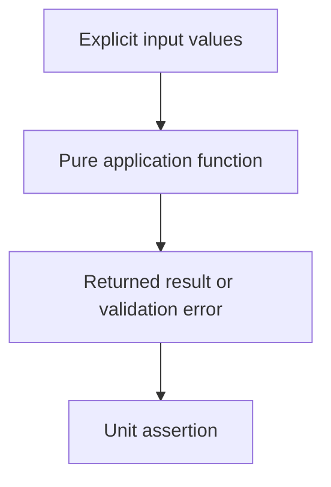

# 0020 · Pure functions, process adapters, and Node unit tests

!!! note "Placeholder for a future teaching thread"
    This page is a teaching brief. Expand it into a full interactive lesson in its own thread. The planned exercises and outcomes have not been completed or demonstrated.

**Level:** Intermediate.

## Prerequisites

- [0019 · JavaScript action metadata, the Node runtime, and the Actions Toolkit](0019-javascript-action-runtime-and-toolkit.md)
- [0009 · Unit tests, event fixtures, and temporary output files](0009-unit-tests-fixtures-and-output-files.md)

## What you will learn to do

- Design a small reusable function with explicit inputs and returned results.
- Separate function tests from real entrypoint tests.

## Explain the Actions behavior

Start from the prerequisite workflow or action behavior and introduce these concepts with focused examples:

1. A pure function makes behavior observable without process or network setup.
2. An entrypoint adapter owns environment and filesystem interaction.
3. A meaningful test changes its result when the intended public behavior breaks.

Explain the relevant workflow YAML, expressions, and action code in context. Follow the [shared teaching guide](teaching-guide.md) for pacing, expected output, and progression toward independent design.

## Planned local lab

Create an isolated exercise under `labs/0020/` when the lesson is developed. Explain setup and expected output before each command; reuse installed tools rather than reinstalling them on every step.

1. Inspect the existing greet function and its Node tests.
2. Extend a deterministic report function with valid, empty, and boundary cases.
3. Keep process input/output in a thin adapter and show how both test layers expose different defects.

## Break it and diagnose it

Move an environment lookup into the pure function and observe how hidden state makes the test less reproducible.

Ask for a prediction first. Capture the smallest reproducer, the actual result, and the corrected behavior. State which remaining claim requires a real GitHub or external-service check.

## Planning diagram



When expanding this lesson, refine the diagram to show the actual processes, branches, data exchange, and trust boundaries being taught.

## Retrieval questions

1. Which dependencies are visible in the function interface?
2. When should a test execute the real process?
3. How would you show that an assertion detects a real defect?

## Evidence to capture in the teaching thread

- A working learner-produced example and an explanation of why it works.
- A reproduced failure, a reasoned repair, and the smallest check that verifies it.
- A short account of remaining limits, unresolved questions, and readiness for the next lesson.

Use [primary references](../references/resources.md) to verify current syntax, runtime support, and tool behavior. Add learning records only for real statements or demonstrated understanding; a placeholder or generated page does not establish mastery.

## Start this lesson in a new thread

```text
/teach 0020

Expand docs/lessons/0020-pure-functions-and-node-tests.md in place using docs/lessons/teaching-guide.md.
Read docs/mission.md, NOTES.md, and the prerequisite lesson pages first.
Begin with a short check of the Actions prerequisites. Explain relevant YAML,
expressions, and action contracts, one concept at a time. Let me predict and
try each exercise before revealing its answer. Keep feedback local where possible.
Finish with retrieval questions and a truthful handoff for the next thread.
```

| Previous | All lessons | Next |
| --- | --- | --- |
| [0019 · JavaScript action metadata, the Node runtime, and the Actions Toolkit](0019-javascript-action-runtime-and-toolkit.md) | [Curriculum](index.md) | [0021 · TypeScript compilation, bundling, and committed distribution files](0021-typescript-bundling-and-dist-drift.md) |
