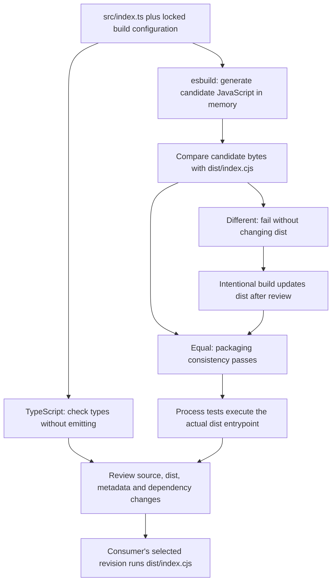

# 0021 · TypeScript compilation, bundling, and committed distribution files

!!! note "Authored reference lesson"
    `labs/0021/` has TypeScript source, a generated JavaScript distribution, independent type and drift checks, artifact tests, and a safe stale-bundle experiment. Predict each result before opening a solution. Authorship does not establish learner mastery.

## Prerequisites and goal

Read [0020 · Pure functions and process tests](0020-pure-functions-and-node-tests.md). Recall that a direct test runs the file you select; a consumer runs the file selected by action metadata. These may be different files.

Demonstrate a passing type check alongside a stale executable, then repair packaging intentionally. Success means you can identify exactly which source, generated bytes, metadata, and dependency configuration belong in a release review.

## The consumer executes JavaScript

**TypeScript** adds a type-checking layer to authored source. In this lesson it is not a separate Actions runtime. The action metadata still selects Node 24:

```yaml title="labs/0021/action.yml — runtime section"
runs:
  using: node24
  main: dist/index.cjs # (1)!
```

1. The runner executes the distribution file at the consumer's selected revision. It does not run the repository's build script first, type-check the source, or install the author's development dependencies.

A **distribution artifact** is the executable file shipped for consumers. A **bundle** combines reachable application modules and dependencies into that artifact. This lab extends the existing TypeScript example inside its assigned lab directory; shared source and `dist` remain unchanged.



The vertical paths show complementary checks. A passing type check says nothing about whether a previously generated bundle matches current source. A byte-for-byte match says nothing about whether that source implements the desired behavior.

## Read the smallest source-to-runtime path

The source contains the same single-line greeting contract as 0019. Its exported function has a type annotation:

```typescript title="labs/0021/src/index.ts — function excerpt"
export function greet(name: string): string { // (1)!
  if (typeof name !== 'string' || /[\r\n]/u.test(name) || !name.trim()) {
    throw new Error('name must be a nonempty, single-line string');
  }
  return `Hello, ${name.trim()}!`;
}
```

1. `name: string` and the return annotation describe the source-level interface. They disappear from executable JavaScript. The validation remains and protects runtime data.

The remainder reads `INPUT_NAME`, validates it, requires `GITHUB_OUTPUT`, appends a greeting, and sets a failing exit code on error. The whole module is an entrypoint with top-level effects. Tests execute it as a child process instead of importing it and unintentionally running the adapter in the test process. If application logic grows, put it in a separate importable module as in 0020.

The lab's `tsconfig.json` enables strict checking, Node module resolution, Node types, and `noEmit`. Its `include` points only at this lab's source. It does not change the root project configuration.

The shared build options live in `bundle.cjs`:

```javascript title="Bundling options excerpt"
buildSync({
  absWorkingDir: __dirname, // (1)!
  entryPoints: ['src/index.ts'],
  outfile: 'dist/index.cjs',
  bundle: true,
  platform: 'node',
  target: 'node24', // (2)!
  format: 'cjs',
  write: false, // (3)!
  logLevel: 'silent',
});
```

1. The build uses the lab directory independently of the command's current directory. Relative source labels keep machine-specific absolute paths out of this small artifact.
2. `platform`, `target`, and `format` control different choices: Node conventions, supported syntax, and CommonJS module output. The target does not install Node or prove the host provides every API used by the code.
3. esbuild returns bytes in memory. Both `build.cjs` and `check-dist.cjs` use this same function; only the build script writes those bytes to the shipping file.

esbuild removes TypeScript syntax but **does not perform TypeScript type checking**. Run the installed compiler independently. See the [esbuild TypeScript documentation](https://esbuild.github.io/content-types/#typescript), [build API](https://esbuild.github.io/api/), and [TypeScript Handbook](https://www.typescriptlang.org/docs/handbook/intro.html), checked **2026-10-30**.

## Three checks, three claims

Run from the repository root using already-installed tools:

```bash
node node_modules/typescript/bin/tsc --project labs/0021/tsconfig.json
node labs/0021/check-dist.cjs
node --test labs/0021/artifact.test.cjs
```

Expected:

| Check | Expected result | Established property |
| --- | --- | --- |
| TypeScript compiler | No diagnostics, exit 0 | Source satisfies the configured type checks |
| Drift check | `PASS: labs/0021/dist/index.cjs matches source.` | Current installed builder reproduces the shipped bytes |
| Artifact tests | 4 tests pass | Real bundled entrypoint satisfies the tested process contract |

The artifact tests check a greeting from an unrelated working directory, default and Unicode behavior, invalid input with no output, and the required output path. They run `dist/index.cjs`, not the `.ts` file. Timings are not fixed expectations.

!!! tip "Predict before repairing anything"
    You change `Hello,` to `Welcome,` in source and run the type checker. Which file changes? What does a consumer still print? Should a command called `check-dist` silently build the shipping artifact first?

## Reproduce a stale bundle without changing the maintained lab

```bash
node labs/0021/drift-demo.cjs
```

Expected:

```text
typecheck exit=0
drift check exit=1; dist unchanged
consumer before build: Hello, Ada!
intentional build + drift check exit=0
consumer after build: Welcome, Ada!
```

The script creates a temporary copy under `labs/0021/`, changes one literal in source, runs the installed compiler, compares `dist`, and launches the stale bundle. It asserts that the failed comparison leaves `dist` untouched. It then explicitly builds, repeats the comparison, executes the repaired bundle, and removes the temporary copy.

The **inner drift check** exits 1 because stale packaging is the expected defect. The **outer demonstration** exits 0 only when all those assertions hold. That distinction prevents a deliberately failing example from being mistaken for an unresolved module failure.

??? tip "Worked diagnosis"
    A valid new string literal remains type-correct. Because `noEmit` is set, the compiler changes no executable. Metadata still selects the old `dist/index.cjs`, so the consumer receives the old greeting. Rebuild intentionally and inspect both the source change and its generated representation. A checker that automatically repaired the bundle would erase the evidence that the proposed release was incomplete.

## Make and review a deliberate change

In a lab copy, change the greeting rule and update the expected artifact behavior to match the intended contract. First run the checker so you can see the stale state. Then repair it with:

```bash
node labs/0021/build.cjs
node node_modules/typescript/bin/tsc --project labs/0021/tsconfig.json
node labs/0021/check-dist.cjs
node --test labs/0021/artifact.test.cjs
```

The build prints `Built labs/0021/dist/index.cjs.`. The remaining commands should pass after the expectations and implementation agree. A build command writes an artifact; a test decides whether its behavior is acceptable. Changing an assertion merely to match an accidental implementation change is not a repair.

Use a scoped review so another module's uncommitted work stays out of this exercise:

```bash
git diff -- labs/0021/
git status --short -- labs/0021/
```

New files do not appear in an ordinary unstaged diff until tracked, so inspect newly authored lab files directly too. This lesson does not request staging or committing anything. In a standalone action repository, publish source, required distribution files, action metadata, license notices, and release notes at the intended revision according to that repository's packaging policy.

??? tip "Worked review questions"
    Does metadata still point to the generated file? Does the artifact contain the new behavior? Are unexpected dependency bytes or absolute paths present? Can a clean checkout with the same locked tool versions reproduce it? Do tests exercise the artifact a consumer receives? Are any imported assets or dynamic modules left outside the bundle and therefore required separately? A bundle is not automatically self-contained just because it has one entrypoint.

## Dependencies are part of the shipped contract

The installed workspace uses TypeScript **7.0.2** and esbuild **0.28.2**, with Node **24.21.0** during this authoring check. The lesson reuses the existing root lockfile and installed packages; it adds no dependencies or root scripts. A later tool update may legitimately change generated bytes even when application behavior does not change. Review that tool diff and regenerated artifact deliberately.

This action imports Node's built-in filesystem module, which remains provided by the runtime. A bundled third-party package contributes shipped code and license/security obligations. Native addons, external binaries, dynamic imports, or data files can require additional artifacts and OS-specific verification. The [maintained TypeScript action template](https://github.com/actions/typescript-action) is a reference for fuller repositories; its exact tooling is not a requirement to replace this already-installed minimal setup.

Adding `@actions/core` later would require a reviewed dependency/lockfile change in the owning project and a regenerated bundle. The uninstalled Toolkit excerpt from 0019 is not proof that a consumer can resolve that package. Do not depend on the consumer running `npm install` inside your action directory.

## Transfer and retrieval

A teammate changes a dependency version, sees all unit tests pass, and leaves `dist` unchanged. Design the smallest additional checks before releasing. Then consider a missing `assets/schema.json` file loaded at runtime: which check should execute from an unrelated working directory or clean checkout?

??? tip "Worked transfer"
    Run type checking, regenerate a candidate in memory with the locked builder, compare it with the proposed shipping bytes, and execute the shipped entrypoint. If comparison fails, build explicitly and review the dependency plus artifact changes. An artifact smoke test that runs from a temporary directory and exercises the schema-loading path catches many packaging omissions, but a clean checkout or packaged-file inventory is also needed to detect a file accidentally available only on the author's disk.

Explain from memory:

1. Which file does the runner execute?
2. Why can esbuild succeed when the TypeScript checker fails?
3. Why must checking and rebuilding remain separate commands?
4. Does a fresh bundle prove the application has no defects?

??? tip "Retrieval check"
    The runner uses the path in `runs.main`. esbuild transpiles and bundles without doing semantic type checking. A check must preserve stale evidence and fail until an explicit repair occurs. Freshness establishes source/artifact agreement under a toolchain, while behavior and integration require their own assertions.

## Verification limits and next session

Local checks prove the listed source, bytes, and process behaviors on this host. They do not prove a remote tag contains these files, a release points to the reviewed revision, older runners support the runtime, or a native dependency works on every supported OS. No release, push, container, or hosted execution occurs here. The inactive `labs/0019/module5-contracts.yml` can later test all six local action interfaces in one runner job; static linting is not execution evidence.

Primary sources were checked on **2026-10-30** and are indexed in the module handoff alongside the [curated library](../references/resources.md). Capture the learner's stale-bundle prediction and review rationale during teaching. Continue to [0022](0022-output-contracts-and-mocked-github-api.md) for asynchronous service adapters.

## Start this lesson in a new thread

```text
/teach 0021

Use docs/lessons/0021-typescript-bundling-and-dist-drift.md and labs/0021/.
Read docs/mission.md, NOTES.md, docs/lessons/teaching-guide.md, and lesson 0020.
Ask what the consumer executes before running the safe drift experiment.
Let me distinguish type, packaging, behavior, and release-reference evidence.
Pause before worked solutions. Use installed tools without dependency changes.
Record actual learner evidence and continue at exact file
docs/lessons/0022-output-contracts-and-mocked-github-api.md.
```

| Previous Lesson | All Lessons | Next Lesson |
| --- | --- | --- |
| [0020 · Pure functions and Node tests](0020-pure-functions-and-node-tests.md) | [Curriculum](index.md) | [0022 · Outputs and mocked API responses](0022-output-contracts-and-mocked-github-api.md) |
