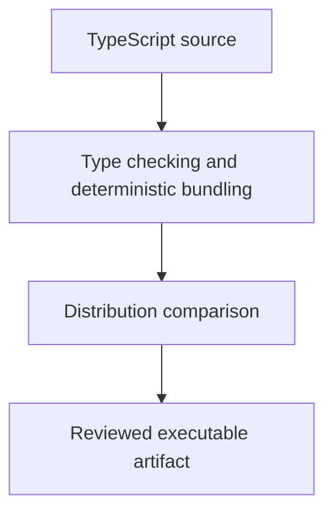

# 0021 · TypeScript compilation, bundling, and committed distribution files

!!! note "Placeholder for a future teaching thread"
    This page is a teaching brief. Expand it into a full interactive lesson in its own thread. The planned exercises and outcomes have not been completed or demonstrated.

**Level:** Intermediate.

## Prerequisites

- [0020 · Pure functions, process adapters, and Node unit tests](0020-pure-functions-and-node-tests.md)

## What you will learn to do

- Explain the source-to-bundle release path.
- Demonstrate that a stale distribution file fails a check until explicitly rebuilt.

## Explain the Actions behavior

Start from the prerequisite workflow or action behavior and introduce these concepts with focused examples:

1. The consumer executes distributed JavaScript, not the TypeScript source tree.
2. Type checking, bundling, and distribution comparison establish different properties.
3. A verification command should detect a stale artifact without silently repairing the evidence.

Explain the relevant workflow YAML, expressions, and action code in context. Follow the [shared teaching guide](teaching-guide.md) for pacing, expected output, and progression toward independent design.

## Planned local lab

Create an isolated exercise under `labs/0021/` when the lesson is developed. Explain setup and expected output before each command; reuse installed tools rather than reinstalling them on every step.

1. Read the TypeScript source and bundled entrypoint with a guided comparison.
2. Change a small behavior and run type checking and the bundle-drift check separately.
3. Rebuild intentionally, rerun the tests, and inspect the exact source and artifact diff that would be released.

## Break it and diagnose it

Make type checking pass while leaving dist unchanged. Explain why a consumer still sees old behavior.

Ask for a prediction first. Capture the smallest reproducer, the actual result, and the corrected behavior. State which remaining claim requires a real GitHub or external-service check.

## Planning diagram



When expanding this lesson, refine the diagram to show the actual processes, branches, data exchange, and trust boundaries being taught.

## Retrieval questions

1. Which file does action metadata point to?
2. Why does a passing compiler check not prove fresh packaging?
3. Why keep the drift check separate from the repair command?

## Evidence to capture in the teaching thread

- A working learner-produced example and an explanation of why it works.
- A reproduced failure, a reasoned repair, and the smallest check that verifies it.
- A short account of remaining limits, unresolved questions, and readiness for the next lesson.

Use [primary references](../references/resources.md) to verify current syntax, runtime support, and tool behavior. Add learning records only for real statements or demonstrated understanding; a placeholder or generated page does not establish mastery.

## Start this lesson in a new thread

```text
/teach 0021

Expand docs/lessons/0021-typescript-bundling-and-dist-drift.md in place using docs/lessons/teaching-guide.md.
Read docs/mission.md, NOTES.md, and the prerequisite lesson pages first.
Begin with a short check of the Actions prerequisites. Explain relevant YAML,
expressions, and action contracts, one concept at a time. Let me predict and
try each exercise before revealing its answer. Keep feedback local where possible.
Finish with retrieval questions and a truthful handoff for the next thread.
```

| Previous | All lessons | Next |
| --- | --- | --- |
| [0020 · Pure functions, process adapters, and Node unit tests](0020-pure-functions-and-node-tests.md) | [Curriculum](index.md) | [0022 · Output files, failure status, and mocked GitHub API responses](0022-output-contracts-and-mocked-github-api.md) |
