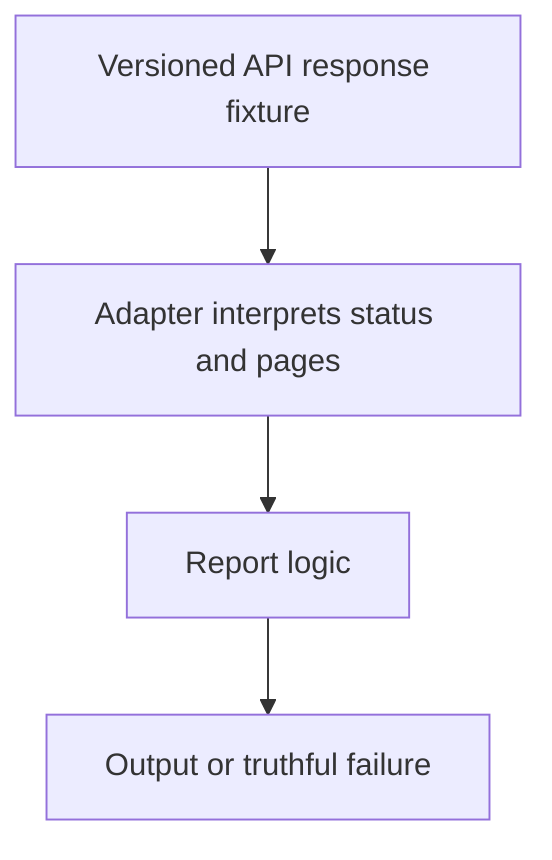

# 0022 · Output files, failure status, and mocked GitHub API responses

!!! note "Placeholder for a future teaching thread"
    This page is a teaching brief. Expand it into a full interactive lesson in its own thread. The planned exercises and outcomes have not been completed or demonstrated.

**Level:** Intermediate.

## Prerequisites

- [0021 · TypeScript compilation, bundling, and committed distribution files](0021-typescript-bundling-and-dist-drift.md)
- [0009 · Unit tests, event fixtures, and temporary output files](0009-unit-tests-fixtures-and-output-files.md)

## What you will learn to do

- Test a repository API adapter with deterministic response fixtures.
- Propagate a failure without fabricating a successful output.

## Explain the Actions behavior

Start from the prerequisite workflow or action behavior and introduce these concepts with focused examples:

1. An API adapter translates response status and data into domain results or failures.
2. Mock responses isolate pagination, rate limits, and unavailable services from remote credentials.
3. Retry policy must consider operation semantics, deadlines, and whether a repeated write is safe.

Explain the relevant workflow YAML, expressions, and action code in context. Follow the [shared teaching guide](teaching-guide.md) for pacing, expected output, and progression toward independent design.

## Planned local lab

Create an isolated exercise under `labs/0022/` when the lesson is developed. Explain setup and expected output before each command; reuse installed tools rather than reinstalling them on every step.

1. Create a tiny report function driven by a fake GitHub client or static response adapter.
2. Exercise multiple pages, empty results, denied access, rate limiting, and a transient failure.
3. Check the final output file and exit status, then identify the smallest real-service integration still needed.

## Break it and diagnose it

Treat an error response as an empty successful report or retry a non-idempotent operation blindly. Diagnose the misleading or duplicated result.

Ask for a prediction first. Capture the smallest reproducer, the actual result, and the corrected behavior. State which remaining claim requires a real GitHub or external-service check.

## Planning diagram



When expanding this lesson, refine the diagram to show the actual processes, branches, data exchange, and trust boundaries being taught.

## Retrieval questions

1. What does the fake client establish about report logic?
2. Which failures should be retried and under which deadline?
3. What authorization behavior remains unproven by a mocked response?

## Evidence to capture in the teaching thread

- A working learner-produced example and an explanation of why it works.
- A reproduced failure, a reasoned repair, and the smallest check that verifies it.
- A short account of remaining limits, unresolved questions, and readiness for the next lesson.

Use [primary references](../references/resources.md) to verify current syntax, runtime support, and tool behavior. Add learning records only for real statements or demonstrated understanding; a placeholder or generated page does not establish mastery.

## Start this lesson in a new thread

```text
/teach 0022

Expand docs/lessons/0022-output-contracts-and-mocked-github-api.md in place using docs/lessons/teaching-guide.md.
Read docs/mission.md, NOTES.md, and the prerequisite lesson pages first.
Begin with a short check of the Actions prerequisites. Explain relevant YAML,
expressions, and action contracts, one concept at a time. Let me predict and
try each exercise before revealing its answer. Keep feedback local where possible.
Finish with retrieval questions and a truthful handoff for the next thread.
```

| Previous | All lessons | Next |
| --- | --- | --- |
| [0021 · TypeScript compilation, bundling, and committed distribution files](0021-typescript-bundling-and-dist-drift.md) | [Curriculum](index.md) | [0023 · Action lifecycle hooks, state files, and cleanup](0023-javascript-action-lifecycle-and-state.md) |
