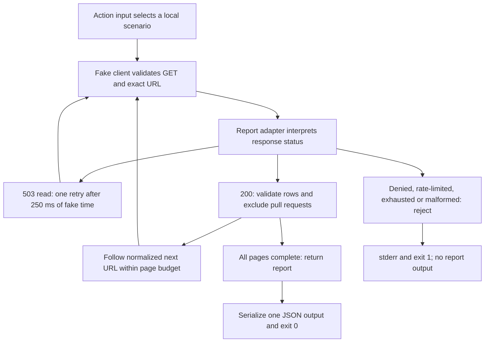

# 0022 · Output files, failure status, and mocked GitHub API responses

`labs/0022/` uses local response fixtures and fake time. The adapter never contacts GitHub, loads a token, or retries a real request, so these tests cannot establish API authorization.

## Establish the service boundary before mocking it

An **HTTP response** contains a status, headers, and a body. An API client may normalize that response or throw on error statuses. A **mock** or **fake** is a controlled substitute at a chosen interface; it proves only the behavior exercised through that interface.

This lab's client interface is deliberately smaller than Octokit:

```javascript title="The injected client contract"
request({ method: 'GET', url })
// Resolves to { status, headers?, data?, nextUrl? }.
// nextUrl is the next-page URL already extracted by a transport adapter.
```

`fixtures/scenarios.json` contains version-controlled examples. The fake checks the method and exact requested URL, returns the next prescribed response, records calls, and rejects unexpected requests. It cannot perform network I/O.

!!! note "Normalized pagination, not a GitHub response field"
    GitHub exposes REST pagination through `Link` headers. `nextUrl` is this lab's normalized seam, not a field GitHub promises in an issues response. A real transport should use the client's pagination facilities or a reviewed Link parser. The [pagination guide](https://docs.github.com/en/rest/using-the-rest-api/using-pagination-in-the-rest-api) is the primary reference.

The fixture URL names a fictional `acme/widget` repository. It is a deterministic request key, not a repository to access. Real integrations should configure the appropriate GitHub API base URL, including Enterprise Server, instead of copying this fixed fixture origin into production.



## Interpret statuses before counting data

`issueReport` takes explicit `request`, `sleep`, and `now` dependencies. The initial route is an issues listing. The GitHub issues endpoint can include pull requests, so this report excludes rows with a `pull_request` field. The first fixture page includes one on purpose.

The adapter accumulates successful rows in memory and returns only after the final page. Each row must have a safe-integer ID and a string title. Invalid shapes are failures, not silently discarded rows. The adapter rejects a repeated next URL to prevent a cycle. It also stops with an error if the result needs more than three pages. For a larger repository, document whether the action fetches all pages or returns an explicit partial result.

| Fixture scenario | Interpretation | Output policy |
| --- | --- | --- |
| `pages` | Two pages, one pull request excluded | Count 2 with both issue titles |
| `empty` | HTTP 200 with an empty array | Valid count 0 |
| `denied` | Ordinary HTTP 403 | Fail, no report |
| `rate` | HTTP 429 with Retry-After | Fail, no retry in this short budget |
| `primary-rate` | HTTP 403 with remaining quota 0 | Fail, no retry in this short budget |
| `transient` | HTTP 503, then successful GET | Retry once and report count 1 |
| `unavailable` | Two HTTP 503 responses | Fail after bounded attempts |
| `partial` | First page succeeds, next page never succeeds | Fail without publishing the first page |
| `malformed` / `cycle` | Wrong response shape / repeated page | Fail with a diagnostic |

The [REST best-practices guide](https://docs.github.com/en/rest/using-the-rest-api/best-practices-for-using-the-rest-api), checked **2026-10-30**, distinguishes rate-limit waiting instructions from ordinary access errors. A 404 can also hide inaccessible private resources; it must not automatically become an empty successful list.

## Bound retries by operation and time

A **retry** repeats an operation after an error. The lab retries only a GET that returns 503, at most once for that page. The injected clock and sleep function advance fake time by 250 milliseconds without blocking. A 1,500-millisecond budget covers the whole report, and the code checks the clock before and after requests and before a wait.

```javascript title="Transient-read policy excerpt"
if (response.status === 200) break;
if (response.status !== 503 || attempt === 2) {
  throw new Error(`API status ${response.status}`);
}
if (now() + 250 >= deadline) throw new Error('retry would exceed deadline');
await sleep(250); // (1)!
```

1. This delay is a chosen teaching policy for a transient read, not GitHub's general rate-limit recommendation. Rate-limit cases are rejected before this branch.

When rate limited, GitHub instructs clients to respect `retry-after`, quota-reset timestamps, or the documented secondary-limit backoff. This short-lived lab fails promptly instead of making another request sooner than allowed. A production adapter may defer a job or wait within an explicit overall budget. It should not turn every 403 into an automatic retry.

Retrying an issue-creation POST can create a duplicate if the server completed the first request but its response was lost. Safe writes need an operation-specific idempotency or reconciliation strategy. Merely adding exponential backoff does not solve duplication.

!!! warning "A clock check cannot interrupt a hung transport"
    The fake resolves immediately. A production network adapter also needs a request timeout or abort signal tied to the remaining deadline. Checking `now()` only after an awaited request cannot stop a request that never returns. No claim of real network deadline enforcement is made by this lab.

## Publish one complete result

`labs/0022/action.yml` honestly names the action as fixture-only, with a `scenario` input and one JSON `report` output. The normal entrypoint calls this adapter logic:

```javascript title="Output boundary excerpt"
const client = fakeClient(process.env.INPUT_SCENARIO ?? 'pages');
const report = await issueReport(client); // (1)!
if (!process.env.GITHUB_OUTPUT) throw new Error('GITHUB_OUTPUT must be set');
appendFileSync(process.env.GITHUB_OUTPUT, `report=${JSON.stringify(report)}\n`, 'utf8'); // (2)!
```

1. An exception from any page skips the write. The outer catch prints a safe diagnostic and sets exit code 1.
2. A title containing a newline is JSON-escaped inside one record. The caller can parse the JSON back into the original title. There is no raw multiline title inserted into the single-line output protocol.

Outputs are still strings. A later workflow step can access `fromJSON(steps.report.outputs.report).count` after a successful identified producer. See [0005](0005-environment-files-and-output-contracts.md) for step-to-job mappings. Output strings are neither secret transport nor an unlimited file store; large reports belong in files/artifacts with a small status output.

## Predict and run the successful and denied cases

From the repository root:

```bash
node labs/0022/demo.cjs pages
node labs/0022/demo.cjs denied
node labs/0022/demo.cjs transient
```

The helper displays a child-process record; its own exit status is zero after printing it. Predict all four channels before opening the solution.

??? tip "Expected child results"
    `pages` has status **0**, stdout `count=2; requests=2; waits=[]` plus a newline, empty stderr, and one output record containing `{"count":2,"titles":["Fix runner","Document\noutputs"]}`. The title's newline is escaped in the output bytes. `denied` has status **1**, empty stdout, stderr `API status 403` plus a newline, and an empty output file. `transient` has status **0**, stdout `count=1; requests=2; waits=[250]`, and a report with the title `Recovered`. No real wait or request occurred.

The exact JSON display escapes newlines again to represent the captured strings. Compare the underlying file assertion in the tests if visual escaping becomes confusing.

## Break it: confuse missing access with no issues

Predict how a blanket error catch changes a denied request:

```bash
node labs/0022/demo.cjs denied --broken
node labs/0022/demo.cjs partial
```

The deliberately broken adapter uses:

```javascript title="Deliberate defect in the broken path"
report = await issueReport(client).catch(() => ({ count: 0, titles: [] }));
```

??? tip "Diagnosis and repair"
    The broken denied case exits 0 and publishes `report={"count":0,"titles":[]}`. That falsely claims a completed empty query. Repair it by allowing the error to reach the failure handler before any output is written, as the normal adapter does. The `partial` case tests a failure after the first page succeeds. The repaired process exhausts its page-two retries, exits 1, and leaves the output file empty. Inspect status and output together; stdout text alone cannot prove success.

Run the focused suite:

```bash
node --test labs/0022/report.test.cjs
```

Expected: **10 tests pass**. The tests cover exact request method/URL, multiple pages, PR exclusion, empty results, denied access, both rate-limit shapes, one transient retry, exhausted retries, malformed data, cycles, page/time budgets, escaped output bytes, append behavior, a missing output path, failure-without-output, and reproduction of the broken catch. Multiple data cases are grouped inside some tests.

## Transfer to an authenticated client

The Toolkit [GitHub package](https://github.com/actions/toolkit/blob/main/packages/github/README.md) supplies `getOctokit(token)` and context. It is absent from this installed workspace, so this conceptual adaptation is reference-only:

```javascript title="Toolkit reference excerpt, not executed here"
const octokit = github.getOctokit(token);
const rows = await octokit.paginate(octokit.rest.issues.listForRepo, {
  owner,
  repo,
  state: 'open',
  per_page: 100,
});
```

A real adaptation must match Octokit's actual thrown-error shape, pagination behavior, request timeout API, and retry plugins. It must obtain the repository explicitly, require only the necessary read permissions, and keep the token out of logs and outputs. Do not copy the fake's resolved `status: 403` contract into code that actually receives a rejected promise without translating it.

The smallest later integration would use a disposable repository with a known issue/PR fixture, read-only permissions, and a single bounded report run. That can verify authentication, response shape, and hosted output mapping; that integration test has not run.

## Exercises and retrieval

1. Add a fixture in your own copy with three pages and explain whether the configured page budget allows it. Then add a fourth-page continuation and predict the failure.
2. Transfer: design a summary containing only the first five titles while still counting all issues. Decide where truncation belongs and how the output reveals it.
3. A failed create-issue request times out. Explain what evidence you need before retrying it.

??? tip "Worked exercises"
    Three complete pages fit; a continuation requiring page four fails before another request. Count all successfully fetched pages first, then return an explicitly truncated preview plus fields such as `total` and `previewTruncated`. Do not silently stop pagination after five issues and call that the total. Before retrying a write, reconcile whether the intended resource already exists or use an operation-specific idempotency mechanism; a transport timeout does not prove the server performed no write.

Retrieve without looking:

1. Why is `nextUrl` not an assertion about GitHub's response body?
2. How does the suite distinguish empty data from denied data?
3. Why does a failed second page publish no first-page report?
4. Which authorization claims remain unknown after every fake passes?

??? tip "Retrieval check"
    `nextUrl` is the chosen normalized client seam; the real transport derives pagination from Link headers or client helpers. An empty 200 returns a report, while denied access rejects and produces exit 1 with no report. Results are accumulated before the output boundary. Fakes cannot establish token permissions, repository access, real response/error shapes, or GitHub event policy.

## Verification limits and next session

This suite establishes report rules, request sequencing, simulated waits, and real child-process output/failure behavior. It does not establish HTTP-client integration, DNS/TLS behavior, rate-limit enforcement, live data consistency, real API-version compatibility, or hosted permissions. All source checking was read-only; the lab itself has no real API client. Sources checked on **2026-10-30** are recorded in the Module 4 handoff and connected to the [curated source library](../references/resources.md).

Continue to [0023](0023-javascript-action-lifecycle-and-state.md), where one action uses separate primary and cleanup processes.

| Previous lesson | All lessons | Next lesson |
| --- | --- | --- |
| [0021 · TypeScript compilation, bundling, and committed distribution files](0021-typescript-bundling-and-dist-drift.md) | [Curriculum](index.md) | [0023 · Action lifecycle hooks, state files, and cleanup](0023-javascript-action-lifecycle-and-state.md) |
