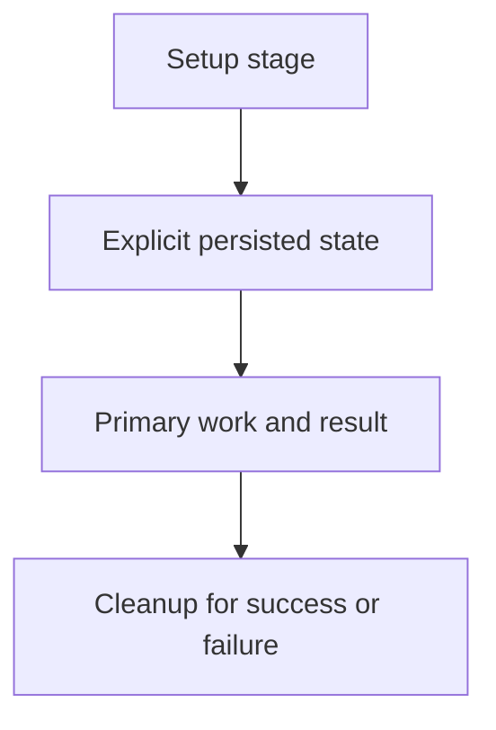

# 0023 · Action lifecycle hooks, state files, and cleanup

!!! note "Placeholder for a future teaching thread"
    This page is a teaching brief. Expand it into a full interactive lesson in its own thread. The planned exercises and outcomes have not been completed or demonstrated.

**Level:** Intermediate.

## Prerequisites

- [0022 · Output files, failure status, and mocked GitHub API responses](0022-output-contracts-and-mocked-github-api.md)

## What you will learn to do

- Draw a setup/main/cleanup lifecycle and its state contract.
- Test cleanup behavior for partial initialization and failure.

## Explain the Actions behavior

Start from the prerequisite workflow or action behavior and introduce these concepts with focused examples:

1. An action can have lifecycle stages with different responsibilities and process boundaries.
2. Persisted state is an explicit exchange mechanism rather than a shared local variable.
3. Cleanup must handle missing state, partial setup, and failed primary work.

Explain the relevant workflow YAML, expressions, and action code in context. Follow the [shared teaching guide](teaching-guide.md) for pacing, expected output, and progression toward independent design.

## Planned local lab

Create an isolated exercise under `labs/0023/` when the lesson is developed. Explain setup and expected output before each command; reuse installed tools rather than reinstalling them on every step.

1. Verify current lifecycle metadata and state helpers in the official reference.
2. Create a disposable resource in a lab and record only the state needed for cleanup.
3. Exercise successful work, failed work, and missing-state cleanup without touching an external service.

## Break it and diagnose it

Assume cleanup can access a local variable from a prior process. Diagnose the missing state and replace the implicit dependency.

Ask for a prediction first. Capture the smallest reproducer, the actual result, and the corrected behavior. State which remaining claim requires a real GitHub or external-service check.

## Planning diagram



When expanding this lesson, refine the diagram to show the actual processes, branches, data exchange, and trust boundaries being taught.

## Retrieval questions

1. Which state must survive between lifecycle processes?
2. What should cleanup do when setup only partly completed?
3. How can cleanup failure affect the result communicated to a caller?

## Evidence to capture in the teaching thread

- A working learner-produced example and an explanation of why it works.
- A reproduced failure, a reasoned repair, and the smallest check that verifies it.
- A short account of remaining limits, unresolved questions, and readiness for the next lesson.

Use [primary references](../references/resources.md) to verify current syntax, runtime support, and tool behavior. Add learning records only for real statements or demonstrated understanding; a placeholder or generated page does not establish mastery.

## Start this lesson in a new thread

```text
/teach 0023

Expand docs/lessons/0023-javascript-action-lifecycle-and-state.md in place using docs/lessons/teaching-guide.md.
Read docs/mission.md, NOTES.md, and the prerequisite lesson pages first.
Begin with a short check of the Actions prerequisites. Explain relevant YAML,
expressions, and action contracts, one concept at a time. Let me predict and
try each exercise before revealing its answer. Keep feedback local where possible.
Finish with retrieval questions and a truthful handoff for the next thread.
```

| Previous | All lessons | Next |
| --- | --- | --- |
| [0022 · Output files, failure status, and mocked GitHub API responses](0022-output-contracts-and-mocked-github-api.md) | [Curriculum](index.md) | [0024 · Cross-platform action behavior, dependency updates, and release versions](0024-cross-platform-actions-and-versioned-releases.md) |
